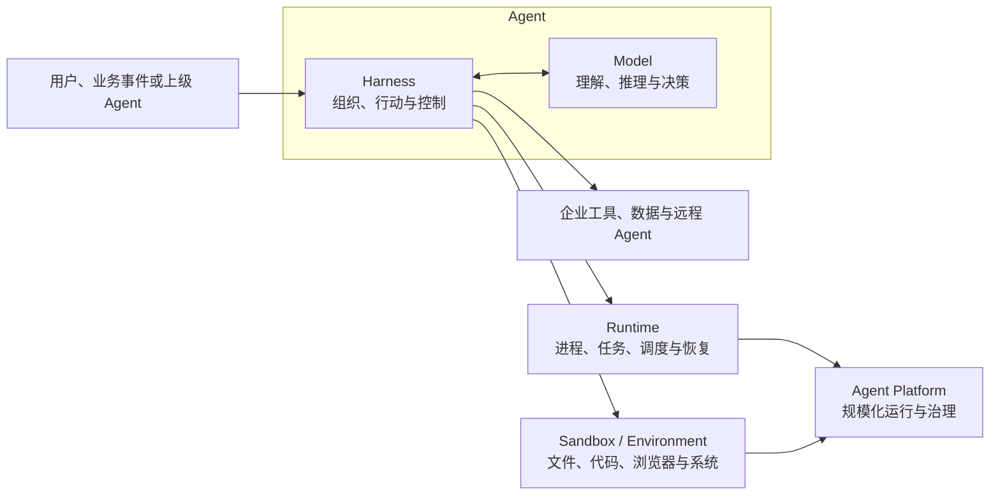
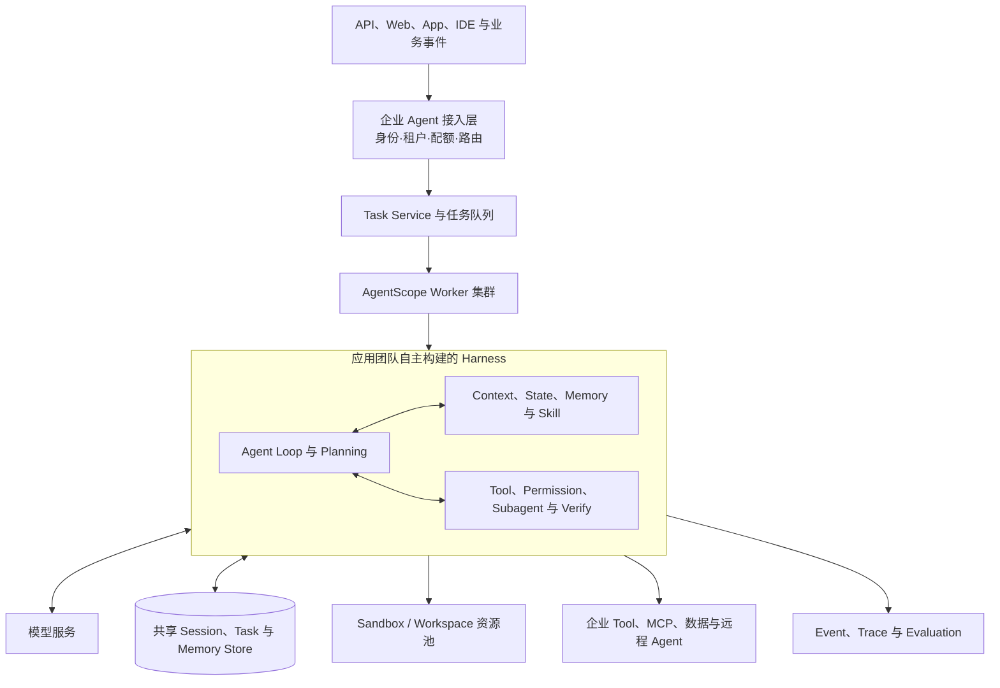
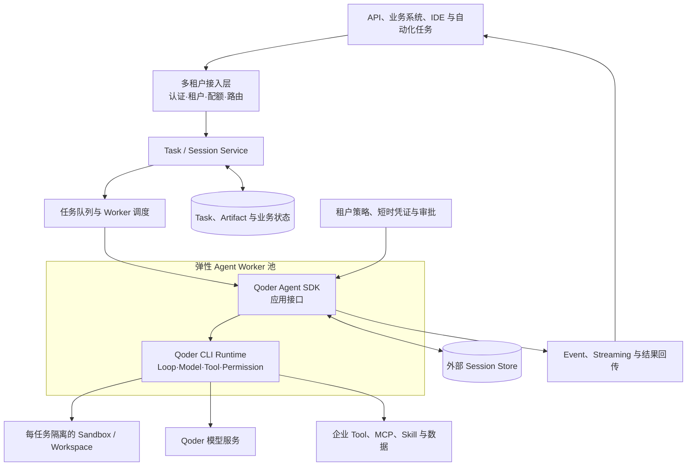
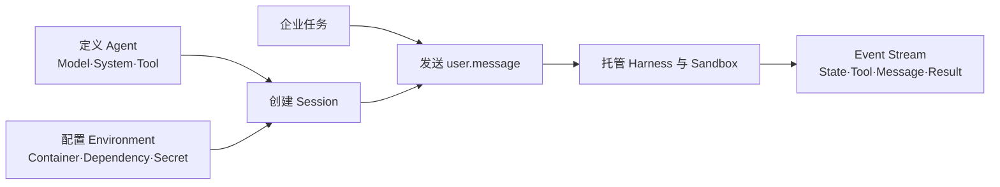
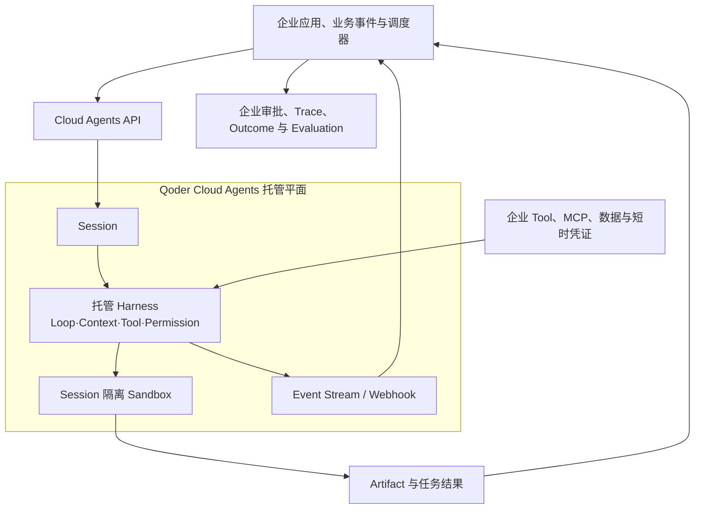

# 第 03 章　范式：Harness 的主流构建方式和责任边界

上一章把 Agentic Application 的参考架构拆开了，这一章开始回答开发者最现实的第一个问题：**动手做一个企业级 Agent，脚手架到底由谁来搭、从哪入手、出了问题算谁的？**

为什么先看 Coding Agent？因为编码场景天然带着编译器、文件差异和单元测试，模型改得好不好、有没有把项目改挂，环境立刻就能给出铁证。但它只是帮我们看清机制的“工程样本”，不是所有业务的模板——审批、交易、客服和运维有自己的状态流转和红线，真正该照着复用的，是 Coding Agent 背后那套任务循环、状态管理、权限拦截和结果验收的工程脚手架，也就是 **Harness**。

面对不同的定制深度和团队精力，当前业内主要有四条务实的起步路径：

*   **自己用高代码框架搭**：拿 AgentScope 这类框架从代码层组装整套 Harness；
*   **嵌入现成的 CLI·SDK 或工作区助手**：把 Qoder CLI / Agent SDK、QwenPaw 这类打磨好的产品化 Harness 直接嵌进自己的应用或工作台；
*   **交给云端托管执行（Managed Agents）**：把 Loop、会话推进和容器沙箱托管给 Qoder Cloud Agents 这类云端服务；
*   **在云平台上低门槛拼装**：借助阿里云 AgentCore 等云产品的预置模型、知识库、工具和环境直接组合上线。

等公司里同时跑起十几个甚至上百个来源各异的 Agent 时，上面单点的“构建入口”就不够用了，还需要统一的企业级 **Agent Platform** 来管目录、身份、调度、观测和评估。下面我们就把“架构分层—四条路选型—多源统一平台”一层层讲透。

## 3.1 先分清谁干什么活：Model、Harness、Runtime 与 Sandbox

### 真实痛点：只靠 Prompt 挂工具，上线必翻车

很多团队做第一个 Agent 时，习惯把精力全花在调教一段超长 System Prompt 上，再接几个函数就觉得万事大吉。结果一进真实业务就连续翻车：任务聊到十几轮后，模型忘掉了最初约束；跑一半服务器重启，前面查到的数据和改了一半的状态全没了；工具参数随便传，测试还没跑通，模型就已经自信满满地回复用户“漏洞修复完成”。

原因其实很简单：**模型只是一颗概率性的认知大脑，天生没有跨轮持久记忆，也不知道外面的真实世界发生了什么。** 单次调用拿不到跨节点进度，塞满长文本会丢注意力，发出工具请求也不代表当前用户真有权限这么干，模型自己喊“完成了”更不能当成交付凭证。想让模型稳定干活，必须在它外面包一层确定性的控制脚手架。

### 核心机制：Agent = Model + Harness

本书用一个简洁公式定义运行态的智能体：**Agent = Model + Harness**。

*   **Model**：负责理解意图、推理权衡、做决策的“认知大脑”。它决定智能体上限能看多深、想多准，但它是无状态的、概率性的。
*   **Harness**：包裹在模型外层的任务控制脚手架。它负责每轮开跑前拼装上下文、在外部维护权威状态和任务清单、管理工具和技能资产、在动作执行前做权限拦截，以及在任务结束前拿客观证据做验收。
*   **Runtime**：让长任务活下来的调度宿主。负责进程托管、排队并发、异步唤醒和故障重启恢复。
*   **Sandbox**：把破坏范围关进笼子的隔离环境。负责限制文件读写目录、命令权限、网络出站和密钥注入，防止模型一失手把宿主机或生产库删了。



| 层次 | 解决的核心问题 | 承担的具体职责 |
| --- | --- | --- |
| Model | 脑子够不够聪明 | 语义理解、规划判断、内容生成、选择工具 |
| Harness | 怎么把脑子变成可控流程 | 任务循环、上下文编译、外部状态、计划管理、工具与 Skill、权限拦截、完成验收 |
| Runtime | 长任务怎么不断线活下来 | 进程承载、并发排队、异步等待、故障恢复 |
| Sandbox / Environment | 手脚伸到哪、捅多大的篓子 | 文件、进程、网络、短时凭证和计算资源隔离 |
| Agent Platform | 几十上百个 Agent 怎么规模化管 | 多租户、版本发布、网关配额、全链路观测、评估与运营 |

表 3-1　Model、Harness、Runtime、Sandbox 与平台的能力分层

工程落地时，这五层不一定对应五个独立的软件。一个本地 SDK 可能把 Harness 和轻量 Runtime 打包在一起，一个云托管服务也可能把 Harness、Runtime 和 Sandbox 全包了。但在设计架构时心里必须有这根分割线，否则真出故障时，你分不清是模型幻觉、脚手架状态丢了、调度器超时，还是沙箱权限没拦住。

### 从一份任务契约起步，而不是先选框架

图 3-1 展示了企业级 Agent 从业务契约到平台运营的承载关系。图中的「Harness 编排层」指的就是上述包裹在模型外层的整套 Harness 脚手架，它向上承接业务目标，向下依赖 Runtime、Sandbox 等生产执行基础，并接受 Agent Platform 的统一治理。

图 3-1　企业 Agent 的构建与承载关系


动手写代码前，先要回答两个比“选什么框架”更底层的问题：

1.  **先把 Agent Contract（任务契约）写死**：这个 Agent 替谁干活、收什么输入、交什么产物、能碰哪些系统、哪些动作必须先拦下来等人批、靠什么铁证算完成。同样是“修支付服务的高危依赖漏洞”，有的团队只让它出一份分析报告，有的让它在沙箱里改代码跑单测提 MR；只要契约没给生产发布权限，哪怕代码改对了也不能自己往线上发。
2.  **再定谁掌握执行路径（Workflow / Agent 主导 / Hybrid）**：步骤和异常全写得死的流程，直接用固定 Workflow 最省钱稳妥；必须看中间报错现场随机应变，才交给 Agent 动态定路径；高风险主干用 Workflow 卡死审批、打款和发布节点，局部检索分析放手给 Agent，这就是最常见的 Hybrid（混合模式）。注意，这说的是“控制权怎么分”，和系统属于单智能体（Single-Agent）、长程任务（Long-Horizon Agent）还是多智能体协作（Multi-Agent）无关，跟下面要讲的“从哪个入口构建”也是两码事。

确定了契约和控制权之后，开发阶段真正要对齐的，是下面表 3-2 里的 8 类工程对象。小原型可以只做前几项，进生产环境后，每一项都得有明确负责人。

| 构建对象 | 开发期必须答清的问题 | 核心产出物 |
| --- | --- | --- |
| Agent Contract | 替谁干活、边界在哪、怎么算赢 | 角色指令、输入输出规范、验收标准 |
| Execution | 怎么循环、拆计划、派子任务、兜底结束 | Agent Loop、状态机、预算上限与验收器 |
| Context & State | 每轮给模型看什么、权威进度放哪 | 上下文策略、Session/Task 结构、工作区与记忆 |
| Capability | 能调哪些函数、知识源和外部方法 | Tool Schema、MCP、Skill、Subagent 与能力目录 |
| Environment | 文件、命令、浏览器在哪跑才安全 | 环境契约、Sandbox 规格与产物隔离边界 |
| Control | 挂谁的身份跑、高危动作谁来批 | 权限策略、人工审批（HITL）与短时凭证 |
| Interaction | 前端怎么看进度、怎么中途叫停改方向 | 语义事件流、渠道适配与断线重连游标 |
| Quality | 怎么验收本次结果、新版到底好没好 | 全链路 Trace、业务 Outcome、回归评测集 |

表 3-2　构建生产级 Harness 必须落地的 8 类工程对象

### 工程取舍：四类构建入口怎么选

四条路不是“初级到高级”的升级阶梯，也没有谁淘汰谁。它们真正的区别只有一件事：**Harness 谁来写、Runtime/Sandbox 谁来扛、出了业务事故谁背锅**。

| 构建入口 | 代表产品 / 方案 | 你自己重点控什么 | 现成复用或托管了什么 | 你绝不能甩掉的责任 | 最适合的工程场景 |
| --- | --- | --- | --- | --- | --- |
| 自己用高代码框架搭 | AgentScope、LangChain、DeepSeek Harness | 任务循环、上下文拼装策略、状态语义、权限与验收逻辑 | 框架提供模型调用、消息、工具、状态和编排抽象 | 组合后的真实行为、分布式 Runtime、沙箱隔离、评测与业务验收 | 业务逻辑独特、上下文与循环需要深度魔改，或数据与环境严禁出内网 |
| 嵌入现成 CLI·SDK 与工作区助手 | Qoder CLI / Agent SDK、QwenPaw、Hermes | 业务目标、自定义工具、审批回调、工作区与产品集成 | 现成的工作区理解、规划执行循环、会话与事件流 | 多租户接入网关、业务 Task 映射、环境隔离、凭证管理与结果验收 | 围绕代码或文件工作区干活，想快速给现有 IDE / 工作台 / IM 挂上成熟能力 |
| 交给云端托管执行 | Qoder Cloud Agents、Claude Managed Agent | Agent 定义、容器环境模板、企业能力对接与最终验收 | 约定范围内的 Harness、长会话推进、事件流、云端容器沙箱 | 租户与用户身份映射、业务状态管理、人工审批链、数据合规与业务验收 | 异步长任务、后台批量处理、API 集成，团队不想自己养沙箱和调度器 |
| 云平台低门槛拼装 | 阿里云 AgentCore 等 | 业务目标、Agent 配置、共享资源组合、发布范围与验收规则 | 平台预置的模型、知识库、记忆、工具、沙箱及管理入口（以具体版本为准） | 业务 Task、数据与权限边界、扩展集成、回归评估与上线把关 | 希望借云平台统一资产和治理底座快速出活，并无缝接入团队共享资源 |

表 3-3　四类 Agent 构建入口的工程选型对照

真实企业里往往四条路混着用：核心交易或风控 Agent 用高代码框架死抠每一轮上下文和状态；研发平台直接嵌入 Coding Agent SDK；夜里跑的批量巡检交给托管云服务；日常办公小助手直接在云平台上搭。接下来四节，我们逐一拆开看它们的具体代码、踩坑点和责任红线。

---

## 3.2 自己用高代码框架搭：控制权最大，运维也得自己扛

### 真实痛点：通用产品改不动，越到深水区越受制于人

当你发现现成工具的上下文压缩方式老是把关键业务字段丢掉，或者审批前必须按你们公司特有的数据库锁做二次核验，而外挂的通用产品根本没留扩展口子时，就得自己用高代码框架（比如 AgentScope、LangChain）把 Harness 捏在手里。

### 核心机制：按契约从最小 Loop 往上叠加能力

高代码框架的“高代码”，意思是开发团队能用代码精确控制 Harness 的每一环——包括每轮拼什么进上下文、哪种报错重试、什么时候存快照、用什么铁证验收（而不是让 Agent 自己改自己代码）。但框架只给砖头和水泥，不会白送多租户隔离、防重入锁和业务评测。

以 AgentScope Java 为例，先搭出一个能跑的最小边界，只需要定清三件事：用哪个模型、工作区目录在哪、这次调用属于哪个用户和会话。

```java
HarnessAgent agent = HarnessAgent.builder()
    .name("remediation-agent")
    .model(model)
    .workspace(Paths.get(".agentscope/workspace"))
    .build();

agent.call(message, RuntimeContext.builder()
    .userId("u-1842")
    .sessionId("remediation-2026-0917")
    .build()).block();
```

这段最小代码把行为主体、推理大脑、外部工作空间和身份会话边界立住了，但进生产还远远不够。接着要**从验收标准倒推需要打开哪些部件**，而不是一股脑全挂上去——比如修复支付服务高危漏洞，需要“先看代码出方案、批准后再动手、扫描大日志别撑爆窗口、命令放进容器里跑”，于是通过 Builder 精准叠加上计划模式、任务清单、消息压缩、大工具结果卸载和 Docker 沙箱：

```java
HarnessAgent agent = HarnessAgent.builder()
    .name("remediation-agent")
    .model(model)
    .workspace(Paths.get(".agentscope/workspace"))
    .enablePlanMode()
    .enableTaskList()
    .compaction(CompactionConfig.builder()
        .triggerMessages(30)
        .keepMessages(10)
        .build())
    .toolResultEviction(ToolResultEvictionConfig.defaults())
    .filesystem(new DockerFilesystemSpec()
        .image("ubuntu:24.04"))
    .build();
```

注意一个关键原则：**确定性的活儿尽量写成工具或规则，留给模型的是权衡和判断，凡是能改外部系统的动作全过权限和沙箱**。千万别把本该用代码校验的硬规则写成几百字“请务必注意……”的 Prompt。

| 能力域 | 在 AgentScope 里怎么接 | 应用团队真正要拍板的规则 |
| --- | --- | --- |
| 指令与上下文 | 项目规则文件、附加 Context、Middleware | 指令覆盖优先级、动态信息注入、Token 预算分配 |
| 状态与记忆 | Workspace、StateStore、Memory、Compaction | 会话与任务边界、记忆防污染写入规则、多租户隔离 |
| 计划与推进 | Plan Mode、Todo、Task State | 什么时候必须先审批再写文件、阶段产物怎么验收 |
| 能力资产 | Tool、Skill Repository、Subagent | 能力版本管理、权限门槛、子任务输入输出契约 |
| 执行环境 | FileSystem、Docker 或自建 Sandbox | 文件读写目录、出网限制、短时密钥和快照回收 |
| 控制与交互 | Permission、Channel、Middleware | 放行/拒绝/询问规则、用户中途纠偏和前端事件映射 |
| 质量与反馈 | Trace、Verifier、评估接口 | 完结铁证定义、埋点字段和发版回归门槛 |

表 3-4　高代码框架下应用团队必须自行拍板的 Harness 契约

单机 Demo 跑通后，要变成全公司都能调的分布式在线服务，还得在框架外面包上一层企业底座：



一旦进多机集群，千万别指望进程内存里的消息列表恢复任务：必须把 Session、Task、计划和产物映射进外置存储，给同一个任务加并发租约锁，Worker 挂掉后从安全点恢复，并且只给沙箱下发短时凭证。

### 工程取舍：什么时候值得走这条重路

只有当你们的业务流程高度定制、核心数据或内网环境严禁出域、效果极度依赖魔改 Loop 或上下文拼装算法，或者公司打算自研统一 Agent 底座时，才建议走高代码框架自建。代价也很直白：团队必须同时接住大模型应用、分布式容灾、沙箱安全和评测基建四件事，并且把模型版本号、框架配置、Skill 和评估基线绑在一起做版本管理，否则线上效果退化时根本回滚不了。

---

## 3.3 嵌入现成的产品化 Harness：直接复用“能干活的工作流”

### 真实痛点：天天都要读文件、查日志、写报告，何必重造轮子

大量企业需求——比如定位线上报错、整理周报、排查代码漏洞、把本地一堆数据脚本跑出分析结论——套路跟 Coding Agent 高度重合：看工作区、定计划、调命令、中途卡住问一句人、最后交文件。从头用高代码框架重撸一遍 Loop、文件编辑工具和权限确认弹窗，既耗时又容易踩低级坑。

### 核心机制：CLI、SDK 与工作区助手的分工

市面上的产品化 Harness 主要有三种交付形态：

*   **Coding Agent CLI**（如 Qoder CLI）：开箱即用，研发在自己终端里直接使，适合个人或小团队工作区。
*   **Coding Agent SDK**（如 Qoder Agent SDK）：把同一套成熟的底层 Harness 打包成编程接口，方便企业嵌进自己的 IDE、故障排查平台、工单后台或自动化流水线。SDK 通常自带配套的 CLI 运行时，业务系统不用额外单独部署远程服务；二者模型能力一样，差别在于由谁发起任务、事件吐给谁消费，以及外面要不要套企业控制面。
*   **工作区助手**（如 OpenClaw、Hermes Agent、QwenPaw）：把“持续记忆 + 定时任务 + 多渠道聊天入口 + 通用工具”整合成贴近个人和团队日常协同的工作区，适合跨入口连贯干活的场景。

#### 用 Coding Agent SDK 嵌进业务服务

下面这段 TypeScript 代码展示了如何用 Qoder Agent SDK 把成熟 Harness 直接嵌进漏洞修复服务里：用可用工具列表限定范围，只对只读工具放行，一旦遇到写文件或执行终端命令，就通过回调抛给业务自己的审批弹窗，最后持续消费输出和结果事件。

```ts
import { accessTokenFromEnv, query } from '@qoder-ai/qoder-agent-sdk';

for await (const message of query({
  prompt: '分析 payment-service 的高危依赖漏洞，修改代码并补充测试；不要发布。',
  options: {
    auth: accessTokenFromEnv(),
    cwd: '/workspace/payment-service',
    tools: ['Read', 'Write', 'Edit', 'Glob', 'Grep', 'Bash'],
    allowedTools: ['Read', 'Glob', 'Grep'],
    permissionMode: 'default',
    async canUseTool(toolName, input, context) {
      // 宿主应用实现审批；取消或超时应拒绝执行。
      const approved = await requestToolApproval({
        toolName, input, signal: context.signal,
      });
      return approved
        ? { behavior: 'allow', updatedInput: input, toolUseID: context.toolUseID }
        : { behavior: 'deny', message: '操作未获批准。', toolUseID: context.toolUseID };
    },
  },
})) {
  if (message.type === 'assistant') {
    for (const block of message.message.content) {
      if (block.type === 'text') publishText(block.text);
      if (block.type === 'tool_use') publishToolEvent(block.name);
    }
  }
  // 保存运行结果；通过测试、安全扫描和业务验收后再确认 Outcome。
  if (message.type === 'result') await persistRunResult(message);
}
```

这里有三个实战细节千万别漏：

1.  **别光靠 Prompt 里那句“不要发布”**：工作目录要指到隔离工作区，环境里不能塞生产发布密钥，还要靠网络和身份策略真把发布通路堵死。
2.  **审批超时或取消默认按拒绝处理**：业务实现的审批界面要把实际命令和入参亮给审批人看，别让人盲点“同意”。
3.  **拿到结果事件不算业务大功告成**：它只代表这轮跑完了，业务系统还得继续核验补丁文件、单测、安全扫描报告，才算真正验收。

此外，能用 SDK 自带的 MCP、Skill、Subagent、Hooks 和外部 Session 存储扩展点，就别在外面用 Prompt 硬凑。但同样不能把一个本地 CLI 进程直接当多租户在线服务扛并发——上线时必须在外面补齐网关鉴权、任务队列和共享会话存储，把每单任务路由到隔离 Worker 上：



还要格外留意：外部 Session Store 记的只是对话流水的镜像（靠它能在另一台机器接上同一个会话 ID），它**不是完整的企业任务数据库**，也不存文件快照和审批单。万一 Worker 半路宕机，恢复前一定要先查工作区和外部系统到底改没改，千万别傻傻地重放最后一次工具调用。

#### 工作区助手的企业封装边界

像 QwenPaw 这类工作区助手，用四行命令就能在本地或云主机拉起一个带 Web 界面、终端和消息渠道的个人工作区（具体命令以当前所用版本文档为准）：

```plaintext
pip install qwenpaw
qwenpaw init --defaults
qwenpaw app
qwenpaw .
```

它的核心价值在于“多渠道连贯体验”：你在 IM 里聊了一半的任务，切到 Web 界面还能接着用同一份工作区、记忆、Skill 和 MCP 工具，顺带还能用定时任务（Cron）或后台子代理跑巡检。但**个人能用不等于企业生产就绪**——官方文档已经明确提示：它的后台子代理不支持断点恢复，沙箱默认不开启强约束时并不自带硬隔离；即便是供团队共用的 QwenPaw Hub，目前也属于早期能力，官方明确说明它不构成面向互不信任用户的强多租户边界。

因此，如果企业想把工作区助手接入内部系统，必须像图 3-2 那样在外面套一层企业接入网关：把多租户鉴权、任务队列、实例调度、短时凭证和业务验收补在外面，别让不同团队共用一个工作区或裸跑高风险命令。

图 3-2　工作区助手的企业接入封装——以 QwenPaw 为例（目标架构示意）


### 工程取舍：什么时候该选产品化 Harness

如果你的团队想快速拥有一流的文件工作区操作、计划、长上下文处理和流式交互能力，优先选这条路：偏代码研发与系统集成的选 Coding Agent CLI/SDK，偏个人知识、跨渠道沟通和定时协同的选工作区助手。需要交付的重点是产品版本锁定、能力权限清单、外置的 Task-Session 映射和沙箱隔离策略。反之，如果任务高度依赖改写底层规划策略或上下文编译顺序，而 SDK 又没开这个口子，就趁早切回第 3.2 节的高代码框架路径。

---

## 3.4 交给云端托管执行（Managed Agents）：基础设施全包出去，业务底线自己攥紧

### 真实痛点：我就想异步跑个修漏洞任务，不想自己养 K8s 和沙箱池

用 SDK 固然省了写 Loop 的力气，但你依然得自己搭任务队列、配容器集群、管镜像依赖、做负载均衡和清理残余沙箱。对于后台巡检、异步工单、批量代码扫描这类长任务，专门养一套弹性沙箱基础设施往往太重了。

### 核心机制：只管定义“是谁、在哪跑、聊什么、收什么事件”

Managed Agents（以 Qoder Cloud Agents、Claude Managed Agent 为代表）把通用 Harness 连同 Serverless 的容器沙箱和会话推进能力一起做成了云端服务。你不用再操心 Worker 怎么扩容，只需要围绕四个核心对象跟云端对话：

| 对象 | 它管什么 | 你的应用配什么 |
| --- | --- | --- |
| Agent | 可复用的智能体规格 | 选哪个模型、System Prompt、开放哪些工具和 Skill |
| Environment | 任务跑起来的容器规格 | 基础依赖、启动脚本、资源配额、环境变量和凭证 |
| Session | 一次具体的长任务执行实例 | 把哪个 Agent 放进哪个 Environment，绑定用户目标 |
| Event | 双向沟通的消息和过程流 | 你发下去的用户指令、工具确认，以及云端吐回来的进度和结果 |

整个跑通流程就五步：配好访问身份 → 建好容器环境 → 定义好 Agent → 绑定成 Session → 先连上事件流，再发任务指令。



下面这组精简的命令行示例演示了如何创建 Agent 与 Session、打开 SSE 长连接监听事件，再把漏洞修复任务发进去（终端 A 保持长连接，确认收到 `HTTP 200` 和 `text/event-stream` 响应头后，再在终端 B 执行提交命令；真实线上务必使用独立服务身份和完善的错误处理）：

```bash
# 终端 A：创建 Agent 和 Session，再建立事件订阅。
AGENT_RESPONSE=$(curl -s -X POST "$QODER_API_BASE_URL/api/v1/cloud/agents" \
  -H "Authorization: Bearer $QODER_ACCESS_TOKEN" \
  -H "Content-Type: application/json" \
  -d '{
    "name": "remediation-agent",
    "model": "ultimate",
    "system": "分析依赖漏洞并生成可审批变更，不得直接发布生产环境。",
    "tools": [{
      "type": "agent_toolset_20260401",
      "enabled_tools": ["Bash", "Read", "Write", "Edit", "Glob", "Grep"]
    }]
  }')
AGENT_ID=$(echo "$AGENT_RESPONSE" | jq -r '.id')

SESSION_RESPONSE=$(curl -s -X POST "$QODER_API_BASE_URL/api/v1/cloud/sessions" \
  -H "Authorization: Bearer $QODER_ACCESS_TOKEN" \
  -H "Content-Type: application/json" \
  -d "{\"agent\":\"$AGENT_ID\",\"environment_id\":\"$ENV_ID\"}")
SESSION_ID=$(echo "$SESSION_RESPONSE" | jq -r '.id')

printf 'SESSION_ID=%s\n' "$SESSION_ID"

# 先订阅：-i 显示响应头；确认 HTTP 200 和 text/event-stream 后再发送任务。
# 此连接持续运行，展示后续任务的进度与结果。
curl -i -sS -N "$QODER_API_BASE_URL/api/v1/cloud/sessions/$SESSION_ID/events/stream" \
  -H "Authorization: Bearer $QODER_ACCESS_TOKEN" \
  -H "Accept: text/event-stream"

# 终端 B：单独执行以下命令，不要排在终端 A 的长连接命令后顺序执行。
# 配置相同的 QODER_API_BASE_URL、QODER_ACCESS_TOKEN，
# 并将 SESSION_ID 设置为终端 A 输出的值；确认 A 已成功建连。
curl -sS -X POST "$QODER_API_BASE_URL/api/v1/cloud/sessions/$SESSION_ID/events" \
  -H "Authorization: Bearer $QODER_ACCESS_TOKEN" \
  -H "Content-Type: application/json" \
  -d '{"events":[{"type":"user.message","content":[{"type":"text","text":"修复 payment-service 的高危依赖漏洞并运行测试"}]}]}'
```

对接这套流式接口时有两个极容易踩中的实战坑：

1.  **建连顺序与断线续传**：自 2026 年 8 月 24 日起，不带游标参数（`Last-Event-ID`）的新 SSE 连接只推送建连之后发生的事件。所以必须**先订阅确认成功，再发任务消息**；每次处理完事件立刻把事件 ID 存下来，断线重连带上游标并做幂等去重，漏掉的事件靠列表接口分页补拉。
2.  **提交超时先查再重试**：发任务如果超时了，千万别无脑重发第二遍，先查服务端会话状态，免得在云端跑出两份重复操作。另外，云端推回会话进入空闲状态，只代表这一回合跑完了，不等于你的业务任务真成功了。



### 工程取舍：托管执行不等于托管业务正确性

云端帮你把循环、容器沙箱和会话推送扛走了，但“能不能改、让谁批、算不算赢”这三件事永远外包不出去。企业仍要把业务任务 ID 和云端会话 ID 的映射记稳，控制好注入环境里的工具、数据源和短时凭证，并自己根据补丁差异、单测和安全扫描报告验收结果。越是托管给云端跑，越要把工具边界、审批触发点和验收契约写成机器可执行的规则——否则只是把“说不清道不明的 Agent 行为”搬到云上跑而已。

---

## 3.5 在云平台上低门槛拼装：用现成共享资源快速出活

### 真实痛点：光写代码不够，每个项目都要重接模型、知识库和权限吗

很多团队选云产品构建入口（例如阿里云智能体构建和治理平台 AgentCore），最初是因为可视化拼装快；但真正上线后才发现，它真正的价值是**从创建第一天起，就把 Agent 放进企业共享的模型、知识、工具、凭证和观测体系里**，不用每个业务组各自去申请一遍 Key、接一遍认证和埋点。

这里要避开一个常见误区：**在页面上点选拼出一个能聊的 Agent，不等于跳过了工程设计，也不等于默认满足多租户隔离、长任务恢复和生产审批。** 它和上一节 Managed Agents 的侧重点也不一样：Managed Agents 重点在“把一个定义好的 Agent 托管跑起来”；云平台入口还要管“怎么创建、怎么装配公司共享资产、怎么管版本和发版灰度”。很多平台产品同时提供这两类能力，二者并不冲突。

### 核心机制：从任务契约倒推云上共享资源装配

正确的拼装姿势不是把平台里能勾的模型、知识库和几百个工具全选上，而是先画好任务契约，再按表 3-5 一项项对齐云产品配置和企业自己的兜底责任（以阿里云 AgentCore 官方列出的 Agent、模型连接、Skill、MCP 工具、凭证、Team、Channel、运行监控、Trace 和评估等能力为例；具体功能名称、地域与限制以正式版本文档为准）：

| 构建对象 | 在云平台上怎么配 | 企业自己必须拍板的底线 |
| --- | --- | --- |
| Agent 定义与版本 | 组织模型、指令、能力引用与运行配置 | 清晰目标、输入输出、版本归属与回滚策略 |
| Model、Knowledge 与 Memory | 挂载推理模型、企业知识库与记忆库 | 模型选型、数据隔离范围、记忆写入规则与过期周期 |
| Tool、MCP 与 Skill | 挂载企业工具、MCP 服务与可复用技能 | 参数校验、风险分级、审批拦截点与失败重试策略 |
| Credential 与 Identity | 配置访问外部系统所需的身份和凭证 | 租户与用户身份映射、最小权限、短时凭证和审计日志 |
| Runtime、Sandbox 与 Channel | 选择沙箱运行时与面向用户的交互渠道 | 计算规格、出网限制、工作区持久化和超时恢复策略 |
| Event、Trace 与 Evaluation | 接通运行监控、调用链与评估评测 | 业务 Task ID 关联、产物归档、发版准入门槛与结果验收 |

表 3-5　云平台低门槛构建 Agent 的配置映射与企业责任

同时记牢一点：虽然这些按钮都在同一个云控制台里配置，但按第 02 章和本章第 3.1 节的分层，模型与上下文策略、Harness 编排、Sandbox 隔离、以及网关与观测治理，在逻辑上依然各归其位——云控制台上点“发布成功”，只代表接口能调通，不代表业务任务就能自动闭环。

### 工程取舍：快是手段，进统一控制面才是目的

想快速把通用能力拼成可交付的业务助手、并且天然复用公司现成的知识库和权限管理，走云平台入口性价比最高。落地时别忘了补齐版本控制、测试用例、评估基线和回滚方案；一旦涉及修改外部业务系统，依然要把审批、幂等和人工接管卡点加上。另外，像 AgentCore 这类平台还有另一重作用：不仅自己在平台内能新建 Agent，还能把前面几条路做出来的自研或托管 Agent 统一接进来管理——这正是下一节的主题。

---

## 3.6 用 Agent Platform 规模化交付：让多条路做出来的 Agent 进同一个大盘

### 真实痛点：四条路一起跑，公司里立刻长出十几个“数据与权限孤岛”

当公司同时有研发团队用 AgentScope 写了核心工作流、用 Qoder SDK 嵌了研发助手、用 QwenPaw 跑了办公协同、又在云端挂了托管 Agent 时，灾难就来了：每个团队各接各的模型 Key、各写各的权限校验、Trace 格式互不相通、出了错不知道花钱花在哪、哪版改坏了也没法统一回滚。

这时候需要的不是“第五种开发入口”，而是一个横跨在四类入口之上的公共底座——**Agent Platform**（如前文提到的阿里云 AgentCore 的平台治理视角）。

### 核心机制：统一公共对象和质量事实，不强求内部长得一样

企业级 Agent Platform 管的是“怎么创建、接入、规模化调度、协作、治理和持续优化一群 Agent”。它并不是把所有框架重构成一套单体代码，而是**留出统一的公共对象和接入契约**，表 3-6 归纳了它承担的核心职责：

| 平台能力 | 管的核心对象 | 解决的规模化问题 |
| --- | --- | --- |
| 创建与资产目录 | Agent 定义、模板、版本、负责人、租户 | 统一资产清单、所有权归属、版本发布和一键回滚 |
| 异构接入与交付 | 自研 Workload、SDK Worker、托管端点、渠道 | 不管里面用什么框架写，都能挂到统一应用入口交付 |
| 共享能力与数据 | Model、Tool、MCP、Skill、Knowledge、Memory、凭证 | 复用过审的公共能力，杜绝密钥散落和重复对接 |
| 多 Agent 协作 | Agent Team、Task、依赖、委派、移交、审批 | 管清本地和远程 Agent 之间的分工、汇总和人工介入 |
| 运行与资源调度 | Runtime、队列、Sandbox、工作区、算力与预算 | 等待时释放资源，按租户配额、数据位置和预算弹性调度 |
| 身份与安全策略 | 用户/服务身份、角色、Policy、Secret、审计日志 | 统一人和 Agent 的委派链路、最小权限和合规留痕 |
| 观测、评估与优化 | Event、Trace、Artifact、Outcome、评分器、成本 | 把过程轨迹和业务结果绑在一起，做回归、灰度和持续调优 |

表 3-6　企业级 Agent Platform 承担的公共治理能力

图 3-3 展示了这套“多源纳管”的目标架构：平台内部既可以有原生拼装入口，也能把高代码自研 Agent、产品化 CLI/SDK 工作节点以及外部托管或 SaaS Agent 接入同一套对象体系里（这里表达的是统一契约下的目标架构映射，具体产品间是否原生直连应以各产品发布能力为准）。

图 3-3　原生与外部 Agent 接入企业 Agent Platform（目标架构示意）


多源 Agent 要真管得住，平台至少要卡死三条硬门槛：

1.  **版本可追溯**：绝不能只记一个 Agent 名字，必须能查到它跑的是哪个模型、哪版 Harness 配置、挂了哪版 Skill 和镜像。
2.  **Trace 连着账本和身份**：所有过程事件和产物必须挂在具体的 Task、租户和发起人名下，出了安全事件和费用暴涨才追查得到源头。
3.  **不许只回一段空话**：远程或外部接入的 Agent 不能只吐一句自然语言“搞定了”，必须交出可核验的产物、事件流或环境状态，否则没法并入企业质量闭环。

此外，平台还要搞定两件单框架搞不定的事：一是**等审批、等扫描时不长期占着昂贵的计算资源不放**，把可恢复状态和执行实例彻底拆开，长任务休眠、收到事件再拉起；二是**把评估结果接回发版门禁**——发现某个 Prompt 或 Skill 出错，改动不能直接热更到线上，必须走完回归评测、安全复检、灰度放量和回滚保护再上线。

### 工程取舍：平台管公共契约，应用管业务逻辑

Agent Platform 可以统一底座、收口安全策略和调度资源，但它**不能替业务应用定目标和验收标准**。在动手对接平台前，至少先把统一 Agent 版本规范、异构适配器、租户权限模型、核心任务与事件契约以及发布前评测基线这几样东西定下来，才能让四条路做出来的 Agent 真正走进同一套运行、治理和调优体系。

---

## 3.7 本章小结

构建企业级 Agent，起步动作不是盲目选型或堆砌 Prompt，而是先搞清楚：**Model 是认知大脑，Harness 是套在它外层的控制脚手架，Runtime 让长任务活下来，Sandbox 把风险关进笼子。**

四条主流构建路各有分工——核心复杂业务用高代码框架死抠控制权，常见工作区和研发链路直接嵌产品化 CLI/SDK 或工作区助手，长周期异步批量任务交云端托管省运维，想吃透共享知识与治理底座则在云平台上低门槛拼装；当多团队齐头并进时，再用统一的 Agent Platform 把目录、身份、调度和评估拉齐。

不管走哪条路，都要把任务契约、权限拦截和基于真实证据的验收写成确定性逻辑，让模型、Harness、工具、环境和评估基线一起受版本管控。选好路、定清责之后，接下来第 04 到第 06 章，我们就顺着**任务、信息、行动**三类工程契约，把 Harness 里面最硬核的实现细节拆给你看。
