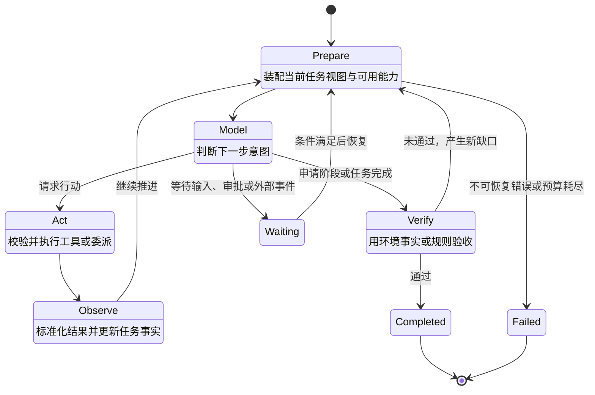
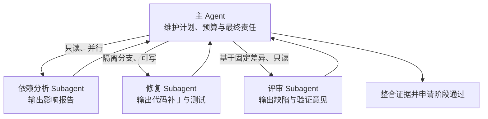
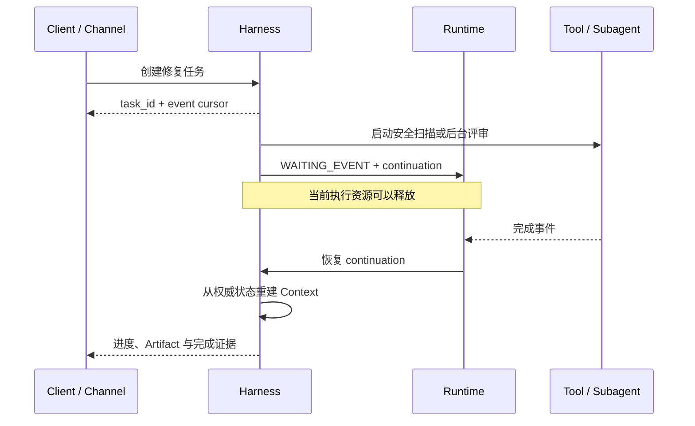
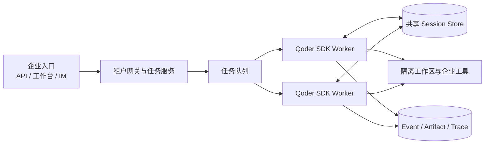

# 第 04 章　任务：编排、长程推进与协作流转

上一章聊完“四条构建路径谁来搭 Harness、各自担什么责”，这一章直接钻进脚手架的发动机舱：**当一个任务不可能靠一次模型问答搞定时，Harness 怎么把模型的离散判断，串成一个推得动、断得了、能恢复、交得了差的完整过程？**

在真实企业业务里，一次调用根本办不完事。Agent 往往得先摸清环境、写好计划，接着连续调十几次工具，碰到高危动作停下来等人批，把耗时活分给子代理并行跑，中间没准还要经历工具超时甚至容器重启，最后还得拿着客观测试和系统状态证明自己真没偷懒。这一整套“让任务稳稳往前走”的控制内核，就是本章要讲的任务契约。

为了让你看清所有零件是怎么咬合的，本章（以及第 05、06 章）会用同一个实战案例贯穿始终：

> **贯穿案例｜生产服务漏洞修复与变更发布 Agent**：系统收到 `payment-service` 的高危依赖漏洞告警后，Agent 要查清受影响代码和线上实例、制定升级方案，把依赖分析、补丁编写和独立评审分派给不同执行者；接着在隔离沙箱里改代码跑测试、生成变更单；涉及发布时卡住等负责人拍板；最后必须拿代码差异、测试报告、安全扫描和变更状态来验收，不能张口就说“修好了”。

---

## 4.1 Agent Loop 与任务状态机：别让聊天记录代替任务账本

### 真实痛点：只靠对话历史推任务，聊着聊着就忘了进度和底线

很多初级 Agent 没有专门的任务账本，全靠把一长串对话消息喂给模型，指望模型自己记住“我现在做到第几步了、还剩多少预算、刚才哪个工具卡住了”。一旦任务拉长到二三十轮，模型要么忘了最初的约束条件，要么在等人工确认期间白占着执行线程，最要命的是，测试还没跑完它就自己宣布“已修复”，外围程序根本拦不住。

### 核心机制：五步稳定循环 + 外置权威状态

**1. 稳定的五步 Agent Loop**

Harness 的执行内核就是一条清晰的主循环：不指望模型一步到位，而是按“备料—判断—行动—观察—验收”反复推进，直到拿到硬证据通过，或者进入等待、失败、取消。



这五个环节各司其职：

*   **Prepare（备料）**：读外置权威状态，定下这一步的小目标，再让第 05 章的 Context Builder 拼出本轮模型能看到的信息视图。
*   **Model（判断）**：调一次大脑，让它决定下一步是调工具、派子任务、追问用户、挂起等待，还是举手申请“我干完了”。
*   **Act（行动）**：把模型的意图交给第 06 章的 Action Plane，老老实实走完参数校验、身份绑定、权限拦截、审批和真正执行。
*   **Observe（观察）**：不管结果来自工具返回、子代理汇报还是用户半路插话，统一转成结构化的观察事实，回写进任务账本。
*   **Verify（验收）**：模型举手喊完成不算数，必须触发对应的客观验收器去查文件、跑测试或查系统状态；没过就带着缺口清单打回 Prepare 继续改。

**2. 机读的权威状态表与多维预算**

聊天记录只是过程流水，不是任务真值。企业级 Harness 必须在模型外面维护一份结构化的任务状态账本（目标、当前阶段、计划清单、已确认事实、阻塞点、子任务、产物引用、剩余预算、等待原因和验收依据），并且把状态枚举拆清楚：

| 状态 | 眼下在干嘛 | 接下来允许怎么走 |
| --- | --- | --- |
| `CREATED` | 任务建好了，还没开跑 | 启动运行或直接取消 |
| `RUNNING` | 正在备料、推理或执行动作 | 继续推、暂停、进入等待、转去验收、失败或取消 |
| `WAITING_INPUT` | 缺用户或业务侧的补充信息 | 收到新输入后恢复，或者超时结束 |
| `WAITING_APPROVAL` | 动作很明确，就差负责人拍板 | 批准、拒绝、修改参数或取消 |
| `WAITING_EVENT` | 挂起等慢工具、子任务或外部回调 | 收到完成事件后唤醒恢复，或者按策略超时 |
| `PAUSED` | 用户或系统主动按了暂停键 | 恢复继续、改规则或取消 |
| `VERIFYING` | 正在核验阶段产物或最终结果 | 验收通过、打回生成修复项或判定失败 |
| `COMPLETED` | 所有硬性验收条件全部满足 | 正式交付结果和证据清单 |
| `FAILED` | 当前策略下确定推不动了 | 重开尝试、转交人工或彻底结束 |
| `CANCELLED` | 任务被显式叫停终止 | 清理资源并保留完整审计事实 |

注意：**等待不是失败，暂停也不是结束。** 把三种等待态和暂停态拆出来，Runtime 才能在任务干等审批时把昂贵的执行容器先释放掉，前端 UI 才能明确告诉用户“卡在等安全负责人审批”，监控面板才分得清到底是模型慢、工具慢还是人没批。

同时，必须从外部死死卡住**多维预算上限**：最多跑多少步、总时长、Token 与费用、工具调用次数、子任务并发数、高危动作次数。快触顶时 Harness 应主动提示模型收敛范围、别再新开分支；真耗尽了，要体面地吐出明确终态和未完成清单，而不是硬生生截断报错。

**3. 案例实景：漏洞修复任务长什么样**

回到贯穿案例。漏洞修复任务收进来以后，内存或数据库里维护的权威状态账本长这样（下面是在做完影响分析、正在改代码阶段的切片）：

```yaml
task_id: remediation-2026-0917
goal: 修复 payment-service 中 CVE-XXXX 并形成可审批变更
state: RUNNING
stage: implement_fix
facts:
  affected_module: payment-core
  current_version: 4.2.1
  target_version: 4.2.4
todos:
  - {id: t1, title: 确认影响范围, status: completed}
  - {id: t2, title: 修改依赖并补充测试, status: in_progress}
  - {id: t3, title: 独立评审变更, status: pending}
artifacts:
  - impact-report.md
budgets:
  remaining_steps: 36
  remaining_minutes: 48

completion_evidence: [ ]
```

模型每轮看到的，是基于这份账本提炼出来的干净视图，而不是在几百条杂乱消息里瞎猜“我刚才做到哪了”。只要安全扫描证据还是空的，哪怕模型嘴上回复“修复已完成”，状态机也只会把它送进 `VERIFYING`，绝不会直接提交 `COMPLETED`。

---

## 4.2 Planning、Todo 与阶段门禁：别拿嘴上叮嘱代替系统硬卡点

### 真实痛点：Prompt 里写“先出计划再改代码”，模型转头就改了文件

很多人在系统提示词里写满“动手前务必先制定完整计划，经用户同意后再写代码”，结果测试十次总有两三次，模型在口头夸自己“我会先规划”之后，顺手就把修改文件的工具调了。原因很现实：Prompt 只是软建议，只要写工具还摆在它面前，模型一着急就会直接跨过去。

### 核心机制：把计划变成外置控制对象 + 阶段权限切换

好的 Planning 不是把模型的内部草稿打印给人看，而是把步骤、依赖、进行到哪、凭什么算过关，变成 Harness 和人类都能直接读写和审批的控制对象。按任务轻重，通常有三种控制粒度：

| 规划模式 | 怎么记录与控制 | 适合什么样的活 |
| --- | --- | --- |
| 轻量 Todo | 一份简短有序的待办列表 | 目标清楚、步骤少、试错成本低 |
| Plan Mode | 先只读摸底写计划，人拍板后再放开写权限 | 改动面大、需要先对齐方案、环境还没摸清 |
| Planner–Executor | 专门的规划器维护阶段和依赖，执行器逐项落手 | 长周期、多依赖、需要并行或分角色分工 |

不管是哪种模式，**计划必须允许半路修订**（发现新报错或用户改需求时，注明触发原因、保留已完成项，但不许通过悄悄改目标来掩盖失败）。待办列表也不用记录每一次琐碎的读文件操作，只记那些真正改变交付状态的里程碑。

更关键的是**阶段门禁（Stage Gate）**——长任务千万别等跑了半小时到最后一步才发现方向错了。把漏洞修复拆成五个阶段，每一关必须交出实打实的产物并通过门禁，才放进下一关：

| 阶段 | 这一关必须交出什么 | 放行下一关的硬门槛 |
| --- | --- | --- |
| 影响分析 | 受影响模块、依赖链、线上实例清单 | 范围可追溯，当前与目标版本事实已核验 |
| 修复规划 | 升级方案、兼容性风险评估、回滚方案 | 计划获人批准，工作区写权限正式放开 |
| 变更实施 | 代码差异补丁、依赖锁文件、补充的测试 | 所有修改严格落在授权目录内 |
| 独立验证 | 单测、集成测试、安全扫描、独立评审意见 | 所有强制项通过，或残余缺口获显式豁免 |
| 发布准备 | 变更单、发布窗口、回滚入口 | 责任人审批确认（本章不自动执行线上发布） |

以 AgentScope Java 为例，只需两行 Builder 配置就能把 Plan Mode 和任务清单挂进 Harness：

```java
HarnessAgent agent = HarnessAgent.builder()
    .name("remediation-agent")
    .model(model)
    .workspace(workspace)
    .enablePlanMode()
    .planFileDirectory("plans")
    .enableTaskList()
    .build();
```

它之所以真能拦住“没批先改”，靠的不是 Prompt 劝说，而是**工程上的工具白名单与状态切换**：在探索阶段，Harness 只开放只读检索工具以及几个专门读写计划和待办的工具，写代码工具压根不放行；当模型调用退出计划工具申请执行时，系统触发人工确认弹窗；只有人真正点头批准了，权限模式才会切开、允许修改工作区。而且计划直接落盘在 `plans/PLAN.md`、待办保存在外置状态里，就算中途断连重启，进度也不会丢。

### 工程取舍

简单查询或改几行小脚本，没必要强上全套 Plan Mode 和五段门禁，轻量 Todo 够用就行；但凡是会改多处业务代码、跨系统写数据或者需要团队对齐方案的任务，必须用工具级只读锁把“探索规划”和“动手修改”物理隔开。

---

## 4.3 Subagent 与任务委派：什么时候该派小弟，怎么防改撞车

### 真实痛点：角色扮演一大堆子代理，结果成本翻倍还互相覆盖代码

不少团队喜欢按人类组织架构，硬造出一个“产品 Agent + 架构 Agent + 开发 Agent + 测试 Agent”的群聊。跑在简单需求上，光传话和互相客套就把 Token 烧翻几倍；跑在复杂任务上，两个子代理同时去改同一个目录直接改冲突，最后主代理还因为“甩手不管”，把有漏洞的半成品原封不动端给用户。

### 核心机制：只为三个收益拆 Subagent，并且签死委派契约

**1. 什么时候才值得用 Subagent**

Subagent 的核心价值不是凑齐“多角色剧本”，而是解决三个实打实的工程痛点：

1.  **隔离上下文**：让子代理单独去翻几十个文件、试错几轮报错，别把主 Agent 宝贵的上下文窗口填满垃圾信息。
2.  **隔离能力与权限**：排查分析的只给只读模型和读工具，改代码的放进隔离分支给写权限，各自按最合适的模型和工具干活。
3.  **并行缩短等待**：几块互不依赖的检索、模块分析或验证可以同时开跑，压低总耗时。

如果任务本来就短、前后步骤强依赖，或者大家得频繁改同一份共享对象，拆 Subagent 纯属添乱——通信和合并结果的代价远大于收益。

**2. 签清楚七项委派契约，分清 Delegation 与 Handoff**

主 Agent 永远要攥住全局目标、计划、预算和最终验收权，绝不能把“最终是否搞定”的责任一并甩出去。顺便分清两个容易混的概念：

*   **Delegation（任务委派）**：父任务保留总账和最终责任，把边界清晰的一块子活派给 Subagent，干完把产物交回来由父任务核验合并；
*   **Handoff（控制权移交）**：主指挥棒彻底转交给另一个 Agent，接收方接管接下来的目标、状态和恢复责任，通常用于跨阶段或跨领域转交。

不管是哪一种，都不能只在对话里发一句“你去帮我查一下”，必须携带可机读的委派契约：

| 契约字段 | 必须写清什么 |
| --- | --- |
| 目标与边界 | 具体交什么产物；只准碰哪些目录、系统和动作 |
| 已知上下文 | 哪些前提已经核实；哪些既定决策不准私自改 |
| 能力与权限 | 配什么模型、Skill、工具、沙箱环境和权限边界 |
| 预算上限 | 最多跑多少步、几分钟、多少钱和并发度 |
| 输出与证据 | 返回什么结构的数据，怎么附带源码行或日志证据 |
| 失败策略 | 失败后是重试、交半成品、向上求助还是直接叫停 |
| 验收门槛 | 父 Agent 拿什么条件判断这份结果能不能采信 |

**3. 案例实景：分析、修改和独立评审怎么接力**



注意图里的协作顺序和隔离规则：依赖分析和代码搜寻可以并行只读跑；代码修改必须在版本号和影响范围锁定后，在隔离工作区或独立分支里改；而**独立评审 Subagent 必须用全新的干净上下文，去读冻结下来的补丁差异和测试报告**——千万别把修改者自己那堆“我为什么这么改”的辩解历史塞给评审者，否则评审很容易被带偏。多个修改者若必须动同一份代码，必须上隔离分支、对象锁或补丁合并机制，绝对不能靠口头约定“大家小心别改同一行”。

下面是用 AgentScope 在工作区中版本化声明一个独立评审 Subagent 的典型配置：

```markdown
---
description: 对漏洞修复补丁进行独立评审，检查兼容性、测试和回滚风险。
workspace:
  mode: isolated
steps: 8
tools: [read_file, grep_files]
---

只审查已生成的差异和测试证据，不修改代码。
按“阻断问题、一般问题、证据缺口”输出结构化结果。
```

主 Agent 调用时，可以用同步生成等待结果，也可以丢到后台拿回一个子任务 ID 异步盯着。重点记住：**Subagent 默认不应该自动继承父 Agent 的全部上下文和所有权限**——父任务有权派活，不代表子代理就有权拿父任务的生产密钥去删库。

**4. 子任务挂了怎么传播，结果怎么合并**

父任务必须提前定死不同子任务失败的处置策略：

*   核心前提挂了（比如主依赖树解析彻底失败）：整单直接叫停（`FAIL_FAST`）；
*   锦上添花的旁路探索挂了：记录缺口但主流程继续（`BEST_EFFORT`）；
*   网络或模型瞬时抖动：在预算内退避重试或换节点重派（`RETRY_OR_REASSIGN`）；
*   碰到业务规则冲突或权限不够：立刻挂起上报等人拍板（`ESCALATE`）。

另外，Subagent 交回来的东西不是“最终答案”，只是一条新的 **Observation**：主 Agent 必须核对它返回的 Schema 对不对、它分析的代码版本是不是最新的（别拿着修改前的老代码出了一篇评审报告！），全部核对无误才能写进权威任务状态。

---

## 4.4 异步任务与长程续行：别让断网、超时或重启毁掉半小时的活

### 真实痛点：安全扫描跑 15 分钟，HTTP 断连、容器重启后任务直接人间蒸发

企业任务经常熬过一次 HTTP 请求、一个终端窗口甚至一整轮模型上下文窗口的寿命。如果把任务生命死死绑在当前请求或容器内存上，前端页面一刷新、网关超时断开或者工作节点弹性缩容重启，跑了二十分钟的活就全白费了；更可怕的是，重连后万一重新触发了一遍不可逆操作，线上直接出重复变更。

### 核心机制：把任务身份与执行连接解耦，靠统一续跑包（Continuation）接力

**1. 脱离单次连接的异步流转**



后台子任务、外部事件和断点续跑应该共用一套统一契约，写死：稳定任务 ID、父任务 ID、当前状态、发起与执行者、输入与产物引用、单调递增的事件游标、超时/取消与幂等键、错误分类，以及恢复所需的续跑信息包（Continuation）。

**暂停、取消与窗口重置的三个保命动作：**

*   **暂停前**：先刹住新动作请求，处理完能优雅中断的操作，再把最新状态落盘。
*   **恢复时**：先重新核对目标有没有被用户改过、外部待办结果到底出没出来、工具刚才到底执行成功没、权限还在不在、工作区文件变没变、预算还剩多少——核实一圈再继续，绝不盲目重放！
*   **取消时**：取消信号必须顺着父子任务链往下传，但如果已经发出去了外部副作用（比如创建了变更单或发了通知），不能假装没发生，必须老实记账并在必要时执行补偿。
*   **跨窗口重置（Context Reset）**：当一轮对话太长必须换新上下文窗口时，只要在旧窗口结束前把目标、当前计划、已确认事实、踩坑失败尝试、产物位置、等待项、剩余预算和权限模式打包成一份干净的 Continuation，新窗口就能从权威状态里一键重建视图接着跑（具体装配和压缩机制在第 05 章展开）。

**2. 接入现实路径：SDK 共享会话 vs 云端全托管**

在产品化 SDK 路径下（比如把 Qoder Agent SDK 嵌进企业后端），一段简洁的 TypeScript 代码就能提交修复任务、限死工具白名单并接管事件流：

```ts
import { accessTokenFromEnv, query } from '@qoder-ai/qoder-agent-sdk';

for await (const message of query({
  prompt: '分析 payment-service 的高危依赖漏洞，修改代码并补充测试；不要发布。',
  options: {
    auth: accessTokenFromEnv(),
    cwd: '/workspace/payment-service',
    allowedTools: ['Read', 'Write', 'Edit', 'Glob', 'Grep', 'Bash'],
    permissionMode: 'acceptEdits',
  },
})) {
  if (message.type === 'assistant') {
    for (const block of message.message.content) {
      if (block.type === 'text') publishText(block.text);
      if (block.type === 'tool_use') publishToolEvent(block.name);
    }
  }
  if (message.type === 'result') persistOutcome(message);
}
```

但要记住：**SDK 跑在单个应用进程里，不等于分布式在线服务。** 多机集群部署时，必须把会话历史存进共享外部存储，记下首次返回的会话 ID 方便任意 Worker 节点随时续接（`resume`），同时在企业侧补齐租户网关、任务排队、并发锁、产物存储和业务幂等：



而如果团队连 Loop、会话续接和执行沙箱都不想自己管，就可以交给 **Qoder Cloud Agents** 这类云托管服务：围绕 Agent、Environment、Session 和 Event 四个对象，云端替你把长任务持续往前推，应用侧只需要保存业务 Task 与云端 Session 的对应关系，然后订阅消费状态和结果事件即可。不过再提醒一遍：执行基础交给平台了，工具数据边界、审批人、成功标准和最终验收依然归企业自己管（第 06 章会用同一案例展示云托管会话的事件流与审批交互）。

---

## 4.5 Middleware 与执行内核测试：把主循环保持干净，把确定性逻辑测死

### 真实痛点：每加一个新能力就改一次主循环，两个月后谁都不敢动代码

很多框架刚起步时只有一百行主循环，清爽极了。后来要加上下文压缩、又加个模型路由、再加权限拦截、埋点监控、死循环检测……每加一个就往核心 Loop 里塞几层 `if/else`。半年后状态迁移变得神出鬼没，改一个压缩阈值居然把审批唤醒搞挂了。

### 核心机制：稳定核心 Loop + 生命周期钩子（Middleware）+ 四类契约测试

**1. 把主循环当铁轨，把变化放进 Middleware**

最稳妥的做法是让核心 Loop 只管五步主干和状态流转，所有横切能力（预算检查、计划提醒、动态路由、死循环刹车、埋点快照）全部做成可插拔的 Middleware 或 Hook，在六个固定生命周期点读取上下文、返回结构化决策或状态补丁（由核心 Loop 统一提交，不允许插件私自乱改共享状态）：

| 扩展挂点 | 适合干什么事 | 绝对不能干的事 |
| --- | --- | --- |
| Task 创建前后 | 任务分类、设初始预算、锁定版本号 | 偷偷改掉用户原始目标 |
| Prepare 前后 | 注入阶段计划提醒、算上下文预算、选模型路由 | 把本该持久化的状态只塞进 Prompt |
| Model 调用前后 | 调整推理参数、解析输出、检测是不是在原地打转 | 把不该留存的敏感内部思考原样落盘 |
| Action 前后 | 扣减预算、把工具报错标准化 | 绕开第 06 章统一的 Action Plane 直接调外部接口 |
| State 变化前后 | 校验状态迁移合法性、打安全点快照、发变更通知 | 在多个地方各自维护一份状态真值 |
| Verify 前后 | 挑出匹配的验收器、生成缺口清单、卡住质量门禁 | 光看模型嘴上说“搞定了”就放行完成 |

像 AgentScope 的 HarnessAgent，正是靠能力组合把工作区、状态存储、计划、子代理、记忆、压缩、Skill、沙箱和渠道一层层挂到统一运行上下文里——给了极高的业务定制空间，代价是团队必须管好这些插件的执行顺序和交互契约。

**2. 对确定性部分做契约测试（不用等真模型跑）**

测试 Agent 执行内核千万别“只测端到端问答准不准”，脚手架本身的确定性控制逻辑可以用录制回放、固定桩或模拟器先测死。至少要有四类必测项：

*   **状态迁移测试**：每个状态只收合法事件，暂停、取消和失败信号能准确沿着父子任务传播；
*   **扩展顺序测试**：Middleware 按既定顺序执行，发生短路或拦截时行为稳定；
*   **断点恢复测试**：在任意危险边缘强行拔电源中断，重启后能干净接上且绝不重复执行有副作用的动作；
*   **预算与边界测试**：撞到步数、时间、费用或高危动作阈值时，Loop 能按预设方式优雅收敛。

**拿贯穿案例举个具体测法**：在“代码补丁已经写进隔离目录、安全测试也已经启动、但测试结果还没回传”的那一秒，强行杀掉执行进程。恢复后的正确行为必须是**先去查原测试任务到底出结果了没有**，而不是傻傻地再改一遍代码或者重跑一轮扫描。把这种“半截断电用例”跑通了，你的 Harness 才算真扛得住生产故障。

---

## 4.6 可靠性与“用证据交差”：怎么对症恢复、怎么叫停死循环、怎么才算真完成

### 真实痛点：报错只会盲目重试，原地转圈烧光预算，或者没跑测试就喊收工

线上跑长任务最怕三种尴尬现场：第一，发出去一个变更单接口超时了，Harness 不查状态直接重试，结果线上建了两个一模一样的单子；第二，模型调一个工具参数一直写错，连错 15 次还在换个花样死磕，把几美元的 Token 烧光才强行报错；第三，安全扫描明明报错了或者根本没跑，模型自顾自总结一句“漏洞已安全修复”交了卷。

### 核心机制：按因施治、幂等防重、无进展刹车、五级客观验收

**1. 别笼统说“Agent 失败了”，按故障类型对症下药**

*   模型限流或网络抖动 → 有限次指数退避重试；
*   工具参数写错 → 把清晰报错喂回给模型修正参数；
*   运行环境缺包或容器挂了 → 重建沙箱或提示降级；
*   权限被政策拒绝 → 转人工审批或明确终止；
*   业务条件根本不满足 → 诚实亮出缺口清单；
*   **有外部副作用的操作（发消息、写库、提变更、发布）超时** → **绝不盲目重试！** 必须凭幂等键先去查外部系统上一次到底有没有执行成；无法证明上一次没发生前，不能重放。一旦触发了降级（比如换了备用模型或缩减了工具集），必须记录在案，因为输出质量边界可能已经变了。

**2. 无进展检测（No-Progress Detection）：比总步数上限更早踩刹车**

别傻等 50 步预算全烧光才叫停。只要出现以下苗头，Harness 就该提前亮黄灯：连续多次调同一个工具且参数高度雷同、连着撞同一个报错、计划清单好几轮一动不动、工作区半天没产生新文件或新事实、或者模型在两个动作之间来回横跳。

亮黄灯后的标准自救三连：先丢给它一份结构化僵局证据要求重做计划（Replan）；还不行就收缩任务范围、换模型或拉一个独立评审 Subagent 进来会诊；再不行就干脆停下来转人工接管。

**3. 关键底线：模型只能“申请完成”，Harness 拿着客观证据才准“提交完成”**

按任务风险等级，验收器（Verifier）要逐级加码：

| 验收层级 | 怎么验 | 适合兜什么样的底 |
| --- | --- | --- |
| 结构验证 | 校验 JSON Schema、必填字段、格式、产物文件在不在 | 低风险结构化报告、数据抽取 |
| 环境验证 | 去真实系统或沙箱查文件差异、Git 状态、接口实际返回值 | 涉及工作区改动或业务系统操作的任务 |
| 确定性验证 | 跑单测、集成测试、安全扫描、静态检查和业务规则脚本 | 只要成功条件能写成代码/规则的，全上这一级 |
| 独立模型验证 | 用一份全新的干净上下文，对照需求和证据找遗漏和矛盾 | 开放式调研分析、长文起草等没法全写死规则的活 |
| 人工验收 | 业务责任人审阅核心差异与报告并正式签署同意 | 高影响发布、资金往来、法律合规类最终拍板 |

一旦 Verifier 没通过，不能直接丢给用户一个冷冰冰的“失败”，而要返回结构化的缺口清单、失败日志和是否可自动修复的判断，当成一条新的 Observation 喂回主循环继续修、重规划或上报。**注意区分**：Verifier 管的是“这一次任务能不能过关交差”；至于“我把 Harness 改了一版，整体是变好了还是变糟了”，那是第 06 章要讲的跨样本评测（Evaluation Harness）。

**4. 案例验收：漏洞修复交出来的不是一句话，是一整包铁证**

对贯穿案例来说，必须同时凑齐下面这几条硬事实才算达标：依赖清单证明目标高危版本已替换且没有通过传递依赖绕回来；代码差异只落在授权目录且符合获批计划；单测、集成测试和安全扫描都有可追溯的报告文件且强制项全绿；独立评审没有未关闭的阻断问题；变更单里写全了影响范围、回滚方案和证据链接。同时目标也要分清——如果任务定的是“生成待审批变更单”，系统不能把“还没发布线上”误判成未完成；如果目标写明含发布，那必须验到审批通过和线上部署成功才算数。

所以最终交付给业务系统的，是一份清清楚楚的结构化事实包：

```yaml
state: COMPLETED
outcome: change_ready_for_approval
evidence:
  dependency_check: artifacts/dependency-tree.json
  code_diff: artifacts/remediation.patch
  unit_tests: artifacts/unit-test.xml
  integration_tests: artifacts/integration-test.xml
  security_scan: artifacts/security-scan.sarif
  review: artifacts/review.json
  change_request: CR-18427
remaining_actions:
  - 由服务负责人审批并安排发布窗口
```

把这套验收壳子换一下里面的 Verifier，就能直接搬去审合同（条款覆盖率+法务签署）、做数据订正（影响行数+抽样复核+回滚快照）或处理客诉工单（系统状态核实+用户确认记录）。

**5. 借助云平台打通长任务的观测与评估基建**

如果要做长任务的可观测与跨版本验证，像阿里云 AgentCore 这类平台能直接帮上大忙——它把统一管理、模型连接、Skill 与 MCP 工具、凭证、运行监控、Trace 和评估收在同一个控制面里，不管底座是自建还是外部接入，都能在一个地方看清执行过程和质量波动。但还是那条老规矩：**平台提供观测跑道和质量信号，业务侧的 Task ID、状态版本号、幂等键、审批条件和最终业务 Outcome 依然必须由企业自己的任务契约来拍板。**

### 工程取舍

做任务编排最怕“一步到位症”：别一开始就硬上复杂的多层 Planner + 5 个 Subagent + 分布式队列。先从干净的五步 Loop、外置权威状态表、多维预算和基于硬证据的 Verifier 起步；等遇到“模型经常绕过计划直接改文件”再锁死 Plan Mode，遇到“探索太多撑爆主窗口或需要并行”再拆 Subagent，遇到“任务经常跑过几分钟断网”再把状态和断点续跑外置出去——每多加一层复杂度，都要能说清它替你拦住了哪种真实线上翻车。

---

## 4.7 本章小结

这一章回答了“任务怎么推进、怎么协作、怎么靠谱结束”：用“备料—判断—行动—观察—验收”五步主循环托底，用外置权威状态机和多维预算管住长期推进，用 Plan Mode 的工具级只读锁把计划落成硬约束，用签死七项契约的 Subagent 解决上下文污染和并行加速，用任务与连接解耦及断点续跑包撑过断网与重启，再用 Middleware 和四类契约测试保持内核清爽可测，最后把完成大权从模型手里收回来，交给拿着铁证说话的 Verifier。

但是光有这套流转架子还不够——每轮进入 Prepare 备料时，模型眼前到底能看见哪些信息、几十兆的日志怎么塞进有限窗口、昨天踩过的坑明天怎么不重犯？下一章，我们就专门拆解 Harness 的信息契约。
