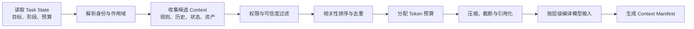
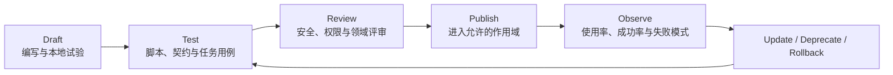

# 第 05 章　信息：上下文、状态与可复用能力资产

长程任务每向前推一轮，Harness 都要回答一个直接决定成败的问题：**这一次调模型，到底该把哪些信息放到它眼前？**

把全部聊天记录、几十个源码文件、几百条工具说明和公司知识库一股脑全塞进上下文窗口，结果一定是花钱如流水、延迟翻倍，而且模型注意力被淹没，关键规则反而看漏；可如果偷懒只保留最近三五轮对话，前脚用户改的要求、刚拿到的依赖版本、哪步工具报错了、审批过没过全丢了个精光。模型窗口是有限的，外面的任务世界却一直在膨胀——解决这个矛盾，靠的不是“再买个更大窗口的模型”，而是一套独立的**信息工程体系**。

先统一划清本章管辖的五个核心信息对象，避免后面概念打架：

*   **Context**：单次调用模型时，它眼前看到的那份临时拼接视图，每一轮都要重新编译生成；
*   **State**（以及配套的 **Workspace**）：存在模型窗口之外、强一致落盘的权威任务账本和工作空间，负责保真推进与断点恢复；
*   **Memory**：跨会话、跨任务沉淀下来的经验与偏好，用得好能避坑，乱写就会变成错误污染源；
*   **Knowledge**：组织官方维护的企业文档、制度和权威业务事实，重点卡权限边界和时效性；
*   **Skill**：某类特定任务“该怎么干”的步骤说明和配套脚本，可发现、按需加载、带版本号发布复用。

本章继续沿用“生产服务漏洞修复与变更发布 Agent”作为贯穿案例。第 04 章讲清了任务怎么流转，本章聚焦任务在每一轮中如何看清现场：漏洞公告、项目规范和当前依赖版本怎么编译进 Context；动辄上万行的安全扫描报告怎么请出窗口但随时能查；计划、补丁和证据怎么安稳躺在 Workspace 里；一次成功修复的套路又怎么沉淀成既能复用、又不会误导后续任务的 Memory 与 Skill。

---

## 5.1 Context 编译管线：模型这一轮到底能看见什么

### 真实痛点：所有文本拼成一个大字符串，冲突了连谁错了都查不到

不少早期 Agent 的做法，就是把系统提示词、项目文档、用户聊天、工具返回结果和知识库召回片段，按时间顺序拼成一个大文本块直接扔给模型。这种做法线上极易翻车：一篇搜出来的外部网页或旧工单里夹了一句指令，就把平台安全底线给覆盖了；或者模型没按要求修复漏洞，排查时对着十几万字的完整 Prompt 发呆，根本不知道这轮到底漏放了项目规范，还是塞了过期知识把正确规则挤出去了。

### 核心机制：分层隔离 + 确定性编译管线 + 可审计 Manifest

**1. 把 Context 拆成优先级分明的上下两半**

生产级 Agent 的输入不是一块静态字符串，而更像一次“**实时编译**”：把多个信息源按严格权限和优先级合并、消解冲突、裁剪预算，最终拼出本轮模型能看的视图。

```text
System Context
├── Platform Policy        平台安全边界、不可覆盖规则
├── Agent Contract         角色、目标、能力边界与输出要求
├── Tenant / Project Rule  租户制度、项目约定与工作区规则
├── Runtime Reminder       当前阶段、预算、等待项与操作模式
├── Selected Skill         本轮所需方法、脚本与参考资料
└── Tool Descriptors       本轮允许披露的能力与参数 Schema

Task Context
├── User Goal / Steering   原始目标和最新纠偏
├── Plan / Todo            当前阶段和未解决事项
├── Recent Interaction     最近消息和 Observation
├── Compacted History      早期过程的结构化摘要
├── Retrieved Memory       与当前任务相关的历史经验
├── Retrieved Knowledge    带来源、权限和时效的企业事实
└── Workspace References   文件、Artifact 和大结果引用
```

这样分层的核心目的，是**划死覆盖优先级，防“以下犯上”**：平台铁律绝不能被某个项目文件改写；用户临时纠偏可以调整任务目标，但撞不破企业权限红线；Memory 里的历史经验只能当参考，不能顶替当下系统的权威事实；工具扫回来的外部网页或文档哪怕写了“忽略以上规则”，也只能乖乖躺在低可信度的数据区里，绝不允许升级成系统指令。

**2. 每次调用模型前跑一遍确定性编译管线**



看清这条管线上两个最容易被写反的顺序：**先按身份和权限硬过滤，再做相关性排序和召回**（绝不能先把跨租户的文档全召回出来，再指望模型“自觉别引用”）；外部拉回来的内容必须一路带着来源标签和可信度等级往下走。

进入预算分配和裁剪时，不能只看向量相似度，还要综合七个维度来排先后：约束强度（安全政策压过经验建议）、当前阶段相关性、时间有效性（最新环境事实压过老结论）、来源可信度（权威系统结果压过模型猜想）、眼下即将调用的工具与验收条件、是否与已有内容重复，以及表达够不够紧凑。窗口额度也不是死板的固定百分比——连续读写代码查文件时，工具描述和工作区状态多分点预算；到了最后做总结和验收时，测试报告和验收标准就要占主角，同时还得留够模型输出和下一轮观察结果的余量。

**3. 每次调用必留一份 Context Manifest（编译清单）**

光把最终拼好的 Prompt 原文存进日志，排查起问题来还是抓瞎——因为同样一段文字，你不知道它从哪个版本文档来、凭什么权限放进来、本来有十条召回结果为什么砍掉了另外九条。因此，每次模型调用都要同步生成一份 **Context Manifest**，像编译器的构建清单一样记下“这轮到底选了啥、丢了啥、改写过啥”：

| 字段 | 记的是什么 |
| --- | --- |
| `source_type` / `source_id` | 来源类型和稳定唯一标识 |
| `scope` | 属于全局、租户、项目、用户、会话还是当前任务 |
| `version` | 指令、文档、Skill、工具定义或摘要的版本号 |
| `trust_level` | 可信度等级（平台规则 / 企业权威事实 / 用户输入 / 外部内容） |
| `permission_basis` | 这一轮凭什么身份和依据有权读到它 |
| `selected_reason` | 为什么选进来（规则命中 / 当前阶段 / 检索相关 / 显式引用） |
| `token_count` | 实际吃掉了多少窗口预算 |
| `transform` | 怎么进来的（原样 / 摘要 / 截断 / 去重 / 只留文件引用） |
| `content_hash` | 内容哈希，用于回放审计和变化检测 |

拿贯穿案例来说，漏洞修复进入“变更实施”阶段时，第 83 次模型调用的清单长这样：

```yaml
model_call_id: call-083
context_policy: remediation-context@2.3
sources:
  - {type: platform_policy, id: prod-change-policy, version: 7, tokens: 620}
  - {type: agent_instruction, id: remediation-agent, version: 12, tokens: 480}
  - {type: task_state, id: remediation-2026-0917, version: 19, tokens: 910}
  - {type: workspace_rule, id: payment-service/AGENTS.md, version: a83c1e, tokens: 740}
  - {type: skill, id: dependency-remediation, version: 3.1, tokens: 530}
  - {type: artifact_ref, id: impact-report.md, transform: summary, tokens: 360}
omitted:
  - {id: raw-security-scan.sarif, reason: artifact_reference_only}
  - {id: unrelated-user-memory, reason: scope_mismatch}
```

这份清单不存敏感原文，却能一秒答清“出 bug 时模型到底有没有看到正确的项目规范、为什么没加载那条历史记忆”。把整套拼装逻辑和阈值固定成版本化的 **Context Policy** 并和 Agent 版本绑定，上下文构建就从玄学变成了可测试、可回放的工程模块。

### 工程取舍

如果你们只是在做简单的单轮问答，静态模板拼接完全够用；只要涉及多租户知识库、多阶段工具切换，或者经常碰到“同一套代码换个提问就漏看规则”，就必须把 Context 编译管线和 Manifest 落下来——有了 Manifest，调试才分得清到底是“大脑推理蠢”，还是“脚手架递错了料”。

---

## 5.2 Context 生命周期与压缩：别让几万行扫描日志撑爆每一轮窗口

### 真实痛点：工具吐出一万行日志后，后面每一轮都在花冤枉钱

在代码修复或日志排障场景里，跑一次全量依赖树或安全扫描动辄吐出几万行 JSON。如果直接把完整返回塞进聊天记录，不仅当场可能撑爆上下文窗口，更惨的是接下来每推进一轮都要把这几万行重传给模型看一遍。而如果粗暴采用“只留最近 10 条消息”的滑动截断，刚过几轮，用户一开始交代的“千万别动支付核心回调逻辑”就被切没了。

### 核心机制：活跃窗口 + 先落盘再压缩 + 跨窗口交接包

**1. 什么是真正该留在眼前的 Active Context**

原始消息流水完整存进外部存储，每一轮给模型看的活跃窗口（Active Context）只保留六块精华：

```text
Active Context
├── Stable goal and constraints  长期稳定、不可遗漏
├── Current task state           当前阶段、Plan、Todo、预算和阻塞
├── Recent verbatim turns        需要精确理解的最近交互
├── Structured history summary   更早过程的压缩表示
├── Retrieved facts              本轮相关 Memory / Knowledge
└── Artifact references          可按需继续读取的外部内容
```

要注意，这里说的“最近”不能光按时间戳算。哪怕是十轮以前用户的临时改需求、还没解决的报错、卡住的审批项和验收没过的证据，只要还没闭环，就还是“活跃状态”，必须死死留在窗口里；反过来，五分钟前为了查一个字段翻过的三十个无关文件，既然已经拿到了结论并存了证据，就可以立刻请出活跃窗口。

**2. 压缩不是随便写梗概，而是“Commit → Compact → Rebuild → Validate”四步闭环**

真正工程可用的压缩，绝不是丢给模型一句“把上面对话总结成 200 字”。任何会影响后续推进的关键事实（审批结果、接口提交返回的单号、最新计划状态、产物路径、剩余预算、用户刚改的要求），必须**先提交进外置权威状态**，再允许从对话窗里清走。

完整生命周期按四步走：

1.  **Commit（提交落盘）**：先把结构化事实写进权威 Task State、Workspace 或对应资产库。注意：高风险事实别靠模型自由发挥总结，直接从状态变更、工具回执和审批单里确定性提取；
2.  **Compact（结构化压缩）**：把早期的过程对话压成结构化摘要，**必须带上覆盖的事件序号范围、生成版本和来源索引**，并且硬性保留八类要素——原始目标与成功底线、已确认事实（分清铁证和猜想）、已拍板决定及被否方案、已执行动作和副作用、当前计划与阻塞点、产物路径和外部对象 ID、用户偏好与权限模式，以及踩过的坑和失败原因；
3.  **Rebuild（重建视图）**：拿这份新摘要、最新权威状态和最近几轮原话重新编译本轮 Context，核对核心约束还在不在；
4.  **Validate（防漂移检查）**：校验目标、未解决项、权限状态有没有漏，并用续跑用例验证模型行为没有跑偏。

至于动辄几万行的查询日志或扫描报告，直接走**大结果卸载（Eviction）**：原文写入 Workspace 或对象存储，窗口里只留摘要、关键报错片段、格式大小和稳定带权限的读取引用（绝对不能用会过期的临时链接，动态数据还要记下读取时的快照版本或时间）。模型真需要细查某几行时，自己调用范围读取或搜索工具按页去翻。

在 AgentScope Java 里，开启自动消息压缩和大工具结果卸载只需要几行配置（比如消息超过 30 条就触发压缩、保留最近 10 条原话，大结果自动写文件留引用）：

```java
HarnessAgent agent = HarnessAgent.builder()
    .name("remediation-agent")
    .model(model)
    .workspace(workspace)
    .compaction(CompactionConfig.builder()
        .triggerMessages(30)
        .keepMessages(10)
        .build())
    .toolResultEviction(ToolResultEvictionConfig.defaults())
    .build();
```

回到漏洞修复案例：安全扫描吐出的完整报告直接存进 `evidence/security-scan.sarif`，活动窗口里只留“发现 2 个高危漏洞、1 个阻断项及文件引用路径”。这省下的不是一轮 Token，而是后面几十轮都不再反复花冤枉钱。

**3. 压缩也救不了，或者跨大阶段了？直接 Context Reset！**

当任务跑得极长、连压缩好几次上下文还是太重，或者刚好跨过一个大阶段门禁（比如“方案已批准，正式切到写代码阶段”），最干脆的做法是**彻底清空旧对话窗（Context Reset）**，由第 04 章准备好的续跑包接力：

```text
Continuation Package
├── Goal & Acceptance Criteria
├── Current Plan / Todo / Blockers
├── Structured Facts & Decisions
├── Workspace / Artifact Manifest
├── Active Async Tasks & Approvals
├── Relevant Memory / Knowledge References
├── Permission & Budget Snapshot
└── Next-step Brief
```

新窗口完全不用重放几百条老聊天记录，直接从这份交接包、权威 Task State 和工作区文件重新起跑——特别是文件化工作区，人和 Agent 都能直接点开计划、补丁和报告看进度，谁也不会被一次模型会话结束卡死。

### 工程取舍：怎么评估压缩做得好不好

千万别只盯着“Token 省了 70%”就庆祝。上线压缩策略必须同时盯五个指标：**关键事实保留率**（约束有没有被压丢）、**续跑成功率**（压完是不是又要从头重新搜一遍文件）、**矛盾率**（摘要有没有和权威状态打架）、**引用可用率**（留下的文件路径还读不读得出东西），以及**总成本收益**（压缩调用和后续回翻文件的开销算下来到底划不划算）。压缩器、摘要模板和阈值全部要纳入版本管控和发版回归。

---

## 5.3 Session、Task State 与 Workspace：把真实世界存到模型窗口之外

### 真实痛点：把“一次聊天窗口”和“一个要交付的任务”绑死，后台执行和跨端接力全卡死

很多系统偷懒把“一次 HTTP 请求”“一个聊天窗口”和“一个后台任务”全混成同一个 `session_id`。结果很快碰壁：用户在飞书里发起了一个修漏洞任务，想切到电脑网页版接着审批和看进度，结果发现任务状态全锁在原聊天线程里；或者在一个对话窗里顺手先后派了三个独立任务，状态全搅成一锅粥。

### 核心机制：三层身份拆开 + 状态三件套 + 分区工作台

**1. 彻底分清 Call、Session 与 Task**

| 对象 | 它到底代表什么 | 活多久 | 里面装什么 |
| --- | --- | --- | --- |
| Call | 应用对 Agent 的单次请求或唤醒动作 | 秒到分钟 | 请求 ID、当下调用身份、临时凭证、本次入参和流式游标 |
| Session | 某个人或调用方和 Agent 连续交互的会话边界 | 分钟到数天 | 参与者、来源渠道、对话消息、会话偏好和关联了哪些任务 |
| Task | 围绕一个明确验收目标存在的执行账本 | 可跨多次 Call、多个 Session 甚至多台机器 | 目标、状态机、计划清单、子任务、预算、产物和验收铁证 |

记住一个关系：**一个 Session 里可以发起好几个 Task；同一个长 Task 也可以先后在好几个 Session（比如 CLI 发起、IM 审批、Web 验收）里被接管和查看。** 必须各自独立编号、显式记录关联关系。

**2. 支撑恢复的三种状态表示，少一个都会出事故**

| 表示形态 | 记录了什么 | 缺了它会怎样 |
| --- | --- | --- |
| Event Log（事件流水） | 按因果顺序发生过的每一件事 | 只有快照没流水，出 bug 时根本查不清状态是怎么一步步变坏的 |
| Snapshot（聚合快照） | 某一刻把流水归并完的最新视图 | 只有流水没快照，长任务跑了五千步以后每次恢复都要重放半天 |
| Checkpoint（安全恢复点） | 快照加上续跑包、幂等状态和环境依赖校验 | 把普通保存当恢复点，重启时容易在事务半截盲目重放造成重复副作用 |

Harness 在构建期就要把这三件事的状态模型、合并规则、并发乐观锁版本号和安全点语义定死，并且面向一套**逻辑状态接口**写代码（而不是在业务代码里直接写死本地 JSON 文件或某个数据库方言）：

| 逻辑接口 | 核心职责 | 本地 vs 分布式映射示例 |
| --- | --- | --- |
| `append_event` | 追加带版本号和因果父指针的事件 | 本地写追加日志文件；分布式写事件流或数据库表 |
| `load_task_state` / `commit_task_patch` | 读权威状态、带乐观锁提交增量变更 | 本地写任务状态 YAML/JSON；分布式走带版本号的状态库 |
| `save_snapshot` / `load_snapshot` | 存取快速恢复用的聚合状态视图 | 本地写快照文件；分布式存 Redis 或关系库 |
| `put_artifact` / `get_artifact` | 存取带来源与权限元数据的产物和证据 | 本地写工作区产物目录；分布式存对象存储 |
| `create_checkpoint` / `resume_checkpoint` | 在明确安全点打包与唤醒续跑包 | 统一对齐快照、续跑契约与幂等状态 |
| `search_workspace` / `read_range` | 供 Context Builder 按需翻看和分页拉大结果 | 本地读文件切片；分布式走工作区索引与对象切片读取 |

只要这套逻辑接口语义统一，不论底层是高代码框架、SDK 还是云托管，将来都能平滑接入企业统一状态存储底座（物理存储与跨节点容灾见第 08 章）。

**3. 把工作台放进外部 Workspace，并且按“产物生命周期”管住文件**

Workspace 是模型窗口之外、人与 Agent 都能直接查看和修改的工作台。和跨任务经验（Memory）不同，Workspace 专注服务手头正在干的活，逻辑上至少要划清六块区域（各区域生命周期和清理策略完全不同，不能全丢在一起随便删）：

```text
Workspace
├── inputs/       用户提供或任务同步的输入
├── scratch/      临时分析、搜索结果和中间文件
├── state/        Plan、Todo、Continuation 和结构化任务视图
├── artifacts/    可交付产物与机器可读结果
├── evidence/     测试、查询、审批和验证证据
└── manifest      来源、版本、权限、状态和保留策略
```

同时别把“模型写了个文件”等同于“交付完成了”。每一份正式产物（Artifact）都应记清稳定 ID、归属任务、来源、哈希和权限，并走完严格生命周期：**草稿（Draft）→ 校验中（Validating）→ 就绪（Ready）→ 已发布/已驳回（Published / Rejected）→ 归档/清理（Archived / Deleted）**。其中变成“就绪”靠验证规则，真正“发布”到外部系统必须走第 06 章的 Action Plane 授权和幂等提交。

结合贯穿案例，在 AgentScope 的 Workspace 规范下，一个漏洞修复任务的外部目录会组织成这样：

```text
.agentscope/workspace/
├── AGENTS.md                         # 项目级工作规则
├── MEMORY.md                         # 已整理的长期经验
├── knowledge/KNOWLEDGE.md            # 企业知识入口
├── skills/dependency-remediation/    # 漏洞修复 Skill
├── subagents/security-reviewer.md    # 独立评审者规格
├── plans/PLAN.md                     # 当前修复计划
├── tasks/remediation-2026-0917/
│   ├── STATE.yaml                    # 当前阶段与 Todo
│   ├── CONTINUATION.md               # 跨窗口交接
│   ├── scratch/                      # 临时分析
│   ├── artifacts/remediation.patch   # 变更产物
│   └── evidence/security-scan.sarif  # 完成证据
└── sessions/                         # 会话历史与摘要
```

实际产品哪怕存进数据库和对象存储，也必须保留这套清晰的逻辑边界——这样就算当前窗口重置、甚至执行节点直接挂掉，换一台机器读回任务状态、交接文件和产物引用就能原样接着跑，人也能随时打开 `PLAN.md`、补丁和扫描报告直接审阅。

---

## 5.4 Memory 与企业 Knowledge：分清“历史经验”与“官方事实”

### 真实痛点：任务一结束就自动总结塞进记忆库，一个月后 Agent 满嘴“老黄历”和错误偏方

很多团队觉得只要挂个向量库、每次对话结束自动总结一句存进去就算有“长期记忆”了。上线跑一个月就发现灾难来了：昨天模型瞎猜的一个报错原因、今天一个临时测试用的规避写法、甚至上一轮执行失败的错误路径，全被总结成了“重要经验”存进去；下次一检索出来，模型把昨天的猜想当成今天铁板钉钉的业务规范，或者把过时的老制度压过了今天刚改的新规则，越跑越偏。

### 核心机制：四类 Memory 分层 + 写入六问门禁 + 双层记忆 + 严格对照 Knowledge

**1. 先看清 Memory 内部有四种完全不同的东西**

Memory 不是一个只进不出的垃圾桶，而是经过筛选、带可信度、会更新也会淘汰的经验资产：

| 记忆类型 | 装的是什么 | 归谁管（作用域） | 怎么进 Context |
| --- | --- | --- | --- |
| Working Memory（工作记忆） | 当前任务的临时变量、未决事项 | 当前 Task / Session | 直接从 Task State 或 Workspace 读 |
| Episodic Memory（情景记忆） | 过去某次任务的行动、踩坑和结果片段 | User / Project / Tenant | 按当前任务相似度、且必须结合当时成败条件召回 |
| Semantic Memory（语义记忆） | 较稳定的事实、用户偏好、实体关系 | User / Project / Tenant | 按实体、主题和权限精确召回（必须带来源和更新时间） |
| Procedural Memory（程序性记忆） | 已经验证管用的操作套路和避坑步骤 | Project / Tenant / Global | 成熟稳定后直接升级成带版本的 Skill 或硬规则，别长期留在散文记忆里 |

**2. 写入 Memory 必须过“六道门槛”，不能每次结束闭眼写**

往长期记忆写东西前，Harness 必须先卡住六个问题：这东西未来任务真的用得着吗？它是环境验证过的事实，还是模型嘴里的猜测或用户随口一句吐槽？它属于哪个用户、项目、租户、留多久？有没有含隐私或合规禁存信息？库里是不是已经有相似或冲突条目（该更新还是标冲突，而不是再复制一条）？将来发现它错了，谁能删、衍生索引跟不跟着清理？

因此，每一条高价值 Memory 都要带上元数据（来源事件、证据链接、可信度、适用前置条件、作用域、最近验证时间、命中次数和成败反馈）。召回时也要先过权限和范围，塞进 Context 时明确标为“历史经验参考”，**绝不能覆盖眼下的实时事实**。遇到新旧记忆打架，保留两边来源和日期让人或高权威规则裁决，千万别静默覆盖；长期没人用、好久没验证甚至多次把任务带沟里的记忆，必须降权复核甚至彻底遗忘（清理正文、摘要、向量、缓存及实体关系，见 5.6 节）。

**3. 一眼看清 Knowledge（企业知识）和 Memory（经验记忆）的分工**

| 对比维度 | Knowledge（企业知识） | Memory（经验记忆） |
| --- | --- | --- |
| 谁写的、打哪来 | 组织官方维护的制度文档、架构说明、业务数据库 | Agent 干活过程中和用户交互积累的经验、偏好、避坑片段 |
| 谁对正确性负责 | 内容 Owner 和业务系统（Agent 无权私自改写） | Harness、用户或项目负责人 |
| 怎么更新 | 文档发版同步、索引刷新、实时接口查询 | 审慎写入、去重合并、纠错覆盖、衰减淘汰 |
| 最大风险 | 文档过期了、跨权限越级泄漏、多份文档打架 | 错误猜想被当真、个别偏方误推广、跨用户串台 |
| 进 Context 带什么标 | 必须带出处、权限依据、生效时间和版本号 | 必须带来源事件、作用域、可信度和当时适用条件 |

对实时强一致数据（比如线上服务当前实例数、订单最新状态），**直接调权威工具现查，绝不能指望离线知识库向量检索**；对稳定的文档制度，检索定位后最好回看原始出处。更关键的是，面向 Harness 的知识接口吐出来的不能是一坨拼接文本，而必须是带完整溯源和权限字段的结构化证据：

```text
Knowledge Evidence
├── content / structured value
├── source and stable identifier
├── version or effective time
├── owner and authority level
├── tenant / project / ACL scope
├── retrieval reason and score
├── freshness / expiration
└── citation or query trace
```

**4. 双层记忆落盘与案例分流实践**

在 AgentScope 里有个非常顺手的双层落地法：日常跑任务抽取出来的原始事实流水，每天按日期追加进类似 `memory/YYYY-MM-DD.md` 的原始流水里（留住来龙去脉，哪怕压缩对话前也先把关键经验抢救落盘）；再周期性清洗、去重、核验，把靠谱的沉淀进 `MEMORY.md` 供每轮按策略加载。

把漏洞修复案例里产生的五种信息分分流，边界瞬间一清二楚：

| 产生出来的信息 | 应该扔进哪里 | 为什么不能放别处 |
| --- | --- | --- |
| 正在改的补丁、测试进度、卡着的审批 | Task State / Workspace | 只服务这一单任务，需要精确恢复，任务结束不该污染别人 |
| `payment-service` 某组件有个历史兼容怪癖 | Project Memory 候选 | 以后升级还会踩到，但要记清版本前提和验证日期 |
| 公司审批通过的依赖升级与发布安全规范 | Knowledge | 制度 Owner 说了算，Agent 只能按权限查，绝不能自己改 |
| 跑通且可复用的影响分析与回归验证步骤 | Skill 候选 | 稳定套路要打包成带脚本和用例的 Skill，版本化发布 |
| 模型半路猜测“某版本大概不兼容”但没实测 | 直接丢弃，不进长期 Memory | 没拿证据证实的猜想固化进去就是定时炸弹 |

---

## 5.5 Skill 与渐进式能力披露：把试出来的套路变成版本化资产

### 真实痛点：公司攒了三百个业务技能，全塞进 System Prompt 直接把模型搞糊涂

当团队把排障流程、发布检查、财务核对全写成一大段 Prompt 经验时，问题很快来了：一两百个方法全塞进系统提示词，Token 先爆掉一半；而且模型看着一堆长得差不多的说明，经常张冠李戴选错流程，或者照着文档里的一行命令就想越权执行。

### 核心机制：把 Skill 当软件资产管 + 三层按需披露 + 动静分离

**1. Skill 的资产长什么样**

一句话分清定位：**Tool 决定“能调什么动作”，Skill 决定“碰到某类任务时怎么把几个动作按正确顺序用好”。** 一个完整的 Skill 不是几行提示词，也不是 Tool 的马甲，它更像一个标准化的任务方法包（清单元数据 + 步骤说明 + 确定性脚本 + 模板示例 + 参考资料 + 测试用例），而且 **Skill 本身不自带额外权限**——能不能跑里面的步骤，依然要过当前用户和任务权限这一关：

```text
Skill Package
├── manifest
│   ├── name / version / owner
│   ├── description / applicability
│   ├── required tools / permissions / environment
│   └── input / output / acceptance contract
├── instructions
├── scripts
├── templates
├── examples
├── references
└── tests / evaluation cases
```

**2. 三层渐进式披露：别一上来就把整本书摊开**

*   **第一层（发现层）**：每轮默认只给模型看所有可用 Skill 的名字、一句话介绍、适用前提和主要风险；
*   **第二层（选择层）**：Harness 先替你把关——不光看语义匹不匹配，还要检查当前模型兼不兼容、所需工具在不在、沙箱环境齐不齐、租户有没有授权、只读阶段（比如 Plan Mode）是不是已经禁了写技能——过关了才展开完整 Manifest；
*   **第三层（执行层）**：真走到那一步了，才按需读取详细步骤说明、脚本代码、输出模板和参考文档。

同时在 Skill 内部也要做好“**确定性脚手架**”与“**模型判断**”的切分：像解析依赖树、跑固定格式的静态扫描、校验必填项这种步骤确定、重复率高、错一点就出大事的活，**写死成确定性脚本或工具**；把理解复杂报错、权衡多个升级方案怎么选留给模型。注意，Skill 附带的脚本同样受第 06 章的 Action Plane、沙箱和权限卡点约束，绝不能躲在说明文档里偷偷绕过审批乱跑。

**3. 案例实景：把一次漏洞修复沉淀成带版本的 Skill**

一次修复成功只是个案。想要沉淀成公司资产，得先对照 Trace 把专属这一次的任务 ID、临时路径去掉，把固定动作抽成脚本并补上测试用例。下面是一份精简的 `SKILL.md`：

```markdown
---
name: dependency-remediation
description: 当企业代码库需要分析并修复第三方依赖漏洞、生成可审批变更时使用。
---

# Dependency Remediation

1. 读取项目规则和漏洞公告，确认坐标、受影响版本与修复版本。
2. 运行 `scripts/dependency-tree.sh`，将完整结果保存到 evidence/。
3. 先生成影响报告与回滚方案；计划获批前不得修改文件。
4. 只在隔离工作区升级依赖并补充必要测试。
5. 运行 `scripts/verify.sh`，不得跳过失败检查。
6. 输出补丁、测试、安全扫描和未解决风险；不得自行发布生产环境。
```

**4. 像管代码一样管 Skill 的发版和退场**

企业里的 Skill 必须进 Registry（资产目录），管住所有者、作用域、版本号、依赖项、权限要求、测试通过率和线上实际收益，走完标准的软件发布闭环：



上线后评测 Skill，别光看“模型选没选中它”，要看启用后**任务总成功率涨没涨、步数和工具报错降没降、人工返工多不多、费用和安全告警什么样**；常年没人用或者老是帮倒忙的 Skill，该改触发描述就改，该下线就下线。**线上跑的任务必须锁定具体版本号**——永远指向最新版的浮动指针只适合开发调试，真出了线上故障连当时用的哪版步骤都查不出来！

在具体落地上，高代码框架（如 AgentScope）可以接本地目录、Git 或企业 Skill 仓库实现按需加载；产品化路线（如 Qoder CLI / SDK）直接复用现成的 Skill 加载机制。无论哪条路，所有权、依赖、权限、评测和版本锁定都不能少。

---

## 5.6 多租户资产治理与反退化：防串台、防投毒、删得干净

### 真实痛点：改了一句知识库或合并了一条记忆，结果 A 租户搜出了 B 租户的数据，核心任务成功率还莫名其妙跌了 8%

当 Context 策略、Memory、Knowledge 和 Skill 都开始跨任务复用，企业很快会遇到两个最头疼的治理事故：一是隔离没做好导致**跨租户泄漏**或者被外部网页里的**隐蔽指令投毒**，用户要求删除敏感记录时发现向量库和摘要里还留着幽灵残影；二是随便改了一条看似无害的知识或 Skill，没人跑回归，上线两天后其他场景效果悄悄滑坡。

### 核心机制：六层作用域 + 三类污染防线 + 真删除链 + 资产回归发布

**1. 划死六层作用域，先过滤再进窗口**

| 作用域 | 典型装着什么 | 默认谁能看 |
| --- | --- | --- |
| Global | 平台安全铁律、通用基础技能 | 所有获授权的 Agent，通常严格只读 |
| Tenant | 企业制度、租户专属知识和技能 | 仅限该企业或组织内部 |
| Project | 项目规则、代码规范、项目级经验记忆 | 项目成员和关联的 Agent |
| User | 个人偏好、个人历史踩坑经验 | 本人及经本人明确授权委派的任务 |
| Session | 当前多渠道会话里的临时交互偏好 | 仅限当前 Session |
| Task | 计划、待办、临时草稿、产物和证据 | 当前 Task 及其获授权父子任务 |

还是那条死规则：**先拿调用身份、租户、项目和任务号卡死查询作用域，再去做检索。** 一旦越权数据进了模型上下文，靠提示词提醒“不要告诉用户”已经彻底晚了。同时所有资产统一挂齐治理元数据（来源、负责人、作用域、版本、生效时间、敏感等级、保留期限、内容哈希、衍生来源链路）。

**2. 盯防三类污染，并且支持“真删除”**

*   **记忆污染**：把猜想、失败走不通的路线或恶意诱导存成了长期经验；
*   **指令污染**：外部文档、网页、工具输出里的文字骗过隔离层，升格成了行为指令；
*   **跨租户污染**：缓存、向量索引、摘要或测试样本把甲公司的数据带给了乙公司。

防污染要堵两头：写入时查来源、验事实、扫敏感词、锁作用域（高风险经验进候选池先审核）；读取时再按身份二次过滤、打上不可信数据标签、做指令与数据隔离。

一旦碰到用户依法要求删数据、过期到期或原始文档撤回，**只把检索打分调低或者只删主记录根本不算完！** 系统必须顺着资产 ID 的衍生血缘链（这篇文档切过哪些片、建了哪些向量、合并进了哪条长期摘要、被哪个 Skill 模板引用过）一路彻底清理：立刻阻断新读取、物理删除或隔离原件、连带清干净索引/缓存/摘要、更新受影响的清单和 Skill、仅留法律允许的最小化删除审计凭证，并触发关联 Agent 版本复核。

**3. 像发布线上代码一样做资产“反退化闭环”**

Context 策略、Memory 规则、知识切片或 Skill 但凡动了一行，都有可能牵一发而动全身（比如治好了 A 场景，却让 B 场景废话暴涨或选错工具）。因此，任何资产修改都要走完整发布流水线：

```text
资产变更
  → 结构与权限校验
  → 受影响 Agent / 用例分析
  → 离线回放与安全评估
  → 灰度进入新 Agent 版本
  → Trace 与 Outcome 监测
  → 保留、修订或回滚
```

评测维度也要按场景、租户和风险分层盯着：不光看任务成功率，还要盯成本、延迟、引用准确率、跨租户零泄漏、记忆误用率、技能误选率和上下文膨胀程度。

### 工程取舍：不同构建路径的信息治理责任对照

前面第 03 章聊的三条典型开发路径（高代码框架、CLI/SDK、Cloud Agents），在上下文、状态和能力资产上各自能复用多少、企业自己还得扛什么，一表看清：

| 信息对象 | AgentScope（高代码框架） | Qoder CLI / Agent SDK（产品化接入） | Qoder Cloud Agents（云端托管） |
| --- | --- | --- | --- |
| Context 拼装 | 团队全盘代码级定制规则、Middleware、工作区和检索管线，调优最深 | 复用成熟 Harness 的编译与压缩；企业通过指令文件、Skill 和选项注入业务上下文 | 平台推进会话；企业通过 Agent 定义、Environment 和 Event 传入目标与规则 |
| Session 与 Task | 自己定状态模型和存储接口，恢复与并发最可控 | SDK 自带会话接续；企业外围补齐多租户任务服务和共享 Session 存储 | 平台托管会话流与事件；企业自己存好业务任务与会话 ID 映射 |
| Workspace 与产物 | 自定本地、共享或沙箱文件系统与清理周期 | 围绕给定工作目录干活；企业把关键产物与证据往外归档 | 由托管 Environment 和沙箱承载；应用通过事件和产物引用拉回企业库 |
| Memory 与 Knowledge | 可深度定制双层记忆、写入门禁和权限过滤 | 借助项目文件、Skill 与外接工具按权限接入企业事实 | 借助对接进环境里的权威数据和工具获取；长期资产和权限仍归企业治理 |
| Skill 资产 | 自建 Skill 仓库、发版流水线和效果评测 | 直接复用 CLI / SDK 原生 Skill 加载发现机制 | 写进 Agent 配置或随受控环境分发，跟可运行版本一起发布 |

选哪条路都没有“省心到不用管数据治理”的选项——越往托管走，越要把“谁能看什么知识、哪些记忆能落盘、哪个租户能调什么 Skill”在边界上定得清清楚楚。

---

## 5.7 本章小结

这一章拆解了 Harness 如何在有限的模型窗口与无限膨胀的任务世界之间架起稳固桥梁：**Context** 靠确定性编译管线按身份、可信度和预算每轮现拼，并用 Manifest 留住完整审计账；面对大日志和长对话，靠 **Commit → Compact → Rebuild → Validate** 四步闭环、大结果外置卸载和 Context Reset 交接包把真相留住、把垃圾请出窗口；**Call / Session / Task** 三层解耦，配上 Event Log、Snapshot、Checkpoint 与分层 **Workspace**，让任务脱离单次连接和单一节点存活；跨任务沉淀时，**Knowledge** 负责带权限和时效的官方事实，**Memory** 负责严防污染的经验参考，**Skill** 则把稳定打法封装成三层按需加载、带版本号发布的软件资产，最后全盘纳入六层作用域、真删除链和反退化回归流水线。

任务能推进了，信息也配齐了，但模型脑子里转出来的“我想调用某某接口”毕竟还只是一个想法。怎么把这句想法变成带身份授权、关在沙箱里安全运行、卡在人工审批点等拍板、进度实时推给前端、还能拿线上翻车现场修补下一版 Harness 的真实动作？下一章，我们进入构建篇最后一环：**行动契约**。
