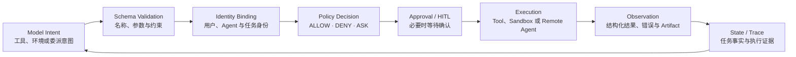
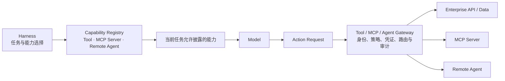
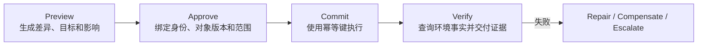
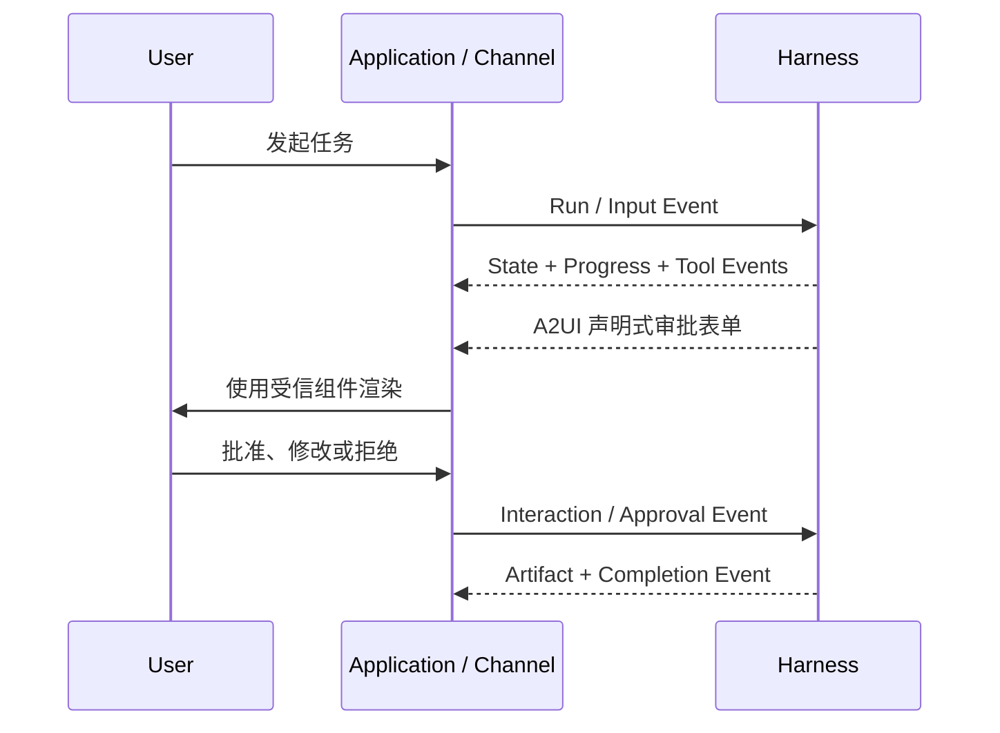
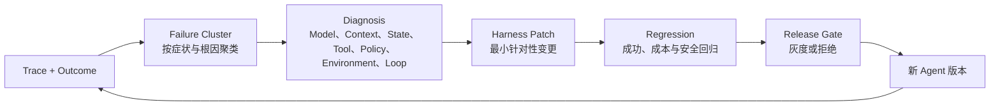

# 第 06 章　行动：受控执行、验证反馈与交付准备

模型吐出一段工具调用 JSON，本质上只是“举手提了个申请”。它既不自带当前操作人的登录身份，也不代表公司安全规则准许这么干，更不代表远程系统真按预期执行完了。真正把模型脑子里的想法安全变成外部世界事实的，是 Harness 的**行动与反馈系统**。

这套系统分成咬合在一起的两条通道：

*   **Action Plane（行动控制面）**：接管模型发出的每一步外部请求，依次过参数校验、身份绑定、权限判定、人工审批和沙箱隔离，再把原始结果洗成干净的观察事实；
*   **Feedback Plane（反馈闭环面）**：一边把进度、卡片和产物实时推给前端用户并支持断线重连和半路叫停，一边把全链路因果轨迹收拢到评估体系里，算出下一版 Harness 该改哪一行。

第 04 章解决了“什么时候行动、怎么推任务”，第 05 章解决了“行动前给模型看什么”。本章继续用同一个「**生产服务漏洞修复与变更发布 Agent**」，走完最惊险的最后一公里：仓库和扫描工具怎么接进来、代码怎么关在容器沙箱里改、为什么能自动提变更单却必须卡死线上发布审批、断网重连怎么接着看进度，以及一次越权误判怎么通过 Trace 定位并修补到下一版 Harness 里。

---

## 6.1 Harness Action Plane：从“模型想调”到“系统真执行”

### 真实痛点：工具写进 Schema 里就能随便调，改草稿的接口顺手把线上发布了

很多初级 Agent 把工具接入做成了“函数直通车”：把一堆接口描述塞进模型上下文，模型一说要调哪个函数，代码直接拿着系统全局管理员密钥发请求。这么干上线就会出两类事故：一是模型受引导或脑补误判，直接调了高危接口；二是把“生成待审批变更单”和“发布生产环境”包成一个含糊的大接口，审批规则根本分不清这次到底有没有危险。

### 核心机制：五道关口串起行动链 + 统一行动契约

**1. 区分三件经常被混为一谈的事**



走通这条链路前，心里先立死三条区别：**模型看得见某个工具**（说明描述放进了本轮 Context），不等于 **Harness 注册了该工具**（系统知道怎么接怎么解），更不等于 **当前用户和任务获得了授权**（此刻真能打向外部系统）。如果“写进工具列表”就等于“允许执行”，最小权限和阶段只读模式就全成了空话。

**2. 用统一行动契约收拢五花八门的调用方式**

不管模型发起的是普通函数调用、Shell 命令、浏览器操作还是远程委派，Harness 都应先把它翻译成统一格式的 **Action Request**：

```text
Action Request
├── action_id / task_id / parent_event_id
├── capability_id / version
├── arguments and expected output schema
├── actor: user / service / agent identity
├── purpose and current task stage
├── requested environment and resource scope
├── side-effect / reversibility / risk classification
├── idempotency key and timeout
└── approval and audit requirements
```

注意一点：模型自己写的“用途说明”只能作参考，能力名、入参类型、作用范围和调用身份必须由确定性代码解析校验。每个 Action 也有自己独立的生命周期——从发起申请（Requested）、参数校验（Validated）、授权或等待审批（Authorized / Waiting Approval）、运行中（Running）直到成功/失败/取消（Succeeded / Failed / Cancelled），接异步外部系统时还会多出已受理（Accepted）和等回调（Waiting Result）。**别把单次工具失败直接等同于整个任务失败**，任务取消时有时还得等在途动作回来后再做补偿。

执行完吐回来的 **Action Result** 也绝不能只有一段干巴巴的文本，必须带齐七项要素：明确状态（成功/失败/未知/部分完成）、给模型看的精简观察摘要、完整日志和产物的稳定引用、错误分类及是否产生副作用、实际执行身份/环境/版本/耗时、建议写入任务账本的状态补丁（统一由 Harness 提交，别让工具各自乱改状态），以及供 Verifier 使用的客观证据。大日志按第 05 章规则直接卸载，敏感字段分别脱敏后再进上下文和前端推送。

**3. 案例实景：创建变更单和执行生产发布，必须拆成两个 Action**

补丁写完、测试跑通后，千万别用一个万金油工具包办变更流程。在漏洞修复案例里，建变更单是中风险可逆操作，带好幂等键可以直接放行：

```yaml
action_id: act-241
task_id: remediation-2026-0917
capability: change.create@v3
actor:
  user: u-1842
  agent: remediation-agent@12
purpose: 为已验证的漏洞修复创建待审批变更
arguments:
  service: payment-service
  patch_ref: artifacts/remediation.patch
  evidence_refs:
    - evidence/unit-test.xml
    - evidence/security-scan.sarif
risk: medium
reversible: true
idempotency_key: remediation-2026-0917:create-change
policy_decision: ALLOW
```

而一旦模型请求发起线上发布，对应的必须是另一个独立的 **高风险行动**（`production.deploy`）：它得明确引用前面建好的变更单号和获批版本，Policy 直接拦住返回询问（ASK），把任务送进等待审批态。哪怕背后调的是同一套内部变更平台，拆开两个 Action 后，授权、审计、重试和验收立刻分得明明白白。企业封装工具就该暴露这种带业务语义的动作，而不是丢一个通用 HTTP 或万能 Shell 让模型自己拼线上指令。

### 工程取舍

不论走高代码框架自建（AgentScope 自己接企业网关）、产品化 SDK（Qoder CLI/SDK 复用内置工具和权限框架），还是云端托管执行（Qoder Cloud Agents 在托管环境运行工具），每个上线 Agent 版本都必须先签清“能调什么工具、以谁身份跑、风险定几级、超时怎么判、拿什么当证据”。如果某个高风险平台接口没法拆分只读和写操作，宁可在网关侧包一层窄接口再喂给 Agent，也不要把裸接口直接交给模型。

---

## 6.2 工具、MCP 与远程 Agent：协议各自管哪层，别硬凑乱用

### 真实痛点：把普通 API 硬包成“Agent”，把异步远程 Agent 当成同步工具调

工程上最常见两种概念混用：一是把本来两行代码就能调完的静态查库 API，硬套上一个循环壳子自称“查库 Agent”；二是去调一个外部团队维护、自己要跑十分钟的独立审计 Agent，却拿普通同步工具的超时去等它，结果连接直接断了、状态和中间产物全丢。此外，还有人误以为接上 MCP 就万事大吉、连鉴权和租户隔离都不用管了。

### 核心机制：三层协议分工 + 好工具怎么设计 + 五对象边界表

**1. Function Calling、MCP 与 A2A 各管哪一层**

*   **Function Calling**：模型和 Harness 之间的**意图表达接口**——让大脑用结构化 JSON 说清楚“我想调哪个能力、传什么参数”。
*   **MCP（Model Context Protocol）**：Harness 和工具/数据提供方之间的**标准连接协议**——让宿主能按统一方式发现和接通外部工具与资源。
*   **A2A（Agent-to-Agent）或等价 Agent API**：面对**拥有自己独立任务循环和状态的远程智能体**——传的不是单次函数入参，而是带生命周期的任务目标、异步进度、消息和产物。

记住一句大实话：**协议只解决“怎么连通、怎么说话”，不替你做授权、租户隔离和效果验收。** MCP 服务能把接口描述吐给你，不代表当前用户有权查它底下的库；远程 A2A Agent 喊一句任务完成，委派方依然要拿契约去验收。

**2. 什么样的 Tool 才算对 Agent 友好**

Tool 好不好用，不看底层 API 能不能调通，而看模型能不能一次填对参数、出事能不能被控制：名字和说明要写清业务意图和**明确不干什么**；入参 Schema 用死枚举、类型和边界，别留一坨自由字符串让模型瞎拼；输出把给程序看的机器结构、给模型看的精简摘要和原始证据引用分开；声明清楚是不是只读、有没有副作用、能不能预览和幂等重试；报错按可恢复类型稳定分类；最重要的是**把认证密钥全留在执行侧，绝不塞进工具说明或模型上下文里**。

粒度太粗（比如一个万能 `ops.exec`），没法做精确审批；粒度太细（拆成几十个琐碎微操作），模型光编排步数就出错涨费用。**最合适的粒度，正好对应一个可说清、可单独授权、可验证的完整业务动作**——比如上面 `change.create` 就要求填服务名、补丁引用、测试证据和回滚说明，并返回稳定变更单号与回查地址，让验收器直接去系统查真伪，不用从自然语言里抠字眼。

当公司内部工具多起来时，用 **Registry（能力目录）+ Gateway（统一网关）** 把元数据、版本、鉴权、限流和审计收拢到一起，Harness 按需给模型看少数相关工具即可（详见第 09 章）：



**3. 一张表分清 Tool、MCP Server、Skill、Subagent 与 Remote Agent**

| 能力对象 | 自己有独立 Loop 吗 | 里面装了什么 | 谁来扛状态和验收责任 | 在 Harness 里怎么用 |
| --- | --- | --- | --- | --- |
| Tool | 没有 | 单个可执行动作 | 调用方自己组合并验收 | 触发一次 Action Request |
| MCP Server | 没有（协议不要求） | 一组可发现的工具和资源能力 | Server 管实现，Host 管选哪几个、授什么权 | 发现后注册成标准 Tool / Resource |
| Skill | 没有 | 干某类活的步骤规范、脚本和资料 | 仍由当前 Agent 的 Loop 兜底 | 按需编进 Context 并顺带调对应 Tool |
| Subagent | 有（通常同平台承载） | 划定好边界的子任务执行者 | 父 Agent 兜总账、负全责 | 本地受控委派（Delegation），父子状态直接连通 |
| Remote Agent | 有（独立部署与治理） | 自治运行的外部智能体服务 | 对端对它承诺的子任务负责，委派方最终验收采信 | 通过 A2A 或 Agent API 建立远程异步任务 |

**4. 连接远程 Agent 时必须签齐的互操作契约**

跨系统派活给远程 Agent，除了第 04 章讲的委派逻辑，还要在协议边界钉死七件事：对方身份与版本边界；最小化任务输入与数据禁传限制（**千万别把父任务的完整 Context 打包甩过去！**）；两边任务 ID 的映射表；状态、进度、产物和报错的对应转换；超时、取消、幂等和回调规则；租户与用户身份如何委派留痕；以及拿什么证据验收。同时记住，远程 Agent 吐回来的文字和文件都是外部不可信输入，照样要做 Schema 校验和防注入检查。

### 工程取舍：按“有没有独立 Loop、要不要异步产物”挑协议

拿捏不准用哪个协议时，用三条简单规则拍板，别管哪个概念更新更火：**短平快、入参清、当场出结果 → 直接调 Tool / Function Calling；跨多个宿主平台复用工具和资源 → 接 MCP；对方有自己的长任务循环、要等异步状态和文件产物 → 走 A2A 或企业 Agent API**。放到贯穿案例里就是：读代码依赖清单用本地 Tool，连公司统一安全扫描平台用 MCP Server，派给独立安全团队维护的深度审计智能体则走 A2A 或远程任务 API。内部哪怕保留自有专有协议，也在 Harness 入口处统一转成标准行动和事件语义，别让协议差异渗进主循环里。

---

## 6.3 执行环境与 Sandbox 契约：把高危动手能力关进笼子

### 真实痛点：直接让模型在宿主机跑 Shell，一个误操作或网页投毒就能顺走密钥、删光文件

只要 Agent 不再局限于调几个写死的业务 API，而是拿到了读写文件、跑终端命令、执行代码、操控浏览器甚至桌面操作这些“通用大杀器”，风险面立刻指数级放大——路径穿越读走系统配置文件、跑测试顺手 `curl` 把内网代码传出去、或者打开一个藏了恶意提示词的网页被直接劫持浏览器会话。

### 核心机制：窄工具优先 + Environment Contract + 按任务隔离沙箱

**1. 能用窄 Tool 解决的，绝不优先放开通用 Shell 或桌面操作**

| 环境能力 | 常见用来干嘛 | 最容易出什么事 | 必须加的硬防护 |
| --- | --- | --- | --- |
| File | 读写、检索工作区文件 | 越界读写、覆盖关键文件、路径穿越泄漏配置 | 锁死根目录、白名单读写范围、变更集与版本对照 |
| Shell | 跑构建、测试、系统命令 | 执行任意恶意代码、容器逃逸、偷环境变量密钥 | 命令策略校验、非 root 降权、网络出站与资源限额 |
| Code Interpreter | 临时跑数据处理脚本、算表画图 | 拉取未知恶意依赖、死循环打满 CPU 内存 | 阅后即焚临时环境、源包白名单、CPU/内存/超时卡死 |
| Browser | 查网页资料、填后台表单 | 网页 Prompt Injection、盗用登录态、误点提交按钮 | 域名白名单、下载隔离、敏感动作确认、内容标不可信 |
| Computer Use | 操作没 API 的桌面客户端 | 视觉误点、波及整台主机、不可逆操作难撤回 | 限制可碰应用范围、屏幕与键鼠隔离、执行前预览确认 |

**2. 用一份 Environment Contract（环境契约）把依赖和隔离要求说死**

Harness 千万别默认“运行机器上肯定装好了 Node 22 或者连得通公网”，而是显式提交一份环境需求清单，交给 Runtime 去落成真实容器或虚机（环境不达标就直接在起跑前报错降级，别让模型摸黑乱试）：

```text
Environment Contract
├── image / OS / architecture
├── filesystem mounts and read-write scope
├── network egress / ingress policy
├── secret references and delegated identity
├── required tools, packages and versions
├── CPU / memory / storage / GPU quotas
├── timeout, idle policy and concurrency
├── persistence / snapshot requirement
└── audit and cleanup policy
```

按隔离强度、成本和合规要求，企业环境通常落在四种部署形态里（注意：如果走云端托管编排 + 敏感数据留内网，可以把推理调度放在云上、实际沙箱执行放在企业自托管环境里，靠稳定事件和身份契约连接，绝不把长期密钥和私域库搬上云）：

| 运行形态 | 好在哪 | 坑在哪 | 适合什么场景 |
| --- | --- | --- | --- |
| 本地工作区 | 直连本地文件和工具，延迟最低 | 各人环境五花八门，失误直接毁掉本机 | IDE 插件、个人 CLI、桌面办公助手 |
| 共享远程环境 | 省机器资源，能复用构建缓存 | 租户隔离弱、并发写撞车、容易留残留垃圾 | 内部受控的低风险研发或测试任务 |
| 托管隔离环境 | 按会话/任务一键拉起、用完即毁 | 要评估出网合规、镜像定制和企业内网打通 | 在线多租户服务、异步长任务、批量跑批 |
| 企业自托管 Sandbox | 数据和执行全程不出企业内网 | 团队得自己扛容器池容量、系统补丁和逃逸防护 | 强合规要求、核心代码库、内网生产联动 |

隔离粒度越细（从按 Agent 隔离 → 按 Session 隔离 → 按 Task 隔离 → 按单次 Action 隔离），横向污染越难，但拉起和传状态的开销也越高。多租户在线服务至少做到**按 Task 或 Session 隔离**；持久化工作区要把只读共享基础镜像和每任务独立可写层拆开。用完销毁前确认产物和证据已经转存、短时凭证已作废；恢复快照前先对一遍镜像和文件版本是否还对得上。

像 Qoder Cloud Agents 通过 Environment 声明运行配置（支持云端全隔离模式，也支持用企业自托管环境承接工具执行），而 AgentScope 可以通过可插拔的文件系统和 Sandbox 对接不同底座。下面这段 AgentScope 代码就是把漏洞修复任务关进固定 Docker 镜像的工作区里（真正上生产时，还必须把镜像标签锁成不可变摘要哈希、掐断多余出网、挂快照和并发租约锁，并接进分布式存储）：

```java
HarnessAgent agent = HarnessAgent.builder()
    .name("remediation-agent")
    .model(model)
    .workspace(workspace)
    .filesystem(new DockerFilesystemSpec()
        .image("ubuntu:24.04"))
    .build();

agent.call(message, RuntimeContext.builder()
    .userId("u-1842")
    .sessionId("remediation-2026-0917")
    .build()).block();
```

放回贯穿案例来看双保险是怎么奏效的：沙箱允许 Agent 在 `payment-service` 副本里随便改代码跑编译，但压根不注入生产集群凭证，也切断到线上生产网段的路由；发布只能走受控的 `production.deploy` 工具。就算代码仓库里藏了一段恶意注释诱导模型去跑线上发布命令，物理网络和凭证边界也能直接把它拦在门外。

**3. 密钥（Secret）和出网边界死规则**

永远别把长期密钥、Token 放进 System Prompt、工具描述、Task State 或模型读得到的环境变量里。真正需要调外部接口时，由执行层拿当前任务身份和目的现换一张**短时、窄范围凭证**，只塞给那个具体的进程或工具用完即毁，日志里只记“用了哪张授权”绝不记明文密钥。默认关掉非必要出网目标、限制协议和外发流量，网页和外部文档抓回来的东西一律标成不可信数据，高敏出站必须加额外规则或人工审批。

---

## 6.4 Permission、HITL 与安全控制：既防瞎搞，也防把审批人点麻木

### 真实痛点：要么全靠人工弹窗把值班同学逼成“盲点同意机器”，要么一句“先出草稿”被当成“准许发上线”

安全策略做不好的团队经常走两个极端：一端是图省事，动不动就抛一个高风险审批弹窗，一天弹几百次全是“要读这个文件吗”“要跑单测吗”，审批人点烦了闭眼全点同意，真夹进一次删库指令也顺手放行；另一端则是静态白名单只看工具名字不看上下文，或者把用户之前一句“可以生成草稿”当成后面所有高危动作的永久通行证。

### 核心机制：动态三元决策 + 分层 HITL + Preview/Approve/Commit/Verify + 指令数据隔离

**1. 身份记三笔账，决策看动态上下文，别拿 ASK 当万金油**

每次动作必须同时留住三类身份：是谁发起的任务、哪一版 Agent 提出的要求、由谁的运行时身份去执行的（服务身份还是用户委派身份，必须一清二楚）。权限判定绝不能只按工具名字写死白名单（同样叫“查库”，查一条测试单和导出整张用户表风险天差地别），必须结合主体、租户、任务阶段、目标资源、敏感度、影响范围、可逆性和历史审批来综合裁决，收口成三种结果：

*   **ALLOW（直接放行）**：条件符合规则直接跑，记下裁决依据；
*   **DENY（硬性拒绝）**：不管模型怎么巧舌如簧都绝不执行，同时吐回结构化的拒绝原因和允许的替代方案，免得模型傻傻撞墙；
*   **ASK（人工确认）**：仅在系统策略凭参数没法完全兜底、后果又重的节点才拦下来请人拍板——**能靠缩窄工具、卡死参数边界和沙箱解决的风险，就别动辄甩给人工审批！**

| 典型操作风险级别 | 建议的默认处置策略 |
| --- | --- |
| 读当前项目内非敏感源码或文档 | 直接放行（ALLOW），留审计记录 |
| 查当前调用人自己有权看的业务数据 | 放行，或按数据密级触发审批 |
| 在隔离工作区里改文件、跑本地测试 | 放行，保留完整代码 Diff 并支持一键撤销 |
| 发外部通知、线上发布、资金支付、批量删改 | 拦下询问（ASK）或禁止（DENY），强制预览确切影响 |
| 跨租户探查数据、企图绕过沙箱、读取长期密钥 | 坚决拒绝（DENY） |

**2. 真正值钱的 HITL 卡点长什么样**

人工介入（HITL）分三个层次：**方案批准（Plan 审批）**、**关键动作批准（Action 审批）**和**最终产出验收（结果审批）**。弹给审批人的卡片不能只有干巴巴的一句“允许调用某工具吗？”，必须亮出六样东西：打算干嘛、为什么干、顶谁的身份干、动哪个对象版本、改前改后长什么样（能否回滚），以及**这次批准只管这一次、管当前任务还是管一类操作**。人点完同意后，Harness 动真格执行前还得再验一遍对象版本有没有在等待期间被人改过。

对于不可逆或影响极重的高危动作，统一上 **Preview—Approve—Commit—Verify** 四步铁律：



如果某个动作压根不可回滚，在 Preview 阶段就必须标红写明；Commit 必须带幂等键防重；提交完必须查真实系统状态 Verify，失败了立刻走修复、补偿或升级上报，别把“请求发出去没报错”当成大功告成。

**3. 接入企业审批流与半路纠偏（Steering / Interrupt）**

在 SDK 路径里，业务系统可以通过授权回调把需要批准的工具拦下来，丢进企业自己的工单或卡片审批弹窗里（下面这段 Qoder Agent SDK 示例只预放行了只读操作，其他动作全进回调）：

```ts
import { accessTokenFromEnv, query } from '@qoder-ai/qoder-agent-sdk';

for await (const message of query({
  prompt: '读取验证报告并生成变更单；写入或提交前必须询问。',
  options: {
    auth: accessTokenFromEnv(),
    permissionMode: 'default',
    allowedTools: ['Read'],
    async canUseTool(toolName, input, context) {
      const approved = await showApprovalDialog({
        taskId: 'remediation-2026-0917', toolName, input,
      });
      if (!approved) {
        return {
          behavior: 'deny',
          message: '用户拒绝了本次操作，请保留草稿并说明未完成项。',
          toolUseID: context.toolUseID,
        };
      }
      return { behavior: 'allow', updatedInput: input,
               toolUseID: context.toolUseID };
    },
  },
})) publish(message);
```

记住两条血泪底线：**第一**，回调只是前端收集用户点没点头，企业后端在真执行前必须拿着当前登录态、租户、资源版本和 Policy 再做一次确定性校验；**第二**，对线上发布这类单次动作，审批通过只能换来一张“一次性的、锁死目标对象”的短时授权，**千万别因为批准了一次就把整个会话切换成“以后什么都直接放行”的模式！**

人工控制除了卡在审批点，还包括跑半截时的**随时插话纠偏（Steering）和紧急刹车（Interrupt）**。用户半路发来“别改 A 模块了，先保核心交易”，不能只是随手塞到长对话尾巴上（可能早排进执行队列的旧计划根本不管它），必须当成高优先级事件交给状态机在安全点先落盘更新 Task State，顺带废掉失效的旧计划和后台子任务，再重建 Context 往下跑。

**4. Guardrail 与防 Prompt Injection（提示词注入）**

输入输出护栏（Guardrail）和语义风险分类器有用，但绝不能拿它们当唯一安全底线——能写死成权限规则和沙箱隔离的，全靠硬代码防住；护栏负责识别复杂语义欺诈和敏感外泄风险。

防 Prompt Injection 的头号铁律是“**指令与数据物理分家**”：网页、邮件、工单正文、外部文档、第三方 MCP 返回和远程 Agent 传来的内容，全部属于**不可信外部数据**，无论里面写了多像圣旨的命令，都绝不能改写平台安全边界、扩大授权范围或解锁新工具；高风险数据外传和变更必须走独立强授权，极高危场景下甚至要把“读不可信材料”和“有写权限去执行”拆进两个隔离阶段里做（详细威胁模型与安全治理见第四篇《治理篇》）。

---

## 6.5 Streaming、Channel 与交互协议：让用户看得见、等得起、随时接得上

### 真实痛点：长任务转菊花二十分钟最后只吐一段总结，断网刷新就没了，还把内部调试报错漏给客户

企业长任务动辄跑几分钟到几十分钟，如果只憋到最后吐一句大段总结，用户根本不知道卡在哪了、是不是在等自己审批，想中途止损都来不及；可如果图省事把底层所有原始事件直接透传前端，既经不起断网重连，又容易把隐藏思维链、敏感调试日志和底层密钥线索全广播给了无权限的旁观者。

### 核心机制：八类语义事件流 + 渠道适配 + 断线续传与身份视图投影

**1. 推给外界的不是原始日志，而是八类脱敏后的任务语义事件**

模型内部隐藏思考过程没必要原样流式吐给业务前端，真正有用的是经过脱敏和结构化的八类语义事件：

| 事件类别 | 里面带什么 | 前端或业务方拿它干嘛 |
| --- | --- | --- |
| Text | 可见文本增量、阶段小结 | 实时打字展示给用户的解释说明 |
| Progress | 当前处于哪一关、待办进度、百分比 | 画出进度条，告诉用户活干到哪了 |
| Tool | 工具调用意图、执行状态、紧凑结果 | 展示正在查什么、改什么、哪步挂了（已脱敏） |
| State | 运行中、等审批、暂停、已完成等 | 同步驱动网页状态徽章和业务任务流 |
| Approval | 预览 Diff、风险项、操作选项 | 直接渲染出让用户点击确认/驳回的审批控件 |
| Artifact | 补丁、报告、链接和版本号 | 交付可点开审阅的正式产物 |
| Error | 归类后的报错、能不能重试、建议动作 | 指导自动重连、转人工或友好报错 |
| Usage | Token 消耗、费用、剩余预算 | 展示成本与预算预警 |

**2. Channel（渠道层）和 AG-UI / A2UI 怎么配合**

Web、App、IDE、CLI 或企业微信/飞书这些入口，靠 **Channel 适配层**去对接——记住它只干翻译和接续的活（做身份映射、把消息线程绑到 Session 和 Task、把卡片按钮转成输入事件、切设备登录时保持任务连续、按渠道规则限流脱敏），**绝不能把状态只存在某个聊天软件的线程里**。跨端接力的秘诀就在第 05 章讲过的“Session 与 Task 分离”：人在 IDE 里拉起的修复任务，半路离开工位用手机 IM 也能接着点审批。

前端交互协议上，**AG-UI** 管的是“Agent 和应用之间怎么双向流式传生命周期、文本、工具和中断事件”；**A2UI** 管的是“Agent 怎么吐出声明式的安全界面组件（表单、审批卡、列表），让客户端用本地受信组件库渲染，而不是冒险执行模型生成的前端代码”。两者各干各的，经常把 A2UI 的界面描述放进 AG-UI 事件里一起发给前端：



**3. 断线、背压、取消与“不同人看不同面板”**

流式通道必须按“随时会断网、客户端会重连、网速快慢不一”来设计：每条事件带单调序号或可恢复游标，重连按最后确认位置补拉并做好幂等去重；碰到网络背压时，高频文字流和琐碎工具日志可以合并采样丢弃，**但状态跃迁、审批卡片、产物和终态事件一条都不能丢**；用户点取消时，前端要分清“系统已收到取消指令”和“底层容器/动作已经安全停下”。

更重要的是**按身份做视图裁剪**：研发在管理台里能看到完整工具参数和调用链，普通客户侧只展示脱敏后的业务进度，审批人能看到受影响对象清单，围观同事只能看见“等待审批中”。同一股事件流出去前，必须按接收者身份和渠道能力生成对应视图。

**4. 案例实景：云端托管 Session 的流式监听与审批接续**

在云托管（Managed Agents）路径下，应用自己不维护执行循环，核心就是接稳云端会话事件流。下面这套 Qoder Cloud Agents 的双终端命令演示了实战接法（终端 A 建好 Session 并确认 SSE 返回 HTTP 200 后，再在终端 B 发任务）：

```bash
# 终端 A：创建 Session，并保持 SSE 连接
set -euo pipefail
SESSION_ID=$(curl -fsS -X POST \
  "$QODER_API_BASE_URL/api/v1/cloud/sessions" \
  -H "Authorization: Bearer $QODER_ACCESS_TOKEN" \
  -H "Content-Type: application/json" \
  --data "$(jq -nc --arg agent "$AGENT_ID" --arg env "$ENV_ID" \
    '{agent: $agent, environment_id: $env}')" | jq -er '.id')
printf 'SESSION_ID=%s\n' "$SESSION_ID"

curl -fsS -i -N \
  "$QODER_API_BASE_URL/api/v1/cloud/sessions/$SESSION_ID/events/stream" \
  -H "Authorization: Bearer $QODER_ACCESS_TOKEN" \
  -H "Accept: text/event-stream"

# 以下在终端 B 执行，保持终端 A 的连接运行。
# 确认 A 已返回 HTTP 200 和 Content-Type: text/event-stream 后再提交。
# B 使用相同的 QODER_API_BASE_URL 和 QODER_ACCESS_TOKEN。
SESSION_ID="sess_替换为终端A输出的完整ID"
curl -fsS -X POST \
  "$QODER_API_BASE_URL/api/v1/cloud/sessions/$SESSION_ID/events" \
  -H "Authorization: Bearer $QODER_ACCESS_TOKEN" \
  -H "Content-Type: application/json" \
  --data '{"events":[{"type":"user.message","content":[{"type":"text","text":"生成可审批的漏洞修复变更，不要直接发布"}]}]}'
```

对接云端流式事件时，有几个极关键的协议细节必须按规矩来，千万别猜：

| 场景或事件 | 协议里的关键字段 / 类型 | 业务应用必须怎么处理 |
| --- | --- | --- |
| 常规运行推进 | `session.status_running`、`agent.message`、`agent.tool_use`、`agent.tool_result` | 映射成自身进度 UI，处理完一条就存好事件 ID；断线带 `Last-Event-ID` 续连，缺的调 List Events 分页补并按 ID 去重 |
| 会话进入空闲 | `session.status_idle` | **不能一见空闲就当任务圆满结束！** 先看是不是等交互，再验真实产物和业务标准 |
| 卡在等确认/等客户端动作 | 空闲事件的 `stop_reason.type` 为 `requires_action` | 对应本文抽象的 `WAITING_APPROVAL` 态；读取 `stop_reason.event_ids` 处理待响应动作 |
| 确认内置/MCP 工具调用 | 回传 `user.tool_confirmation` | 必须用 `tool_use_id` 精确关联原请求（绝对不能发一条普通 `user.message` 混过去） |
| 客户侧自定义工具执行完 | 回传 `user.custom_tool_result` | 业务侧跑完审批和执行后，用 `custom_tool_use_id` 精确关联回传（发布仍走企业工具和审批系统） |

---

## 6.6 Observability、Evaluation 与从 Trace 到补丁闭环

### 真实痛点：线上出了越权或漏改事故，团队唯一会的一招就是“在 Prompt 里再加一句请小心”

一个线上 Agent 突然把事情搞砸了，常见事后动作是开发者看一眼最终输出，在系统提示词末尾加上一句“千万不要未经审批发布”。结果过两天又在另一个角落翻车，或者把正常流程也搞僵了——因为根本没查清当时模型眼前到底看到了什么上下文、哪条策略放过了它、哪个工具报错被吞了，也没拿评估集验过这次改动有没有把别的功能改坏。

### 核心机制：因果级 Task Trace + 三层评测 + Trace-to-Patch 闭环

**1. 因果级 Task Trace：把决定、上下文、行动和结果串成一条链**

Trace 绝不能只是一堆按时间排的“模型问与答日志”，必须能在出事后反推出因果链：**哪一版 Agent 和 Harness、拿着哪份 Context Manifest、依据什么状态和计划、为什么做出这次模型判断、走了哪条权限审批、调用哪个环境和工具、花了多少成本、拿了什么验证证据，最后业务结果到底成没成**。

```text
Task Trace
├── Agent Version / Model / Harness Version
├── Session / Task / Parent-child topology
├── Context Manifest and compaction decisions
├── Plan / Todo / state transitions
├── Model calls, latency, token and cost
├── Action Requests, policy and approvals
├── Tool / Environment / Remote Agent results
├── Workspace changes and Artifacts
├── Retry, downgrade and failure classification
├── Verifier results and completion evidence
└── Business Outcome and user feedback
```

所以在构建期，就得在 Loop 每一步、Middleware、工具、子代理、环境和验收器上埋好统一的 Span 和关联 ID（明确哪些默认采集、哪些仅调试模式录、敏感原文如何脱敏或加密只留摘要、采样策略如何保证出错/高危/长尾任务 100% 留存、跨进程和远程 Agent 如何透传 Trace Context）。构建期不把这些字段和版本钩子埋好，后面上线治理篇根本没法做归因。

**2. 分清“单次过关门禁”和“跨版本跑分评估”**

| 对比维度 | Agent Harness 内的 Verifier | 独立的 Evaluation Harness |
| --- | --- | --- |
| 干什么用的 | 卡住“这一次具体任务”到底能不能交差 | 用同一把尺子回放和比对“两个版本谁更好、有没有退化” |
| 吃什么进来 | 当前任务的目标、上下文、能力和环境状态 | 固定评测数据集、环境镜像、预算、评分器和待测 Agent 版本 |
| 吐什么出去 | 这一单的轨迹、产物、铁证和任务结论 | 全局指标、失败聚类、版本对比差异和发版准入建议 |

注意：**Evaluation 跑对比时，必须锁死或披露模型、推理参数、Harness、工具版本、预算、重试、环境和评分标准**，否则分数涨了也不知道是改得好还是刚好换了测试环境。另外也别把昂贵的离线发布评估器塞进每次线上真实执行路径里。

评测对象一定要拆成**单步、轨迹、最终结果**三层看——只看最终结果，可能放过“绕远路烧十倍钱甚至顺手越权一次但最终猜对了”的危险轨迹；只看单步，又容易错杀模型合理的探索试错。真正要盯紧的是按任务类型和风险分层的综合指标（成功率、交付质量、人工接管率、工具报错率、安全越权事件、延迟和成本），并且别把用户点赞直接当唯一真值，要结合真实环境证据看。

**3. 从线上失败到下一版 Harness Patch 的正经解法**



看清图里的精准归因对照关系——**病在哪一层，补丁就打在哪一层，只有确认大脑实在带不动了才换模型**：

*   漏看关键信息了 → 改 Context 编译规则或 Knowledge 权限过滤；
*   老踩同一个历史偏方 → 清理并修正 Memory 写入门禁；
*   稳定流程老做错步骤 → 抽出或修补 Skill 和脚本；
*   工具传参总写错或权限漏放 → 改 Tool Schema 描述或收紧 Policy；
*   原地转圈不前进 → 调优 Loop 无进展刹车或 Planning 门禁；
*   容器缺这少那 → 修复 Environment Contract；
*   没做完就喊收工 → 加硬 Verifier 检查项。

**案例复盘：一次“把批准写草稿当成批准线上发布”的事故怎么修**

顺着因果级 Trace 往回一查，瞬间水落石出：

```text
Context Manifest
  └── 包含“可以生成变更”的用户回复
Model Decision
  └── 请求 production.deploy
Policy Decision
  └── 仅按 Tool 名称匹配，错误返回 ALLOW
Action
  └── 发布因目标环境无权限而失败
Outcome
  └── 任务未造成生产变更，但触发高风险越权事件
```

最蠢的修法是在 Prompt 里多加一句“请谨慎发布”；**真正治本的 Harness Patch** 是把生成变更单和生产发布彻底拆成两个独立 Action，在策略层强校验线上发布必须同时核对“批准类型、具体变更单对象版本、目标环境和一次性短时授权”，并且把“草稿获批绝不得推导为发布获批”做成确定性回归用例。接着把**原失败用例、相邻正常用例（合法新建草稿和合法发布）以及 Prompt Injection 对抗用例**放进同一套回归集跑一遍，确保把漏洞堵死的同时，没有把正常任务全卡死在无尽审批里。等将来主力模型升级时，还可以回头清掉旧版 Harness 里针对老模型的冗余拐杖规则。

### 工程取舍：四条构建路径如何接上统一评估闭环

不管前面第 03 章选了哪条路起步，最后都能接进同一个观测与优化大盘里用同一套标准打分：

| 构建路径 | 漏洞修复案例里的行动与反馈重点 | 企业依然必须亲手兜住的底 |
| --- | --- | --- |
| 自己用高代码框架搭 | 自定义 Tool/MCP、Docker 沙箱、权限 Middleware、全链路 Trace 埋点，业务调优空间最大 | Action 契约、沙箱隔离质量、策略精度、观测字段、Verifier 和最终业务效果 |
| 嵌入现成 CLI·SDK 与工作区助手 | 复用成熟工具循环、权限模式和事件流；用 `canUseTool` 接进自有审批，靠共享 Session 存储多机接续 | 租户网关、业务工具封装、共享任务状态、审批后端和结果回流 |
| 交给云端托管执行 | 用 Agent、Environment、Session、Event 托管运行，靠 SSE 接进渠道和监控，在限定轮次内评估修订 | Agent 规格、企业工具与数据边界、任务映射、业务验收标准、审批流程与跨版本评估 |
| 云平台低门槛拼装 | 在平台内直接组合 Agent 定义、模型、Skill、MCP 和凭证，复用预置沙箱、渠道和 Trace，走平台评估和灰度发版 | Agent 版本归属、能力与数据授权边界、业务 Task 映射、验收门槛和跨版本回归 |

像**阿里云 Agent 观测与优化 AgentLoop** 这类评估与调优平台，就是架在这四条路径头上的“统一裁判”：不管下面跑的是自研框架、产品化 SDK、云托管会话还是平台拼装出的版本，只要交上带版本号的 Trace、业务 Outcome 和评测用例，就能在同一把尺子下公平比对哪个版本真正更稳、更省、更安全（完整闭环实践见调优篇）。

---

## 6.7 本章小结

这一章把模型脑子里的想法真正安全地落到了外部世界：**Action Plane** 用“参数校验 → 身份绑定 → 策略裁决（ALLOW / DENY / ASK）→ 人工审批 → 沙箱执行 → 结构化观察与 Trace”六道关，把意图变成受控事实；**Function Calling、MCP 与 A2A** 各司其职，分清了单个工具、协议连接和自治远程智能体的边界；**Environment Contract 与 Sandbox** 把文件、终端和浏览器动作关进笼子，把长期密钥彻底藏在模型视线之外；**分层 HITL 与 Preview—Approve—Commit—Verify** 既防住了越权灾难，也避免把审批人点麻木；**语义事件流、Channel 与 AG-UI / A2UI** 让跨端交互断网不丢、千人千面；最后靠**因果级 Task Trace 和三层 Evaluation Harness** 把线上每笔翻车变成精准可验证的下一版补丁。

至此，《构建篇》全部收官：做好一个能打的企业级 Agent，靠的不是一段神奇的提示词，而是**选对责任匹配的构建入口，再把任务、信息、行动三套 Harness 工程契约做扎实**。下一篇《运行篇》，我们将深入分布式调度、持久状态存储、AI 网关、沙箱运行时与多 Agent 协作，看看这套系统在真实生产流量里如何扛住高并发与长期演进。
