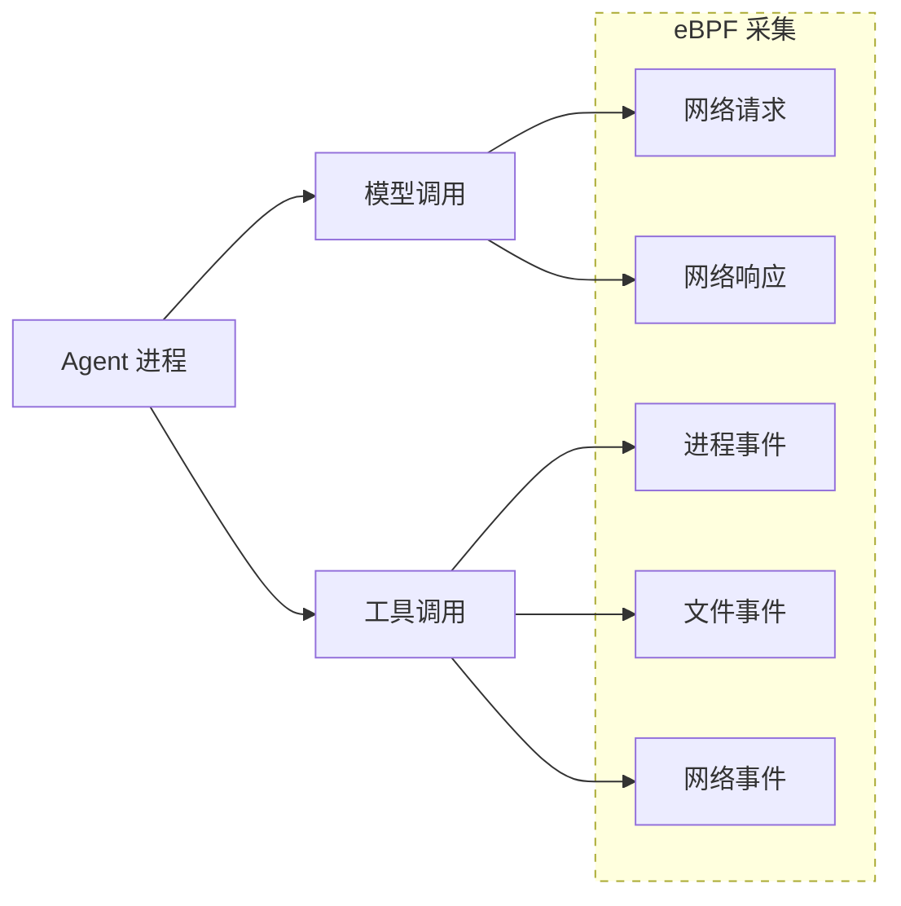
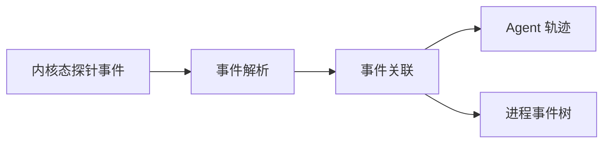

# 第 13 章　Agent 的可观测性

## 13.1 为什么“服务返回 200”救不了 Agent 排障

### 真实痛点：传统监控看不懂 Agent 的翻车现场

做传统微服务时，团队盯着 QPS、HTTP 5xx 错误率和接口 P99 耗时，基本就能判断系统健不健康。但把 Agent 放到线上之后，值班同学很快就会发现这套老办法失灵了，最常见的翻车现场有四类：

*   **接口返回 200，业务却搞砸了**：请求没报错，链路也没超时，但认知大脑 `Model` 推理跑偏、知识检索没找对文档、或者工具传错参数，结果用户拿到的是错误答案，甚至数据库被错改了。“请求成功”根本不代表“任务成功”。
*   **每次执行走的路线都不一样**：传统接口调用链基本固定，而一次 Agent 任务会现场决定调几轮模型、并发几个工具、要不要拉起子 Agent、什么时候暂停等人工审批。没有动态链路视图，事后根本还原不出它当时怎么想、怎么干的。
*   **单个步骤没毛病，合在一起却在空转或卡死**：单看一次模型调用耗时正常、返回格式也对，但放回整个会话才发现它在原地重复调同一个工具十几次；或者问题压根不在业务代码，而是同批别人一条超长请求把推理引擎的 GPU 算力卡死了。
*   **能改代码的应用和黑盒工具混在一起**：有的 Agent 是自己用 Python/Java 写的，能随便加埋点；有的却是直接采购或本地跑的 Coding Agent（如 Claude Code、Codex、Qoder），根本改不了源码；同时 Prompt、工具参数和检索原文动辄几万 Token，还夹带密码和用户隐私——全量采集存储成本爆炸且泄密风险极高，不采又完全没法定位问题。

因此，生产阶段的 Agent 可观测性必须同时回答四个问题：**Agent 到底执行了什么、问题出在哪一步、时间和钱花在哪个环节、哪些现象是基础设施拖累的**。需要说明的是，本章只关注生产运行期的可观测性，既不是模型训练期间的 Loss 监控，也不是用大模型去分析传统运维告警的 AIOps。目前社区已有 [OpenTelemetry GenAI Semantic Conventions](https://github.com/open-telemetry/semantic-conventions-genai/blob/main/docs/gen-ai/README.md) 正在沉淀通用规范，工程落地时应先兼容这类开放标准，再按需补充业务与运行时语义。

### 看什么、看哪里：四个维度与三层观测对象

为了避免把监控指标铺成一地鸡毛，动手采集前先对齐一张“观测地图”：

*   **看什么（四个观测维度）**：
    1. **运行表现**：任务到底办成没有，输出是否靠谱；
    2. **稳定性与性能**：报错、超时、重试、死循环和慢步骤出在哪里；
    3. **成本与效率**：Token、模型和工具调用花掉了多少钱，有多少是无效空转；
    4. **行为审计**：关键操作是谁在什么授权下发起的，实际改了什么外部状态，事后能不能复核。
*   **看哪里（三层观测对象）**：
    1. **任务与交互层**：用户请求、消息轮次、会话（Session）和业务任务（Task）；
    2. **Agent 执行层**：编排逻辑、模型调用、检索、记忆读写、工具执行、安全护栏（Guardrail）和人工审批；
    3. **AI 基础设施层**：AI 网关、推理引擎（如 vLLM/SGLang）、隔离执行空间 `Sandbox` 沙箱，以及底层的 Pod 与 GPU 资源。

## 13.2 三路采集架构：让自研代码、黑盒 Agent 与沙箱都能开口说话

### 整体采集架构：多路入口，统一汇聚


从上图可以看出，既然自研 Agent、桌面 Coding Agent、AI 网关和底层沙箱暴露信息的口子完全不同，就不该指望靠某一个 SDK 一网打尽，而是**让四类对象走最适合自己的采集方式，在统一处理层对齐语义后再分头落库**：

1. **被观测对象与采集接入层**：能改代码的高代码 Agent 用应用内埋点或自动插桩；改不了代码的 Coding/通用 Agent 靠生命周期 Hook、本地会话日志适配器加独立 Daemon；AI 网关与推理引擎直接吐原生遥测；MCP 工具、沙箱、Pod 和 GPU 则结合运行时事件与内核级 eBPF 补齐“底层到底干了啥”的铁证。
2. **统一处理层**：各地探针统一走 OTLP 等标准协议汇入采集网关，在这里集中做批处理、字段语义对齐、上下文关联、采样和敏感信息脱敏，避免不同框架报上来的字段各唱各调。
3. **存储与消费层**：不要强求所有数据塞进一张表。Trace、Metrics 和日志事件各有各的存储库，靠稳定的关联标识串在一起做下钻排查。

三类遥测信号在工程上各有明确分工，**千万不要混用**：

*   **Trace（调用链）**：串联单次活跃执行的因果树，从入口一直穿到模型、工具、AI 网关、推理引擎和沙箱里的真实子进程与文件/网络操作。
*   **Metrics（聚合指标）**：看请求量、错误率、延迟分位、Token 与成本趋势。**硬禁忌**：指标标签只放模型、应用、工具类型、环境等低基数维度，绝对不要把 Session ID、Trace ID、tool-call ID 或用户 ID 塞进指标标签，否则时序数据库会直接被打爆。
*   **日志与事件**：留存错误栈、策略命中明细、文件读写、网络连接等海量细碎细节，挂上 Trace ID 和实例 ID，供需要时从调用链里点开下钻。

### 路数 A：高代码应用的三种接法

自研或基于 LangChain、LangGraph、AgentScope 等框架开发的应用，最适合从代码和框架内部入手，把一次执行还原为 `ENTRY → AGENT/WORKFLOW → STEP → LLM/RETRIEVAL/TOOL` 的清晰父子结构。需要跨多个步骤透传的字段（如租户、会话、渠道、实验分组）在入口写入 Baggage 顺着链路往下带，单步私有细节只留在对应 Span 上。

Python 应用通常有三种具体接法，从“语义最准”到“改动最小”递进：

#### 方式一：用 LoongSuite GenAI Utils 手动埋点

自研编排循环或尚未被探针适配的框架，推荐直接使用开源的 [LoongSuite GenAI Utils](https://github.com/alibaba/loongsuite-python/blob/main/util/opentelemetry-util-genai/README-loongsuite.rst)。它在 OpenTelemetry SDK 之上预先封装好了 Entry、Agent、ReAct Step、LLM、Tool、Retrieval、Memory 等语义操作，不用每个团队自己拍脑袋定字段名。

为了防止正文漏泄隐私或把遥测库撑爆，**LoongSuite GenAI Utils 默认不采集 Prompt 和模型回复原文**，只在完成脱敏、权限和保留周期评估后按需开启。下面这段代码展示了标准的 `with` 上下文嵌套写法：

```python
from opentelemetry.util.genai.extended_handler import (
    get_extended_telemetry_handler,
)
from opentelemetry.util.genai.extended_types import (
    EntryInvocation,
    ExecuteToolInvocation,
    InvokeAgentInvocation,
    ReactStepInvocation,
)
from opentelemetry.util.genai.types import (
    InputMessage,
    LLMInvocation,
    OutputMessage,
    Text,
)


def run_task(request):
    # 在 Provider 初始化完成后再获取 Handler，避免模块导入期绑定到默认 Provider
    handler = get_extended_telemetry_handler()

    entry = EntryInvocation(
        session_id=request.session_id,
        user_id=request.user_id,
    )
    with handler.entry(entry):
        # 决定 Span 名称与 Baggage 的字段必须在创建 Invocation 时传入
        agent = InvokeAgentInvocation(
            provider="dashscope",
            agent_name="order-agent",
            input_messages=[
                InputMessage(
                    role="user",
                    parts=[Text(content=request.text)],
                )
            ],
        )
        with handler.invoke_agent(agent):
            step = ReactStepInvocation(round=1)
            with handler.react_step(step) as current_step:
                llm = LLMInvocation(
                    provider="dashscope",
                    request_model="qwen-plus",
                    input_messages=[
                        InputMessage(
                            role="user",
                            parts=[Text(content=request.text)],
                        )
                    ],
                )
                with handler.llm(llm) as current_llm:
                    response = call_model(request.text)
                    # 结果类字段在退出上下文前写回 Invocation
                    current_llm.output_messages = [
                        OutputMessage(
                            role="assistant",
                            parts=[Text(content=response.text)],
                            finish_reason=response.finish_reason,
                        )
                    ]
                    current_llm.input_tokens = response.input_tokens
                    current_llm.output_tokens = response.output_tokens

                tool = ExecuteToolInvocation(
                    tool_name="query_order",
                    tool_call_arguments={"order_id": request.order_id},
                )
                with handler.execute_tool(tool) as current_tool:
                    result = query_order(request.order_id)
                    current_tool.tool_call_result = result

                current_step.finish_reason = "completed"
            return result
```

真实工程里写手动埋点有三个容易栽跟头的细节：

1. **流式响应别提前关 Span**：做装饰器或上下文包装时，如果函数返回的是生成器或异步流，不能刚返回迭代器就退出 `with` 上下文，必须等流真正消费完、被取消或抛异常再收尾；首 Token 延迟（TTFT）要在首个有效文本块到达时记录。
2. **异步和并行靠运行标识串，别靠线程号**：接入框架原生生命周期回调时，要拿框架提供的运行标识和父运行标识（`run_id` / `parent_run_id`）维护上下文，不能绑在线程号上，否则并行工具或异步协程一来就会串链。
3. **Web 入口打好根锚点**：在 WSGI/ASGI 中间件里调入口 Span，把会话 ID、用户 ID 放进 Baggage，配合上下文处理器自动传给后续子 Span。

#### 方式二：启动命令零侵入自动插桩

如果应用用的是主流 Web 框架、数据库驱动、模型 SDK 或常见 Agent 框架，可以使用开源 [LoongSuite Python](https://github.com/alibaba/loongsuite-python) 在启动进程时自动挂载探针，无需大改业务代码：

```shell
pip install loongsuite-distro opentelemetry-exporter-otlp
loongsuite-bootstrap -a install --latest --auto-detect
export OTEL_SERVICE_NAME=order-agent
export OTEL_EXPORTER_OTLP_ENDPOINT=http://otel-collector:4317
export OTEL_EXPORTER_OTLP_PROTOCOL=grpc
loongsuite-instrument --traces_exporter otlp python app.py
```

这种方式用起来省事，但要注意两点：一是使用 Uvicorn、Gunicorn、uWSGI 或 gevent 等多进程/协程启动器时，必须在预发环境实测探针初始化顺序，防止 fork 后丢数据或卡死；二是自动插桩只知道“调了哪个模型接口”，不知道“当前处于哪个业务阶段、任务算不算成功”。如果是自研小众框架，可基于 OpenTelemetry 的 `BaseInstrumentor` 包装稳定入口并处理同步、异步、流式、异常和取消五条路径。

#### 方式三：Kubernetes 集群级自动注入

当集群里有几十上百个多团队维护的服务时，逐个改 Dockerfile 和启动命令不现实，可以上 [OpenTelemetry Operator](https://opentelemetry.io/docs/platforms/kubernetes/operator/automatic/) 或阿里云 [ack-onepilot](https://help.aliyun.com/zh/ack/product-overview/ack-onepilot) 这类集群级注入组件，靠 Pod 注解或标签在创建阶段把多语言探针注进去。注意它解决的只是“探针怎么发下去”，采集能力和版本兼容边界与方式二完全一样；而且极短寿命的脚本任务或禁止 init 容器的受限环境不适合走注入，上线前还得盯一下初始化容器的启动耗时和内存配额。

三种接法的工程取舍如下：

| 接入方式 | 覆盖范围 | 业务语义表达力 | 适用条件与落坑点 |
| --- | --- | --- | --- |
| LoongSuite GenAI Utils 手动埋点 | 入口、Agent、推理轮次、模型、检索、记忆与工具 | 最强：能写清目标、阶段与业务结果 | 需改代码；重点管好流式生命周期、异步上下文和去重 |
| 进程启动自动插桩 | 主流 Web/HTTP/DB/模型 SDK/Agent 框架 | 中等：技术属性全，但缺业务阶段语义 | 改依赖和启动命令；注意启动器兼容与依赖版本范围 |
| K8s 集群级自动注入 | 批量为容器工作负载下发多语言探针 | 与进程插桩相同，可叠加少量手动埋点 | 需集群权限；不适合短生命周期或受限工作负载 |

**落地经验**：生产上不要执着于“纯零代码”，“**自动插桩采通用底座 + 手动埋点补业务入口与阶段语义**”往往性价比最高。只要牢记一条铁律：**同一个进程只保留一套 TracerProvider；探针已经为某次模型或工具建了 Span，手动埋点就只往当前 Span 补属性，千万别再套一层重复的 LLM 或 Tool Span**。

### 路数 B：Coding 与通用 Agent 的采集（Hook + 独立 Daemon）

到了 Qwen Code CLI、Qoder 系列（Qoder IDE、Qoder CN、Qoder for JetBrains、Qoder CLI、Qoder Work、Qoder Work CN）、Qwen Work CN、Claude Code、Codex、Cursor、Cursor CLI、Grok Build、Kiro CLI、OpenCode、MiMo Code、Pi Coding Agent、DeepSeek Harness、OpenClaw、Hermes Agent、WorkBuddy、Wukong 这类 Coding 或桌面通用 Agent，工程团队往往改不了它的内部源码，只能从外部插件、生命周期 Hook 和本地会话文件（transcript / SQLite）下手。

目前开源的 [LoongSuite Pilot](https://github.com/alibaba/loongsuite-pilot) 已经给出了一套成熟的解法：**Agent 侧放轻量适配器，后台跑独立 Daemon**。先看三类采集入口的适用范围：

| 采集入口 | 能拿到什么证据 | 工程边界与典型实现 |
| --- | --- | --- |
| 原生插件 / 扩展回调 | 模型请求响应、工具起止、状态 | 结构化最稳，但受限于产品插件 API 开放程度，如 [OpenClaw 插件](https://github.com/alibaba/loongsuite-pilot/blob/f6632f28d06ff2e158c20e7f1c1c73c1ceae48c0/assets/plugins/openclaw/plugin.mjs) |
| 生命周期 Hook | 用户输入、工具触发、子 Agent 与轮次结束通知 | 适合打点或写唤醒信号，不能假设 Hook 里自带 Token 用量；如 [Qwen Code CLI](https://github.com/alibaba/loongsuite-pilot/blob/f6632f28d06ff2e158c20e7f1c1c73c1ceae48c0/assets/hooks/qwen-code-cli-hook-processor.mjs) 与 [Claude Code](https://github.com/alibaba/loongsuite-pilot/blob/f6632f28d06ff2e158c20e7f1c1c73c1ceae48c0/assets/hooks/claude-code-hook-processor.mjs) |
| 本地 transcript / 日志 / DB | 完整消息、原生调用 ID、模型名、Token 明细 | 靠文件偏移或游标增量读取，需抗延迟落盘、文件轮转和半行写入；如 [Codex](https://github.com/alibaba/loongsuite-pilot/blob/f6632f28d06ff2e158c20e7f1c1c73c1ceae48c0/src/inputs/codex-transcript/codex-transcript-input.ts) 与 [Qoder](https://github.com/alibaba/loongsuite-pilot/blob/f6632f28d06ff2e158c20e7f1c1c73c1ceae48c0/src/inputs/qoder-trace/token-enricher.ts) |


*图 13-2　Coding 与通用 Agent 观测数据采集架构（根据 LoongSuite Pilot 实现绘制）*

图 13-2 展示了适配器与 Daemon 的协作分工：适配器贴着 Agent 运行环境走，负责触发唤醒和落地轻量记录；重活（增量扫描、跨来源字段拼装、脱敏过滤、批量上报与重试）全丢给独立 Daemon。同时，“把探针装上去、出事修复”的集成管理动作，和“输入有没有事件、输出成不成功”的采集健康状态监控彻底拆开。

在把多源事件归一化为遥测事件（详见 [输出事件 Schema](https://github.com/alibaba/loongsuite-pilot/blob/f6632f28d06ff2e158c20e7f1c1c73c1ceae48c0/docs/zh-CN/output-event-schema.md)）再转成 Trace 的过程中，图 13-3 展示了一个标准映射样例——这也是踩坑最多的地方，以下五条踩坑清单务必提前防住：


*图 13-3　遥测事件到 Trace 的映射示例（根据 LoongSuite Pilot 事件模型与转换流程绘制）*

1. **Hook 千万别阻塞主流程**：如果在 Stop Hook 里顺带解析大体积 transcript 再同步发网，一旦网络抖动就会直接把用户的终端卡死。Hook 只管快速落标记或设严格超时，解析上报交给 Daemon 异步做。
2. **多源融合认 ID 不猜时间，Token 别算重**：Hook 和 transcript 经常观察到同一次模型或工具调用，必须优先用原生请求 ID、工具调用 ID 去重合并，只拿时间邻近当辅助校验；转换 Trace 时剔除兼容副本（如输入类的重复事件）；如果服务端返回的输入 Token 总量已经含缓存读写，汇总千万别再叠加一遍；拿不到用量就老实标缺失，绝不填零。
3. **模型答完 ≠ 一轮结束，别用落盘时间冒充耗时**：模型吐完字后面还可能跟着工具执行、重试或子 Agent，必须看运行级终止记录判定轮次结束；如果只有 transcript 落盘时间戳，必须老实标明这是记录时刻，不能当成精准的模型推理延时或 TTFT。
4. **本地游标不等于后端必达**：Pilot 的[常规 Input](https://github.com/alibaba/loongsuite-pilot/blob/f6632f28d06ff2e158c20e7f1c1c73c1ceae48c0/src/inputs/base/base-input.ts)在发出事件后就会推进本地读取游标（需处理文件截断、末尾半条记录和并发 Hook 原子写，注意这只是采集进度，不是业务级安全点 Checkpoint），并不等远端确认写库；对“一条也不能丢”的场景，必须额外配持久化发送队列和后端幂等去重。
5. **内容采集先审后开**：Pilot 的[默认配置](https://github.com/alibaba/loongsuite-pilot/blob/f6632f28d06ff2e158c20e7f1c1c73c1ceae48c0/src/normalization/agent-config.ts)默认打开了消息正文采集，而[内容过滤策略](https://github.com/alibaba/loongsuite-pilot/blob/f6632f28d06ff2e158c20e7f1c1c73c1ceae48c0/src/normalization/agent-content-policy.ts)在输出前生效。生产接入时一定要显式收窄采集范围，对代码、工具参数、结果和密钥做脱敏与截断，多模态附件走受控引用。验收时拿真实多轮对话、并行工具、取消、报错、子 Agent 派发和进程重启场景，对照原始日志和最终 Trace 逐项核对。

### 路数 C：内核层 eBPF 无侵入兜底（AgentSight）

如果遇到完全闭源的二进制、或者怀疑脚本在 Sandbox 里偷偷干了“命令行表面看不出来”的事（比如一个 `bash run.sh` 里面派生了五个子进程、改了三个配置、顺手往外网传了包），应用埋点和 Hook 都抓不到这么深。此时可以上基于 eBPF 的无侵入方案 [AgentSight](https://github.com/agentic-os-org/ANOLISA/tree/main/src/agentsight)，直接在操作系统内核层拦截模型调用的网络流和工具执行的系统调用：



内核探针批量采集这些原始事件后送到用户态，按下面这条流水线还原出两份硬核证据——**进程事件树**（每条命令到底拉起了谁、改了哪个文件）和按时间串起的 **Agent 行为轨迹**：



eBPF 在流式响应里抓包还能顺带算出相当准的 TTFT、输出间隔（TPOT）和端到端网络耗时；但它天生的盲区是没有业务授权和上下文（也看不透未解密的私有用户态加密载荷），因此工程上最稳的用法是拿 eBPF 的“操作系统铁证”去和上层应用埋点互证。

## 13.3 拿到数据后怎么串成全链路：边界、语义与分析

有了采集能力，下一个常见坑是“数据全采上来了，但查的时候全搅成一锅粥”：长会话一条链挂了三小时、不同框架工具名字五花八门、报错后不知道该看接口成功率还是任务达成率。

### 第一步：把 Session、Trace、Span 的边界划干净

*   **Session**：只是一根“身份绳”，把跨多轮对话、甚至隔了几个小时恢复的任务串在同一个会话下。**千万别把整个长会话写成一条不结束的 Trace**，否则瀑布图拉不开、超时报警乱跳。
*   **Trace**：代表**由一次外部输入触发的连续活跃执行**（用户发消息、人工审批通过、异步回调唤醒）。只要 Agent 回复结束、抛出终止错误，或者进入跨请求等待（如挂起等人工点确认、等用户补订单号），当前 Trace 就立刻收尾结束；等明天用户回消息继续干时，开一条新 Trace，靠相同的 Session ID 和前序 Trace ID 接上上下文：

```plaintext
Session S1
├── Trace A：用户提出请求，Agent 执行到一半发问并挂起等待（Trace A 结束）
└── Trace B：用户补充信息，唤醒 Agent 恢复执行并输出最终结果（关联 Trace A）
```

*   **Span**：Trace 里的具体操作单元。**工程要点**：同进程内的内部重试、模型回退、流式消费都留在同一条 Trace 下各建一个 Span；如果人工确认就在同一个阻塞连接里卡着等，可延用当前 Trace，但只要释放了控制权做持久化休眠，就必须切新 Trace。

### 第二步：用 12 个统一执行语义对齐所有框架

不管底层用 LangGraph、AgentScope 还是自研循环，进入可观测平台后统一收敛成以下 12 种执行语义，跨应用聚合查询才不会鸡同鸭讲：

| 语义 | 表达的操作 | 观测边界与落地注意点 |
| --- | --- | --- |
| `ENTRY` | 一次外部请求或交互入口 | 接住协议入口与业务上下文，一个 Session 下有多条 ENTRY |
| `AGENT` | 一次完整的 Agent 调用 | 主 Agent 和派发出的子 Agent 各自建节点，子 Agent 挂在发起方下 |
| `WORKFLOW` | 确定性编排流程 | 表达既定节点、分支与子流程拓扑 |
| `STEP` | ReAct 的一轮“推理—行动” | **只在框架真能认出迭代轮次时才建**，别拿普通函数凑数 |
| `LLM` | 一次实际发往模型的请求 | 模型回退与重试各自建一条，流式要覆盖到最后一块读完或中断 |
| `RETRIEVAL` | 知识库或外部检索召回 | 记录查询条件、数据源和返回概况；若由工具发起，挂在 TOOL 下 |
| `MEMORY` | 读写或合并 Agent 记忆 | 只记显式的记忆管理动作，别把读取已拼好的 Context 算成 MEMORY |
| `TOOL` | 一次真实的工具执行 | **模型提出调用意图不算数**，审批等待时间也不准算进工具执行耗时里 |
| `GUARDRAIL` | 护栏校验与风险拦截 | 记清保护谁、命中哪条规则、动作是放行/脱敏还是直接阻断 |
| `COMPACTION` | 上下文压缩、裁剪或卸载 | 记清触发原因和压缩前后规模变化，压缩调用的模型挂在它下面 |
| `HITL` | 人工审批、追问补充 | 区分等待、通过、拒绝、超时；跨请求等待需切分 Trace |
| `INTERRUPT` | 中途被打断或强制终止 | 保留发起方和已产出结果；用户主动打断不算系统报错，但也不算正常完成 |

把这组语义落到一条典型 ReAct 链路里，长这样：

```plaintext
ENTRY  一次外部请求或用户交互
└── AGENT  主 Agent 的一次运行
    ├── RETRIEVAL / MEMORY  固定流程触发的检索或记忆读写（可选）
    ├── STEP  ReAct 第 1 轮（可选）
    │   ├── GUARDRAIL  检查模型输入（可选）
    │   ├── LLM  生成本轮推理与行动
    │   ├── GUARDRAIL  检查工具参数与权限（可选）
    │   ├── TOOL  检索、记忆或派发类工具（可选）
    │   │   ├── RETRIEVAL / MEMORY  实际检索或记忆操作
    │   │   └── AGENT  由派发工具启动的子 Agent（可选）
    │   └── GUARDRAIL  检查工具返回结果（可选）
    ├── STEP  ReAct 第 2 轮（可选）
    │   ├── LLM  根据上轮观察继续决策或生成答案
    │   └── GUARDRAIL  检查最终输出（可选）
    └── COMPACTION  上下文压缩（可选）
        └── LLM  生成压缩摘要（可选）
```

看一张真实落地的 Trace 调用树截图就能瞬间理解这套语义的威力：


*图 13-4　Agent 执行 Trace 调用树示例*

**图表解读**：看图 13-4 顶部摘要，这次任务总耗时 1 分 6 秒、调了 2 次 Agent、11 次 LLM 和 11 次工具，消耗 18.5 万 Token，Prompt 缓存命中率达到 80%。顺着左边调用树往下拉，主 Agent 先花了 11.9 秒调模型决定把仓库调研交给子 Agent，随后调用 `spawn_agent` 工具（耗时 44.3 秒）把执行权交出去；工具节点底下紧贴着真实挂出的子 Agent（`researcher`）以及它自己跑的那 11 次交互，其中一次读取文件失败还直接标红了 `error`。**记住这条铁律：调用树永远反映真实调用因果，子 Agent 是工具拉起的就老老实实挂在 TOOL 底下，并行工具并列挂在同一个父节点下，绝不为了凑模板硬捏树形。**

### 第三步：用三张指标与评估表拆解“稳、省、准”

光有单条 Trace 还不够，日常盯盘和复盘需要三套抓手配合看：

**1. 稳定性与延迟看板（盯慢和错）**：流式场景下，**用户看到第一个字的时间**和**模型吐出第一个 Token 的时间**必须分开算，因为中间隔着编排、检索和护栏；工具报错但 Agent 自己换路绕过去了，两条状态都要保留，不能让最终成功掩盖中间工具的高错误率。

| 指标类别 | 重点看什么 | 排查什么问题 |
| --- | --- | --- |
| 请求量 | 请求数与速率 | 流量突增或跌零趋势 |
| 错误与超时 | 总错误率、各语义类型错误率、首次失败位置分布 | 定位报错到底集中在大模型、检索、工具还是安全护栏拦截（仅记执行错误，不含业务答错） |
| 端到端延迟 | 总耗时 P50/P95/P99、用户可见首输出延迟 | 衡量真实用户体感等待时间 |
| 步骤延迟 | Agent / LLM / 检索 / 记忆 / 工具 / 护栏 / 压缩各层分位数 | 找出拖垮整条链的关键慢步骤和长尾 |
| 模型生成性能 | 模型调用耗时、TTFT、TPOT、输出速率 | 区分模型根本没轮到（慢在排队/Prefill）还是生成吐字慢（Decode 慢） |

**2. Token 与成本效率看板（盯花钱与空转）**：尽量拿模型服务端返回的实际用量，实在拿不到靠分词器估算的**一定要单独打标，绝不跟财务计费数据混算**；Prompt 缓存各家厂商口径不同，要按返回字段如实拆出缓存读取、缓存写入和命中率。

| 指标类别 | 重点看什么 | 排查什么问题 |
| --- | --- | --- |
| Token 用量 | 单次调用与整条 Trace 的输入、输出、推理和总 Token | 搞清钱主要烧在塞了太多上下文、模型想太久，还是吐字太多 |
| 缓存 Token | 缓存读取、缓存写入、缓存命中率 | 验证系统提示词和长前缀的缓存是否真省到钱了 |
| 模型调用成本 | 各类型 Token 成本、单次及按模型分摊占比 | 揪出滥用高价旗舰模型跑简单任务的浪费 |
| 执行效率 | 每条 Trace 的步骤数、模型/工具调用数、重复步骤占比 | **结合任务结果看**：高成本是因为任务确实难，还是工具报错后在原地死循环空转 |

**3. 任务效果与质量评估（盯到底办没办成）**：接口全绿不代表质量合格。效果评价必须跟 Session、Trace 和具体 Span 绑死，别只存一个孤零零的总分。能写死代码校验的（比如 JSON Schema 对不对、数据库改了没有）优先上确定性规则；语义类和主观质量再用 LLM-as-a-Judge 或人工抽检，且每次评估都要留下评估器版本、分数和证据引用。

| 评估器 | 检查什么 | 盯哪一层对象 |
| --- | --- | --- |
| 正确性 | 事实、结论或操作结果是否与基准或校验一致 | 最终回答、任务产物 |
| 相关性 | 有没有直接回用户问题，检索回来的材料沾不沾边 | 最终回答、检索 Span |
| 完整性 | 请求里的关键问题、限制条件和必要步骤漏没漏 | 最终回答、任务结果 |
| 有据性 | 结论是不是靠检索材料或工具结果撑起来的，有没有瞎编 | RAG、搜索与分析类 Agent |
| 指令遵循 | 格式、语气、角色禁止事项守没守住 | 最终输出与 Agent 行为 |
| 检索质量 | 召回内容够不够准、够不够全 | 检索 Span 及召回内容 |
| 工具调用正确性 | 选没选对工具、调用时机和传参合不合理 | 工具 Span 与单步决策 |
| 轨迹质量 | 整体路线顺不顺，有没有漏步、偏航或多余绕路 | 整条 Trace 与多 Agent 协作 |
| 安全与合规 | 有没有越权、泄密或吐出违规内容 | 最终输出、模型与工具操作 |

注：通用评估器只提供基础质量信号，真正衡量业务成败与 ROI 的端到端评测体系会在调优篇展开。

## 13.4 出了安全事故怎么查：从审计证据链到处置闭环

可观测回答“发生了什么、哪一步慢或错”，评测回答“答得好不好”，安全护栏（Guardrail）负责“当场拦住”，而 **Agent 审计**解决的是出事之后能不能拿出一份**经得起复核的铁证**：到底是谁在什么权限下发起的任务、Agent 调了哪些资源、在操作系统和业务里留下了什么不可逆后果、为什么当时被放行了。事后审计追不上已经发出去的邮件或删掉的数据，但它是定责、止损和修补策略的唯一依据。

### 凑齐最小可复核证据链

只记 Prompt 或只记最终回答，出事时谁都说不清。完整的审计记录必须把七个环节串成一条线：**主体与授权 → 目标和指令 → 模型调用 → 检索/记忆 → 工具调用 → 系统副作用 → 结果传播**，落到数据上就是四块最小字段：

1. **主体与范围**：用户、Agent、子 Agent、服务身份，加上租户、应用、会话、任务、Trace 和轮次 ID；
2. **意图与授权**：用户原话目标、指令来源、当时可用工具列表、权限范围、人工审批记录和生效的策略版本；
3. **执行事实**：模型问答摘要、检索与记忆读写、工具实参和返回结果，以及进程、文件、网络和凭证使用等真实系统副作用；
4. **结果与证据**：最终状态、受影响对象、风险规则命中位置、原始事件时间戳与引用句柄。

这里尤其要注意两个实操原则：第一，虽然 [OpenTelemetry GenAI Agent Spans](https://github.com/open-telemetry/semantic-conventions-genai/blob/main/docs/gen-ai/gen-ai-agent-spans.md) 正在推进标准语义（目前仍处于演进期），但**应用层报上来的“模型想调工具”绝不能直接当成“命令已经运行”**——一定要拿前文 13.2 节路数 C 的内核级 eBPF 探针、容器日志或下游系统回执来互相印证“到底执没执行、改了哪个文件、连了哪个外网 IP”。反过来，eBPF 看不出业务授权意图，也不能单靠一条内核事件就给用户扣越权帽子。第二，审计数据本身就是高敏金矿，原始事件要**只追加写、不原地篡改**，同时按 [OpenTelemetry 输入输出采集建议](https://github.com/open-telemetry/semantic-conventions-genai/blob/main/docs/gen-ai/gen-ai-spans.md#capturing-instructions-inputs-and-outputs) 做最小采集、脱敏、加密和独立权限管控。

### 盯紧五类高危风险与四步研判流

参考 [OWASP Top 10 for Agentic Applications 2026](https://genai.owasp.org/resource/owasp-top-10-for-agentic-applications-for-2026/)，审计检测规则不该只是搜几个敏感关键词，而应围绕信任边界和破坏后果盯住五件事：敏感数据流转（Secret/PII 进上下文、写进记忆或顺工具发往外网）、间接提示词注入（网页/邮件/工具返回值篡改任务目标）、高危工具误用（删库、改权限、异常外联是否经授权和人工确认）、身份与委托链越权、以及记忆/知识库/Skill/MCP 描述被长期投毒。

面对海量告警信号，不要一报警就瞎忙或直接封号，推荐按四级漏斗收敛：**原始事实 → 候选信号（规则/异常匹配） → 上下文回捞研判（核对授权与是否真产生副作用） → 可处置的风险工单**。

研判结论必须硬性分成三档：**确认风险**、**证伪（确在授权内）**、以及**关键证据缺失（暂不可判）**——绝不能把“没采到日志”当成“一切安全”。如果引入大模型辅助汇总长日志和降噪，必须把待审计文本与系统指令严格隔离、禁用模型工具，且**模型输出的解释只能当辅助线索，绝不能替代原始事实和人工复核**。

确认风险后，工单要能按会话时间线回放全过程，也能按密钥、用户或目标 IP 反查所有波及范围；处置完（如轮换密钥、封禁工具、收回权限）必须验证旧密钥彻底失效、同类行为不再复发。最后在反哺护栏时守住一条线：**实时同步拦截只留给规则确定、延迟极低、可灰度回滚的规则**（参考 [OWASP Agent Control Standard](https://genai.owasp.org/resource/agent-control-standard-acs/)）；高度依赖模糊语义的嫌疑信号送异步人工研判，避免误杀正常生产请求。

## 13.5 穿透 AI 基础设施：网关、推理引擎与沙箱

就算业务代码埋点做得再完美，一旦慢在 AI 网关选路、GPU 排队或沙箱冷启动，只看应用层依然是一头雾水。最后一层可观测必须穿透基础设施。

### AI 网关：跨应用兜底的统一观察哨

业务团队技术栈五花八门，埋点进度永远参差不齐。让内部所有流量统一过一遍 AI 网关后，网关天然成了跨应用的兜底观察点：应用层传下来 Trace 上下文，网关接力往下传给推理引擎和 MCP Server，瞬间把“Agent 怎么决策—网关怎么鉴权路由—上游怎么响应”拼成一条整链。

网关观测要拆开**模型代理**和 **MCP/Tool 代理**两套账来看，尤其不能把 MCP 协议里的初始化、能力协商、列工具列表全算成一次 Tool 执行：

| 网关视角 | 重点观测项 | 解决的核心定位问题 |
| --- | --- | --- |
| 模型流量代理 | 请求状态分布、分段耗时（网关处理 vs 上游首块 vs 流式持续）、路由命中与 Fallback 切换、真实 vs 估算 Token 与缓存命中、调用身份与安全护栏处置结果 | 辨明报错是网关、客户端还是上游模型锅；验证路由和降级策略有没有按预期切；按应用/租户核算成本并证实安全策略确实执行了 |
| MCP/Tool 代理 | 协议版本与协商/发现耗时、具体 Server 与工具调用摘要/规模、多实例路由与后端健康、身份映射与审批拦截结果 | 分清是工具业务挂了还是 MCP 连接发现协议炸了；定位同名工具实际落到哪台后端；核对高风险操作有没有通过身份授权和人工审批 |

### 推理引擎（vLLM / SGLang）：用并发视图揪出“隐形拖油瓶”

对自建或托管的 vLLM、SGLang 在线推理服务而言，只看接口总耗时和 GPU 利用率照样查不出问题——前者分不清时间卡在排队、Prefill（读提示词算首字）还是 Decode（逐字往外吐），后者看不出是哪条大请求拖累了全批流量。（如果对 Prefill/Decode、KV Cache、Continuous Batching、TTFT 和 TPOT 这些底层概念还不熟，可以先跳到第 17 章[《深入浅出推理框架》](<../05-optimization/第 17 章　模型调优/02 深入浅出推理框架.md>)看通俗图解；阿里云侧具体指标口径也可对照 [LLM 推理服务监控大盘说明](https://help.aliyun.com/zh/ack/cloud-native-ai-suite/user-guide/configure-monitoring-for-llm-inference-services) 与 [vLLM/SGLang 推理引擎可观测文档](https://help.aliyun.com/zh/cms/cloudmonitor-2-0/observe-the-vllm-and-sglang-inference-engine)。）

#### 第一眼先看大盘和单请求瀑布图


*图 13-5　推理引擎模型级监控大盘示例*

图 13-5 的模型级大盘把流量可靠性、用户体验（E2E / TTFT / TPOT）、Token 吞吐与长度分布、KV Cache 命中率摆在同一时间窗里。读这类看板最忌讳两点：第一，别只看 QPS，因为同样 10 QPS，3 万字的 Prompt 和 500 字的 Prompt 压力差几十倍，必须盯 Token 吞吐和长度分布；第二，单台实例慢还是全体一起慢，切到 Pod 和 GPU 面板对比 Waiting 请求数、KV Cache 占用和显存带宽一眼就能分清（别把某个示例截屏的数值当成你自己的报警阈值）。


*图 13-6　跨 Prefill 与 Decode 分离实例的单次推理 Trace*

大盘看到某个时段变慢后，钻到单条慢请求的 Trace 里（见图 13-6）。这是一次总耗时约 193.39 ms 的 Prefill/Decode 分离请求：左边瀑布图清清楚楚标出 Prefill 侧排队 `wait` 只花了 16 微秒、`prefill` 计算花了 9.38 ms，而 Decode 侧 HTTP Span 占了 177.18 ms——瞬间排除“排队堵车”和“读长文太慢”，把瓶颈锁定在 Decode 生成阶段。


*图 13-7　推理 Span 右侧 Attributes 关键诊断属性*

再看图 13-7 展开的右侧属性面板，这里藏着解释“为什么这么慢”的负载档案（生产中同样要注意对输入输出正文做脱敏与按需采集）：

| 属性字段 | 它告诉你什么现场事实 |
| --- | --- |
| 操作类型与流式标记 | 区分 Chat、Embedding 还是 Rerank，决定该重点盯 TTFT 还是总耗时 |
| 候选返回数 | 一次要吐几份候选结果（`choice.count`），翻倍生成量自然拖慢速度 |
| 输入输出消息结构 | 还原异常请求的上下文规模与角色构成（按安全原则决定是否保留） |
| 引擎分段耗时系列 | 精确拆出排队、分词、Prefill、Decode、反分词和 TTFT 各自花掉几毫秒 |
| PD 角色与 Token 缓存计数 | 标明这是 Prefill 还是 Decode 节点，以及 Prompt 长度、生成长度和前缀缓存命中了多少 Token |

#### 真正的杀手锏：用并发视图抓 Continuous Batching 相互踩踏

单条 Trace 有个致命死角：**它只记录“自己经历了什么”，看不见“同一毫秒是谁挤在旁边抢它算力”**。现代推理引擎跑的是 Continuous Batching（连续批处理），每完成一个步长就动态踢出已完成请求、塞进等待请求。这就导致两个极易误诊的经典现场：

**翻车现场一：一条超长 Prompt 把同车所有人全拖慢（图 13-8）**


*图 13-8　未分离部署下，大 Prefill 阻塞同批 Decode 的并发视图*

看图 13-8，这套 `vllm-single` 引擎最大并发槽位是 8 条轨道。原本大家的 Decode 都跑得飞快，红框位置 Thread 1 突然杀进一条输入高达 32,435 Token 的大 Prefill（蓝色长条），在 Prefill/Decode 混布模式下，同一时刻原本正在顺畅吐字的另外 7 条 Decode 轨道全被拉长卡住，TPOT 集体飙高！如果只盯着受灾用户的单条 Trace 看，你会百思不得其解“他一共才输出十几个字怎么这么慢”。定位出这种踩踏后，工程上就可以精准决策：限制最大输入、把长 Prompt 切流，或者干脆上 Prefill/Decode 分离。

**翻车现场二：突发流量把槽位占满引发排队雪崩（图 13-9 与图 13-10）**


*图 13-9　单条 Trace 暴露出长达 1.88 秒的排队 Wait 阶段*


*图 13-10　同时间窗口并发视图显示 8 个运行槽位全满、队列积压 81 个请求*

图 13-9 里，一条总长 2.89 秒的请求光 `wait` 就干等了 1.88 秒，而真正 `prefill` 才 8 毫秒。切到图 13-10 同秒的并发快照，立刻真相大白：8 个运行槽位全被 Decode 占死，后台还积压着 81 个排队请求。这时盲目调大单实例并发上限反而会把单请求显存带宽挤爆、尾延迟更惨，正确动作是判断属于瞬时尖峰还是持续缺算力，再用限流排队、扩副本或优化路由来解。

**P/D 分离场景怎么看（图 13-11）**


*图 13-11　Prefill 与 Decode 分离架构下的跨池并发关联视图*

一旦上了 P/D 分离，并发视图可以把上面泳道留给 Prefill Worker、下面泳道留给 Decode Worker，并用虚线把同一次请求跨池的因果牵起来——是 Prefill 池卡了、KV Cache 跨节点传输慢了，还是 Decode 池槽位不够，一屏定位清楚。

因此，推理引擎排障永远走这条“五步闭环”：**大盘指标定时间与实例 → 慢 Trace 切出 Wait/Prefill/Decode → 并发视图看同批踩踏 → Pod/GPU 核对路由倾斜与显存 → 改完参数后在相同请求长度分布下对比前后分位数**，防止优化完一头、瓶颈转移到另一头。

### 工具与执行沙箱：拿系统铁证验证 Agent 的“手脚”

到最后一步工具和 `Sandbox` 沙箱执行，最核心的一句话是：**模型在返回里吐出“我要调某个工具”，只是表达了“意图”，离“系统真执行了、而且执行对了”中间还隔着五道关**。


*图 13-12　从工具调用意图到系统副作用的六环可观测链路*

如图 13-12 所示，一次工具调用从 Agent 发起，还要经过权限与参数策略检查、沙箱调度与冷启动/复用、命令实际派生进程、在文件/网络/CPU/内存上留下系统副作用，最后才收拢回遥测存储。全程必须死死咬住任务/会话 ID、Trace ID、tool-call ID、沙箱实例 ID、进程号和策略版本这六个锚点。


*图 13-13　应用侧工具语义与运行时系统事实的双层互证*

把图 13-13 左右两边拼在一起，就能在实战中一键分清三笔糊涂账：

*   **变慢了是谁的锅**：是卡在等人工审批、等沙箱排队与镜像冷启动、脚本自己跑得慢，还是调用远程依赖超时？
*   **失败了怎么定因**：是入参不对、被安全策略执行前拦下（**注意：执行前被拦只需记一条策略判定事件，千万别伪造一条工具执行 Span**）、沙箱创建失败、非零退出、OOM 被杀还是网络超时？
*   **成本和安全有没有异常**：Agent 在沙箱里死循环重试了多少次、资源规格是不是配过大、那条看似无害的脚本到底私下改了哪些敏感文件或连了哪些未知外网地址？

采集策略上，应用内埋点最懂“为什么调、参数是什么”，Sidecar 和内核 eBPF 最懂“到底起了什么进程、动了哪个文件”。把细碎的大量文件读写挂成 Span Event 或关联日志（保持原始发生时间，别拿采集时间顶替），只把关键子进程和外部服务调用建成独立子 Span，就能在控制存储开销的前提下，既看懂业务因果，又留住不可抵赖的底层铁证。

## 13.6 工程落地快速对照表

如果你要马上把这套可观测体系在团队里落地，可以按应用形态对号入座，优先补齐以下关键环节：

| 应用形态 / 层级 | 推荐首要接入方式 | 必须守住的落地红线 |
| --- | --- | --- |
| 自研 / 高代码框架 Agent | 进程级自动插桩 + LoongSuite GenAI Utils 手动补齐入口与业务阶段 | 绝不建重复 LLM/Tool Span；Metrics 不准打高基数 ID 标签；长会话按单次活跃执行切分 Trace |
| 闭源或桌面 Coding Agent | LoongSuite Pilot 适配器 + 独立后台 Daemon 增量读取 | Hook 不阻塞主交互；靠原生 ID 合并去重；开启内容采集前先上脱敏与范围策略 |
| 不可修改或高风险沙箱 | Sidecar + AgentSight (eBPF) 采集进程树与网络/文件事实 | 只把策略拦截前事件记为判定，不伪造执行 Span；靠 tool-call ID 与实例/进程号跟上层互证 |
| AI 网关与推理引擎 | 透传 Trace 上下文 + 网关日志 + 推理并发视图 | 模型流量与 MCP 发现流量分开算；慢请求必看同时间窗口并发视图排查 Continuous Batching 踩踏 |
