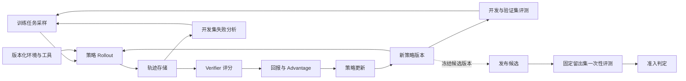
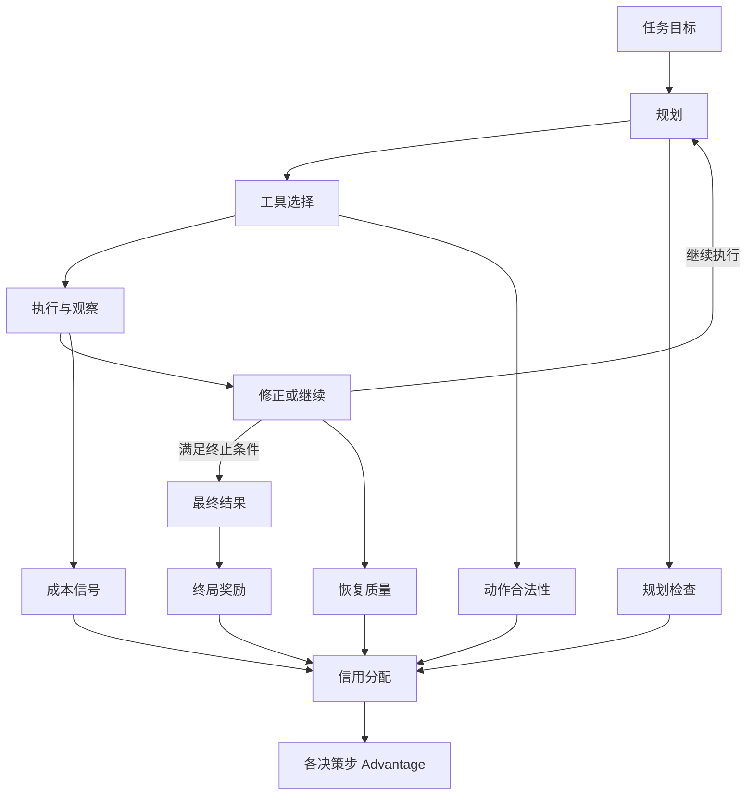

# 模型调优综述

在 Agent 系统里，**Model 是负责听懂任务、选工具、排步骤、看反馈再改主意的「认知大脑」**。当外层的 Harness（上下文拼装、工具协议、状态管理、权限拦截）和底层执行环境（业务 API、数据库、Sandbox）都靠谱时，模型能力直接决定两件事：任务上限能到多高，以及每做成一件事要花多少钱。

很多团队上线后遇到一个经典瓶颈：**Prompt 越写越长，规则越堆越多，但模型该漏还是漏、该瞎猜还是瞎猜；或者勉强靠超长提示和反复重试把事情做成了，算下来每单耗时几十秒、Token 账单高到用不起。** 这时候，光靠在 Prompt 里「反复叮嘱」已经不够了，就需要动用模型调优——用 SFT、偏好对齐、Agentic RL（基于可验证奖励的强化学习，常称 RLVR）或模型蒸馏，把稳定决策的本事真正写进模型权重里。

但动手之前必须先浇一盆冷水：**模型训练是所有优化手段里最重、最贵、最难回滚的一招。** 大多数线上翻车其实根本不是模型不行，而是上下文漏了字段说明、工具文档含混不清、或者后端接口超时。拿几百张 GPU 卡去训模型，填的却是工程配置的坑，往往费力不讨好。这一章先帮你把「什么时候千万别微调」的红线划清楚，再一步步讲透 SFT、Agentic RL / RLVR、模型蒸馏怎么做，以及训完的模型怎样放进完整 Agent 里验收上线。

## 17.1 动手训模型前先归因：什么时候千万别微调

拿到一个线上效果不理想的 Agent，工程上最省钱的习惯是**先做问题归因，再定优化手段**。整个闭环见图 17.1-1：从真实场景和能力缺口出发，先过一遍归因判断；只有确认是模型能力缺口，才进入左侧中间的 SFT、Agentic RL 或蒸馏训练；如果是工程问题，直接分流去修 Harness 或执行环境。无论哪条路改完，最终都得回到完整 Agent 里跑端到端验收，通过后灰度上线，再用线上新反馈驱动下一轮迭代。


图 17.1-1 Agent 优化闭环总览

### 17.1.1 三层排查顺序：执行环境 → Harness → 模型

一个动作从「模型起念」到「真正落地」，要穿过三层边界（图 17.1-2）：

- **模型（Model）**：大脑，负责理解任务约束、规划步骤、提出「要调哪个工具、填什么参数」、看懂返回结果、判断何时重试或收手。
- **Harness**：外层任务控制脚手架，负责从知识库/记忆里把上下文拼给模型、定义清晰的工具接口并路由调用、维护任务进度和状态、在动作执行前做权限校验与护栏拦截。
- **执行环境**：手脚和现场，包括业务数据库、企业 API、Sandbox 容器和外部搜索/支付服务，负责真正把动作执行下去并吐回真实结果或报错。


图 17.1-2 模型—Harness—执行环境职责边界

实际排查时，**绝对不要从模型开始怀疑**，而要按「执行环境 → Harness → 模型」的顺序一层层排除：

拿「数据分析 Agent 老写错 SQL」这个常见痛点举例。假设用户想对比两个季度的新增付费企业客户数，模型写出来的 SQL 总是把老客户也算成新客户。先别急着凑数据微调，顺着三层往下查：

1. **先查执行环境**：绕开模型，直接拿正确的 SQL 去跑查询接口。如果数据库连不上、Sandbox 权限不足或查询服务超时，这是环境故障，训一万遍模型也连不上网。
2. **再查 Harness**：检查模型在写 SQL 那一瞬间，眼前到底看到了什么。如果数据字典里压根没告诉模型「按企业主体去重、以历史首次有效付费时间判定新增、排除测试账号」，或者时间范围参数的描述有歧义，甚至查询报错信息被 Harness 截断了没传回给模型——那都是 Harness 的锅，补全上下文或改清 Tool Schema 就能立竿见影。
3. **最后才看模型**：只有当你确认业务口径、表结构、字段含义和工具报错全都清清楚楚送到了模型眼前，接口也完全健康，但模型换几个季度问法还是照样「先过滤季度订单、再算首付时间」——这时候，才算抓住了货真价实的模型能力缺口。

表 17.1-1 把这三层的验证方法整理成了一张日常排查对照表。

表 17.1-1 Agent 失败归因

| 归因对象 | 常见失败情况 | 如何验证 |
| --- | --- | --- |
| 执行环境 | 模型已经给出可执行动作，但业务系统、数据服务、Sandbox、计算资源或外部服务无法正常执行并返回结果 | 绕过模型直接调用相应工具或服务；若故障仍能复现，则归因于执行环境 |
| Harness | 模型没有获得必要信息、清晰的工具接口或完整反馈，或者任务状态、重试、停止和权限控制没有被可靠管理 | 固定模型和执行环境，修正上下文、工具协议或运行控制；若问题明显减少，则归因于 Harness |
| 模型 | 信息、动作接口和反馈均充分，执行环境也正常，但模型仍持续作出错误的理解、推理、工具选择、失败恢复或终止决策 | 固定 Harness 和执行环境进行重复测试或替换模型；若错误跨任务变体稳定出现，或随模型变化显著改善，则归因于模型 |

如果模型和 Harness 的边界一时掰扯不清，就在执行环境稳定的前提下做一组 **2×2 对照实验**：原模型+原 Harness、原模型+新 Harness、新模型+原 Harness、新模型+新 Harness，用同一批题目和预算跑一遍，谁出了多少力一清二楚。如果新模型必须配合一套专门改写过的提示词才能提分，那套提示词改动也要记在部署成本里，不能全算成模型训练的功劳。

还有一种情况是**成本逼出来的微调**：有些高频任务靠几千字提示词、多次重试或者强模型复核已经能做对，但账单太吓人、耗时太长。只要任务格式和分布相对稳定，就可以考虑通过 SFT 或模型蒸馏，把「靠堆提示词撑出来的本事」压进一个更轻快的模型里。

**哪些情况千万别微调？** 只要撞上以下四条里的任何一条，直接停手改工程或换方案：

- **口径和上下文还在天天变**：业务规则一周改三次，微调进去的习惯很快过期，不如放进可热更新的 Harness 上下文或 Skill 文档里。
- **调用量太低、算不回本**：一天只有几十几百次调用，数据清洗、训练、评测、维护和独立部署的固定开销远大于省下来的 API 费用。
- **问题出在工具协议或硬权限**：模型老调用不存在的参数或越权删数据，优先靠 Schema 校验、静态拦截和权限网关卡死，微调不能替代安全闸门。
- **连什么是「做对了」都说不清**：你自己都写不出清楚的验收标准，也没有可信的正反例，直接开训只会把含糊和错误固化进权重。

### 17.1.2 归因到模型后，到底要补哪四项能力

确认是模型自身短板后，不能只笼统地说「模型变聪明点」，必须把问题拆到下面四项具体决策能力中的一两项，训练数据才知道往哪儿使劲：

- **任务理解与约束识别**：能把用户的自然语言拆成可执行目标，抓准完成标准和边界条件（比如「比较客户增长」要认出按企业去重、排除测试号），条件不够时知道先反问澄清，而不是硬猜。
- **工具使用与反馈理解**：能挑对工具、填对参数；收到返回值后，能看懂数据全不全、口径对不对，决定是继续查还是已经够用。
- **多步决策与状态利用**：长任务走到第 8 步时，记得前面已经核实了什么、还缺哪一块，并根据刚发生的变化调整顺序。涉及用户协同操作共享环境时（比如用户和 Agent 都能改同一张表或同一个工单），还要能协调交互——`τ²-Bench` 的消融实验专门把这类沟通协调失误和纯推理失误区分开，说明交互配合同样关键。
- **失败恢复与合理终止**：工具报错了，能分清该改参数重试、换条路径查、向人求助，还是发现大功告成及时收手结束，不在死胡同里无限循环。

### 17.1.3 先定目标再训：质量、可靠性、成本与安全护栏

动手训练前，先把「变好」翻译成可验收的硬指标，从四个维度同时盯住，缺一不可：

- **质量**：最终任务到底有没有按业务口径办妥。工具格式对不对只是辅助诊断，最终必须看端到端完成率和证据一致性。
- **可靠性**：同一件事多跑几遍稳不稳。输入换个说法、对话拉长、工具偶发报错时，不能一把对三把错；尤其要盯着高频核心场景不能被新模型训坏。
- **成本**：算账不能只看「单次模型调用多少钱」，而要算**单位成功任务成本**——把统计期内**所有成功和失败任务**耗掉的模型、工具、重试和人工兜底开销全加起来，除以成功完成的总任务数。如果小模型单价便宜一半，但老是规划错、多绕十步还经常重跑，最后每做成一个任务的成本反而更贵；比较时还要固定题目构成，不能靠专挑简单题制造「降本假象」。
- **安全护栏**：任何训练方法都不能替代系统的硬控制。模型学的是「自觉遵守约束」，但最终防越权、防资损的底线，必须由 Harness 的动作白名单和执行环境的强校验兜住。

### 17.1.4 选哪条训练路线：SFT、DPO、Agentic RL（RLVR）还是蒸馏

摸清能力缺口和目标后，就能按手头拥有的「学习信号」来挑武器。图 17.1-3 给出了一条清晰的决策树：最上面先确认问题确实出在模型，接着看首要目的，并且**必须过掉每一路下面的两道门槛才允许开训**。


图 17.1-3 模型优化方法选择路径

用非算法工程师能听懂的大白话，主流路线其实就四件事：

1. **SFT（监督微调，图 17.1-3 左路）**：相当于 **「照着标准答案抄作业」**。当你已经知道什么做法是对的（比如人类专家标好了示范，或者强模型留下一批经核验的正确轨迹），只是模型老执行不稳，就用 SFT 把「在这种局面下应该做这个动作」的概率拉高。前提是图里的两道门槛：**示范必须真对、可审计**，而且**样本覆盖生产里的各种工具反馈和状态变化**。
2. **偏好对齐（如 DPO，直接偏好优化）**：如果手里不光有标准示范，还有一批「同一局面下，做法 A 明显比做法 B 好」的成对对比数据（比如回答风格更简洁、优先选成本低的工具、拒绝瞎猜），但又暂时没条件搭一套能反复跑在线试错的强化学习沙箱，可以用 DPO 这类离线偏好对齐方法低成本微调模型倾向。不过要看清它的边界：它吃的是现成的成对轨迹，不会自己去环境里探索全新路径，解决不了复杂长链路上的试错归因。
3. **Agentic RL / RLVR（基于可验证奖励的强化学习，图 17.1-3 中路）**：相当于 **「放进沙箱里实战练兵，做对了给奖励、做错了扣分」**。很多复杂任务根本没有唯一标准步骤（条条大路通罗马），你没法手把手教每一步；但只要**最终结果或关键节点能被自动、客观地验证**（比如单元测试跑过没有、数据库里的退款状态和金额对不对、格式符不符合规则——这就是业界常说的 **RLVR，Reinforcement Learning with Verifiable Rewards**），就能让模型自己跑出多条路径，靠真实反馈把更稳、更省的策略练出来。门槛很硬：**沙箱环境必须能重置复现、验证器必须靠谱、成本兜得住**。
4. **模型蒸馏（图 17.1-3 右路）**：相当于 **「老师傅带小徒弟，既省钱又提速」**。大模型已经能稳稳把活干好，但太贵太慢部署不动，就把大模型做出来的示范轨迹甚至每一步的概率分布喂给更小、更快的学生模型。门槛同样实在：**老师自己得先在目标任务上稳稳领先**，且**学生模型的脑容量和线上延迟预算匹配得上**。

这几种方法不是互斥的单选题，常见组合是：先用少量高质量 SFT 给模型「开窍/定格式」当冷启动，再上 Agentic RL（RLVR）在沙箱里打磨多步策略，最后为了低成本高并发上线，把强 RL 专家模型蒸馏成轻量小模型（或配合 On-policy Distillation 在学生真实状态分布上纠偏）。不管用哪套组合，最后都得过同一套**质量、可靠性、成本、安全**统一准入门槛。

## 17.2 SFT：照着好示范学「什么时候做什么动作」

很多团队对 SFT 有个误解，以为就是「拿一批问答题微调，让模型背下标准回复」。放到 Agent 里，模型学的远不止最后那句答复，而是**任务进行到每一步时该怎么做决定**：是直接回答、调哪个工具、参数怎么填、看到返回报错是该追问用户还是换个工具重试、还是已经够了直接收尾。

回到前面「新增付费企业客户数」的数据分析例子：哪怕系统提示里明明白白写了「按企业去重、看历史首次有效付费时间、剔除测试号」，基座模型还是经常手滑先过滤目标季度的订单再算最小付费时间，把老客户算成新增。如图 17.2-1 所示，在决策条件（用户目标、工具定义、字段说明、历史动作和可用动作空间）完全不变的前提下，SFT 的工作机制非常直白：**把这组决策时刻可见的上下文当作输入 $x_t$，把经过核验的正确动作当作目标 $y^*_t$，只对目标输出算损失 $\mathcal{L}_{\mathrm{SFT}} = -\log p_\theta(y^*_t \mid x_t)$ 并更新权重 $\theta$**。训练完之后，模型在类似局面下选「先查全量历史确定首次付费时间」的倾向就会显著压倒偏离动作——而外层的 Harness 状态维护、工具执行、权限拦截和数据库本身，SFT 一概不改，也替代不了。


图 17.2-1 Agent SFT 对模型行为的作用机制

### 17.2.1 什么时候适合用 SFT，拆解到具体决策点

决定上 SFT 前，先问自己一个问题：**我想让模型学的那个动作，人类专家或强模型能不能稳定演示出来？** 如果答案是肯定的，SFT 就是最稳妥的手段；如果同一状态下连专家都拿不准哪步最好、必须扔进环境里跑完才知道优劣，那就别拿拿不准的轨迹硬当监督标签，老老实实先把验证机制补齐，或者转去用 Agentic RL。

把「提升 Agent 效果」拆成具体决策点，SFT 才好备料：比如到底是**调用时机错了**（不用查工具非要瞎调，或者该查工具直接瞎编）、**选错工具**、**参数口径填错**、**漏了前置条件没向人澄清**，还是**半路丢了用户约束 / 不会收尾**。每一类坏毛病，都需要对应的正反对比局面去喂数据。

### 17.2.2 怎么把轨迹切出不泄密的训练样本

线上跑出来的完整轨迹不能直接整条塞进训练，因为一条轨迹混着系统提示、工具定义、环境报错甚至后续纠正，直接拿来训会踩两个大坑：

1. **信息穿越（因果泄漏）**：把完整长对话拆成多个决策点样本时，第 $t$ 步的输入**绝对只能包含这一步做出决策前已经发生、已经可见的信息**。工具还没返回的数据、用户在后面第 5 轮才补充的限制条件，哪怕就写在原始日志下文里，也绝不能提前漏进第 2 步的输入。否则模型在训练时看着「未来答案」考满分，上线后两眼一抹黑，根本复现不出来。
2. **动作单一化（训练出「工具狂魔」）**：如果训练集中全是「接到问题立刻调工具」的例子，微调完的模型遇到常识问题也会忍不住乱调工具。必须同时覆盖「信息够了直接答」「需要外部数据才调工具」「条件没说清先反问澄清」「中途需求变了改计划」「报错后修正重试或及时认输终止」几类局面。

另外记住一条铁律：**状态维护是 Harness 的事，不是靠模型硬背出来的**。如果必要条件在进入模型前已经被截断或漏拼，先回去修 Harness 的上下文拼装逻辑，别妄想用 SFT 让模型「靠猜把丢掉的字段脑补回来」。

### 17.2.3 掩码与质量控制：任务成功不代表每一步都该学

这是 Agent SFT 最容易踩坑的地方：**整条任务最后成功了，不代表中间每一步都值得模仿！** 一条成功轨迹里完全可能夹着两步多余的无效查询、一次乱填参数的报错、甚至瞎蒙撞大运的中间判断；反过来，一条包含报错的轨迹里，后面那段「看懂报错 → 查可用字段 → 改对参数重跑」的纠错过程反而是金子。

处理方法不是把含错轨迹一刀全删，而是**精准控制损失掩码（Mask）**：把出错的那一步动作和环境报错原封不动留在历史上下文里（这样模型才能看懂「因为前面这样错了，现在才需要改」），但**屏蔽掉错误步骤自己的训练损失**，只对后面经人工或规则核验过的正确恢复动作算损失。表 17.2-1 总结了各类交互片段的标准掩码做法：

表 17.2-1 Agent SFT 中不同交互内容的监督处理

| 交互内容 | 在样本中的作用 | 常见监督处理 |
| --- | --- | --- |
| 系统指令、用户请求与工具定义 | 提供任务目标、约束和动作空间 | 作为输入上下文，通常不作为本任务的生成目标 |
| 工具结果、环境观察与错误反馈 | 提供决策时可见的执行状态 | 保留在输入中，通常不计算生成损失 |
| 经验证的工具调用、澄清、修正和最终答复 | 表示模型应当学习的目标行为 | 对选定内容计算监督损失 |
| 用于解释恢复场景的错误模型步骤 | 说明失败状态及后续修正的起点 | 可保留为上下文，但屏蔽相应损失 |
| 尚未核验或质量存疑的步骤 | 无法确认是否值得模型复用 | 补充核验；无法确认时移出训练集 |

很多框架默认按「角色掩码（Role Mask）」处理，也就是只遮掉 user 和 tool 返回、把 assistant 说的所有话全算损失——这不够细。既然错误调用也是模型自己发出来的，就必须在数据清洗层再加一道「质量掩码」，并且**动手训之前务必抽查几条真实进损失计算的 Token 切片**，亲眼确认工具调用边界、终止符和错误恢复屏蔽完全按你的意图生效。

### 17.2.4 数据配比、模板对齐与全参 vs LoRA

在配比和训练细节上，四条工程经验能帮你避开大多数无效训练：

- **按失败分布配比，别靠复制刷权重**：高频主流程用来立住基本功，长链路用来练跨步状态利用，低频高损异常用来补恢复动作，还要混入一定比例的通用指令遵循和「无需调工具直接答」的简单题防止整体智商退化。把同一套同质样本复制十遍，远不如换不同的季度范围、字段表达和表结构变化来得有效。
- **训练和推理的模板必须严丝合缝**：对话模板、工具调用 JSON/XML 格式、特殊停止符必须与线上推理框架完全一致。超长样本截断时千万检查别把关键系统约束或上一轮工具报错给切掉了，否则训练 Loss 降得挺好看，上线一跑工具全解析失败。
- **全参微调还是 LoRA**：LoRA 只训少量旁路适配器参数，省显存、迭代快、方便多业务共享底座，适合预算有限或快速验证；全参微调改动空间更大，适合任务复杂度高、数据量充足且基础设施跟得上的团队。但两者都不能替你解决脏数据问题，也不能保证不损伤通用能力，选谁看独立评测结果说话。

### 17.2.5 别信 Loss 下降：必须在完整环境里自主跑完验收

评估 SFT 模型最常见的自欺欺人做法，是拿一条固定标准历史对话让模型预测下一步输出（Teacher-forced 单步续写）。这种方式掩盖了真实线上最大的问题——**一步走偏、步步踩空（错误累积）**。

真正的验收必须把模型放回固定的 Harness、工具接口和执行预算里，让它从零自主跑完多轮任务，接收真实或沙箱工具返回的反馈，然后从四方面看账：端到端任务成功率（Quality）、多次重复跑的稳定性与回退情况（Reliability）、含失败重试在内的单位成功任务成本与端到端耗时（Cost），以及是否越权或突破停止条件（Safety）。测试集划分必须按**任务族、模板或数据来源隔离**（比如改季度、改字段叫法、加历史复购和多笔订单边界），防止仅仅换了几个近义词就自以为泛化成功。

### 17.2.6 和 Agentic RL、蒸馏怎么衔接

SFT 很少是终点，它更像一台稳定器：先把明确的规范行为练稳，如果线上执行评测发现模型还是在多步选路、权衡成本和容错恢复上卡壳，就拿这版 SFT 模型当起点，接着上 Agentic RL（RLVR）探索更优策略；反过来，当强模型已经跑通了复杂能力，你想压小体积、降推理账单时，蒸馏本质上也经常落回到用老师数据做 SFT（或配合在线策略蒸馏）。

## 17.3 Agentic RL（RLVR）：没有唯一标准答案，就让模型在沙箱里自己试出好策略

很多团队做到一定阶段会遇到 SFT 解决不了的问题：拿「核验订单规则并发起退款」来说，模型可能先把订单查了、漏掉查退款政策直接退钱；也可能虽然退成功了，却反复查了五遍无关数据。你想给每一步标出唯一正确的操作顺序，专家自己都写不完，因为本来就有好几种合法查法；可一旦任务跑完， **「钱退没退、政策合不合规、金额算没算错、有没有越权」** 这几件事，靠数据库状态和业务规则一验一个准。

这就是 **Agentic RL**（核心工程落地正是 **RLVR，基于可验证奖励的强化学习**）的主场：你不教模型每一步非得怎么走，而是给它一套能重跑、能校验结果的沙箱，让它自己去试多条路径，最后拿可验证的任务结果、关键节点和成本信号做奖惩，拉高合规且省钱的路径概率。前提同样苛刻：如果环境没法重置、上下文有缺失、或者 Harness 权限拦不住，RL 只会把漏洞和投机行为练得更加炉火纯青。

### 17.3.1 准入检查：先过这六道关再开练

开动强化学习集群前，先对照表 17.3-1 把六道准入门槛过一遍，有任何一项亮红灯就先补前置条件，不要硬上训练：

表 17.3-1 Agentic RL 准入判断

| 判断维度 | 适合进入 Agentic RL 的条件 | 条件不满足时的优先处理 |
| --- | --- | --- |
| 问题归因 | 失败来自模型的动作选择、反馈利用或恢复策略 | 先修复上下文、工具协议、权限或执行环境 |
| 示范可得性 | 有效路径不唯一，难以为每个决策点提供稳定标签 | 若正确行为可稳定示范，优先使用 SFT |
| 结果可验证性 | 任务结果或关键中间状态可由规则、测试或可靠评审稳定判断 | 先建设验证器或高质量标尺集 |
| 环境能力 | 任务可重复执行，状态可重置，探索可隔离，过程可追踪 | 先建设 Sandbox、模拟器或可回放环境 |
| 基础策略 | 模型已具备基本指令遵循和工具调用能力，能够产生一定比例的有效轨迹 | 先通过提示、SFT 或能力更强的基座建立可学习起点 |
| 投入产出 | 预期成功率、可靠性或单位成功任务成本的改善能够覆盖 Rollout 与环境维护成本 | 使用更低成本的模型、数据或 Harness 优化方案 |

这里最关键的一条是 **「结果可验证」** 重于 **「过程能标注」**。在退款任务里，如果你的验证器偷懒只检查「数据库里是不是多了一条退款记录」，却不检查退款政策和金额上限，RL 很快就会教会模型「见单就退、退得飞快」。连工具 JSON 都老写错的底座，也得先靠 SFT 把基础格式垫稳再来跑 RL，否则采样出来全是废轨迹，根本学不到有效梯度。

### 17.3.2 搭建可重置、防泄密的交互沙箱

在工程建模上，Agent 面对外部世界有个天然特点：**模型永远看不到数据库和外部系统的全貌真实状态 $s_t$，它只能看见眼前收到的用户请求、历史对话、工具定义和工具返回值这些局部观察 $o_t$。** 因此模型在第 $t$ 步真正依据的，是截至目前积累的交互历史 $h_t = (o_0, a_0, \dots, o_t)$。一条完整执行轨迹可以记成：

```text
τ = (o₀, a₀, r₀, o₁, a₁, r₁, …, oₜ, aₜ, rₜ)
```

其中策略记为 $\pi_\theta(a_t \mid h_t)$，训练目标是最大化折扣累计回报期望：$J(\theta) = \mathbb{E}[\sum_t \gamma^t r_t]$（$a_t \sim \pi_\theta(\cdot \mid h_t)$）。把公式翻译成写代码要对齐的四项环境契约：

- **观察（Observation）**：模型每步能看到什么（用户目标、上下文、工具说明、剩余步数预算）。**训练期看到的绝对不能比生产环境多**，比如把隐藏答案字段或内部调试日志漏进环境返回里，否则上线直接抓瞎。
- **动作（Action）**：模型能发起的动作集合（回复、调工具、写记忆、澄清、等待或终止）。
- **转移（Transition）**：工具调用后环境怎么变，必须真实包含成功、业务报错、超时和返回残缺等生产常态。
- **任务结束（Termination vs Truncation）**：**必须严格区分「业务终局结束」和「外部强制截断」**！任务成功、业务失败或步数预算用完，属于明确终止（Termination）；因为基础设施超时、采样时间到被硬掐断，属于截断（Truncation）。只有截断后还能拿到有效的下一步观察、且价值模型能据此估算后续残余价值时，才能做价值续估（Bootstrap），绝不能把所有中途掐断的轨迹一律当成「策略失败」扣分，更不能在没有后继状态时硬估。

一个合格的训练环境必须同时满足五个硬条件：**可执行**（沙箱或模拟器真能跑通工具状态转移）、**可重置**（每次采样回滚到干净初始状态，样本间不互相污染）、**可复现**（任务、随机种子、工具版本、Prompt 和环境快照全锁定）、**可审计**（全链路观察/动作/耗时/终止原因留档）、**可隔离**（探索行为绝不能碰真实生产库和资金账户）。下面是一个退款任务沙箱规格示例：

```json
{
  "task_id": "refund_017",
  "environment_version": "refund-sandbox-v4",
  "initial_observation": {
    "user_goal": "核验订单并发起退款",
    "available_tools": [
      "query_order",
      "check_policy",
      "create_refund"
    ]
  },
  "limits": {
    "max_steps": 12,
    "max_tool_calls": 8,
    "timeout_seconds": 90
  },
  "terminal_checks": [
    "refund_created",
    "policy_satisfied",
    "amount_verified"
  ]
}
```

### 17.3.3 奖励怎么设计才不被模型「钻空子」

奖励函数就是指挥棒，模型会不择手段把指挥棒指向的分数刷到最高。设计奖励的核心不是指标越复杂越好，而是**死死咬住真实业务目标，不留投机钻营的缝隙**。实用上通常把四类信号组合成一条加权公式：

```text
R(τ) = w₁R_task + w₂R_process - λC_execution - μP_violation
```

其中 $R_{\mathrm{task}}$ 是核心的**结果奖励**（任务成没成、口径对不对），$R_{\mathrm{process}}$ 是**过程奖励**（只奖励可客观核验的关键中间状态，缓解长链条稀疏反馈），$C_{\mathrm{execution}}$ 扣减**执行成本**（步数、Token、重试、耗时——注意只能在成功前提下比较省不省，别把模型逼成「怕扣成本干脆直接摆烂提前终止」），$P_{\mathrm{violation}}$ 扣减**约束违背**。权重参数不要拍脑袋定，要靠离线回放和消融校准。表 17.3-2 展示了退款场景下这几层信号的分工：

表 17.3-2 退款任务中的反馈层级

| 反馈层级 | 退款任务示例 | 设计边界 |
| --- | --- | --- |
| 系统硬约束 | 禁止越权退款、限制金额、隔离真实账户 | 由 Harness 与执行环境强制实施，不能只依赖负奖励 |
| 结果奖励 | 退款已创建，政策满足，金额与订单一致 | 直接对应任务成功，应作为核心信号 |
| 过程奖励 | 已核验订单状态、退款政策和金额依据 | 只奖励可客观判断的关键状态，不规定唯一行动序列 |
| 成本信号 | 无效查询、重复调用、时延和人工介入 | 优先比较成功策略，避免诱导提前终止 |

负责算这些分的验证器（Verifier）分三种：**规则验证器**（代码校验、数据库状态、单测断言，最稳最便宜，**RLVR 的主力**）、**模型验证器**（LLM 裁判，覆盖开放语义但容易偏爱废话长文或自家语气，需要拿人工标尺集对齐）和**人工反馈**（太贵，只用来做标准标尺和抽查边界案例）。

跑 RL 时最容易栽在三个坑上：**奖励投机**（Reward Hacking，模型摸到评分漏洞刷高分却没干正事）、**代理目标偏移**（刷高了某个好测的局部指标，端到端真实体验反而降了）以及**评审器漂移**（中途改了裁判模型或业务规则，新老分数对不上账）。

防踩坑的根本原则是**把「训练奖励」「系统硬约束」和「独立评测」彻底拆成三套互不替代的闸门**（图 17.3-1）：模型在沙箱里选出候选动作 $a_t$ 后，必须先过中间的**② 系统硬约束闸门**（Harness 权限/预算/工具白名单与执行环境金额上限），拦截住了根本不放进 Sandbox，而不是指望扣负分让模型「自觉」；左边**① 训练奖励**只在训练回路内依据验证器打分、更新参数 $\theta$；右边**③ 独立评测**则是在训练回路外冻结候选模型，换锁定的留出集和独立评测器做最终上线裁决。三者各管一摊、反馈时刻不同，绝不能混用。


图 17.3-1 Agentic RL的三重控制边界

### 17.3.4 Rollout 采样、策略更新与工程解耦

把一轮 Agentic RL 跑起来，完整闭环如图 17.3-2 所示：按场景难度采样任务 → 结合版本化环境与工具做策略 Rollout 攒轨迹 → 送入 Verifier 评分 → 算回报和优势信号（Advantage）→ 更新策略参数 → 同时在开发/验证集上做日常监控和失败分析反哺采样；直到挑出满意候选版本冻结，再丢进锁定留出集跑一次性准入判定。



图 17.3-2 Agentic RL的训练闭环

一轮训练的六个核心步骤可以浓缩为下面这段与具体算法解耦的伪代码：

```python
policy = initialize_from_base_or_sft_model()

for iteration in range(num_iterations):
    rollout_policy = freeze(snapshot(policy))
    tasks = sample_tasks_by_scenario_and_difficulty()
    trajectories = rollout(tasks, rollout_policy, pinned_environment)
    rewards = verifier.score(trajectories, pinned_verifier)
    update_batch = assign_credit(trajectories, rewards)
    policy = update_policy(policy, rollout_policy, update_batch)
    evaluate_on_development_suite(policy)

candidate = freeze(select_by_validation_results())
evaluate_on_locked_holdout(candidate)
register_if_pass(candidate)
```

在把轨迹分数转化为每步该强化还是削弱的优势信号（Advantage）时，主流有两条路（表 17.3-3）：

- **价值模型基线（如经典 PPO）**：再养一个 Critic 价值模型去估轨迹每一步的预期好坏，通过概率比率裁剪限制策略单步跳太远（按需加参考策略 KL 约束）。好处是长轨迹里能做出较细粒度的步间归因，代价是训练系统重，且 PPO 近似 on-policy，老版本轨迹复用太多会带偏更新，需要限复用或做离策略校正。
- **组相对基线（如 GRPO 类方法）**：不养独立的 Critic 价值模型，而是让同一道题并行采样出好几条轨迹组成一个「组」，谁比组平均分高就多学谁、谁比平均分低就抑制谁，同样可配合裁剪和 KL 正则。优点是架构轻、很适合可并行沙箱；缺点是 Rollout 采样贵好几倍，而且如果同一道题跑出来组内几条轨迹全对或全错（回报没差异），优势信号直接归零，白烧算力。

**表 17.3-3 优势估计方式的选择条件**

| 方式 | 主要优势 | 主要代价 | 适用条件 |
| --- | --- | --- | --- |
| 价值模型基线 | 可结合状态价值估计，对不同轨迹位置构造较细粒度优势 | 需要训练和维护价值模型，系统复杂度较高 | 能够获得稳定价值估计，任务需要细粒度信用分配 |
| 组相对基线 | 利用同任务多轨迹比较，无需单独训练价值模型 | Rollout 成本较高，依赖组内回报差异 | 任务可重复采样，验证器能够稳定排序 |

工程落地时，**千万把 Agent 执行侧和模型训练侧拆开解耦**，通过标准模型接口和轨迹协议对接——但上线归档时，工具版本、Prompt、环境镜像、验证器和模型权重必须绑成同一个版本清单登记，不然哪天效果回退了都不知道是改了哪一层。在具体平台实践上，例如阿里云 PAI 强化学习服务可以承接任务调度、并行 Rollout、验证器接入与策略更新，而工具和状态写操作放进隔离 Sandbox 里跑，让业务团队把精力专注在把奖励和验证逻辑定义对。

### 17.3.5 长程决策的信用分配与多路径探索

长程多步任务上 RL 最难的点叫「信用分配（Credit Assignment）」：一个任务走 15 步，第 3 步选错了表、第 14 步才彻底崩盘。如果只给最终结果打个总分再平均扣到 15 步头上，模型根本分不清是第 3 步错还是第 14 步错。图 17.3-3 展示了正确的信号回流机制：除了终局奖励 $RT$，把规划检查（$RP$）、动作合法性校验（$RV$）、成本信号（$RC$）和恢复质量（$RR$）这些可客观验证的阶段信号，一起喂进信用分配器，算出每个具体决策步的 Advantage。



图 17.3-3 Agentic RL 的信用分配机制

工程上有四招能显著拉高长程 RL 的效率：
1. **课程式采样**：先拿步数少、反馈快的题热身，再逐步加工具数量、状态复杂度和步数跨度；
2. **只对硬状态节点给过程奖**：比如「订单已核验」「政策已满足」这种能查证的里程碑，别给模型长篇大论的自言自语打过程分；
3. **同题多采样比相对优劣**：靠组内对比挑出省步又合规的路径；
4. **把故障塞进题库**：专门安排参数报错、查无此记录、工具超时等恢复题，逼着模型把切工具、改参数、澄清和及时止损练熟。

这里有个常见误区：**把长轨迹随便切段并不会自动改善信用分配**。只有切出来的每一段正好卡在一个可验证的子目标、阶段奖励或状态估价节点上，信号才传得回来；光按字数或轮数切，模型照样猜不透早期哪一脚踩偏了。

拿退款任务里的多条路径对照（图 17.3-4）最直观：

```text
轨迹 A：查询订单 → 直接创建退款 → 政策校验失败 → 任务失败
轨迹 B：查询订单 → 核验退款政策 → 校验金额 → 创建退款 → 任务成功
```

再把更多候选轨迹摊到同一张图里看（图 17.3-4）：从同一起点 $h_0$ 出发，轨迹 A 跳步直接创建退款导致政策不达标；轨迹 D 甚至试图直接创建大额退款，被系统硬约束当场拦截；只有轨迹 B（分步核验政策和金额）和轨迹 C（合并成一次性核验政策与金额，步骤更省）同时通过了结果、约束和成本检查，进入「有效策略集合 {B, C}」。Agentic RL 并不强求只认一条「标准答案」，而是先拿验证器和硬约束淘汰掉 A 和 D，提高落入 {B, C} 的整体概率，再在合规集合内部按成本信号偏向更省步骤的轨迹 C。至于失败轨迹 A 和被拦轨迹 D，只能用来做错误剖析、调整采样权重或清洗成 SFT 纠错上下文，不能无限制拿历史失败老轨迹反复当 on-policy 梯度喂。


图 17.3-4 多路径探索与有效策略集合

### 17.3.6 通过独立评测确认真实收益

训练曲线一路飙红，只能说明模型越来越会从你的训练验证器手里「拿高分」，**绝不等于上线能力真涨了**。发布前必须拉出训练回路，按四步做独立大考：

1. **冻结版本并对齐条件**：基础模型、SFT 模型和 RL 候选模型同台竞技，Prompt、Harness、工具协议、最大步数预算和沙箱版本必须严丝合缝保持一致。
2. **三套数据集与评测器隔离**：**开发集**用来调奖励和修验证器；**验证集**用来挑最佳 checkpoint 和推理超参；**锁定留出集**按任务模板、业务实体和环境种子彻底隔离，只在冻结候选后跑一次最终裁决（而且过阵子还得换新题防止「看榜间接过拟合」）。同时，独立评测器和训练验证器尽量分离，并用人工抽检高分轨迹，抓一抓有没有利用沙箱隐藏状态的作弊捷径。
3. **端到端四维报数**：完整跑通任务，报告成功率（Quality）、多次 Rollout 波动与置信区间（Reliability）、单位成功任务总成本与耗时（Cost），以及模型违规尝试率与 Harness 实际拦截率（Safety）。
4. **消融归因与防伪排查**：如果 RL 涨分了，用消融实验看看是过程奖、成本惩罚还是课程采样立了功；如果**训练奖励狂涨、独立成功率纹丝不动**，八成撞上了下面四件事之一：奖励设计留了作弊空子、训练评审器有偏见、环境把答案漏给了模型、或者训练沙箱和线上真实数据分布差太远。

## 17.4 模型蒸馏：把强模型的本事装进快又省的小模型里

大模型确实聪明，可一旦 Agent 跑上规模，每步决策都请旗舰大模型出山，API 账单、P99 时延和 GPU 容量马上吃不消。模型蒸馏的真正目的，不是让小模型学会大模型「说话的腔调」，而是**把强模型在关键决策上的判断力迁给轻量学生模型，让小模型扛下绝大多数常规单子；遇到实在超纲的硬骨头，再优雅交还给老师模型兜底**。

动手蒸馏前，死盯两个互相咬合的硬问题：**哪些能力真能迁得动？** 以及 **把失败、重试和老师兜底全算进账单后，单位成功任务总成本真的降了吗？**

### 17.4.1 先画「任务—职责—风险」矩阵，定谁干什么

不要拍脑袋说「把整个 Agent 替换成 7B 小模型」，正确做法是从线上职责切分开始，画一张「任务—职责—风险」矩阵，把流量拆成三档：**学生独立跑**（低风险、高频、边界清）、**学生干 + 老师/规则验**（中风险或格式易错）、**老师直接上**（高风险、不可逆或长程开放规划）。对资金、删改数据这类不可逆操作，就算小模型离线平均分看着不错，也别轻易撤掉老师复核闸门。

能力迁移也分两种粒度：**完整 Agent 轨迹迁移**让小模型从头到尾学规划、选工具、填参、看反馈和收尾；**技能级迁移**则只切出其中最稳定、最烧钱的一环（比如意图路由、参数抽取、SQL 生成、结果核验），先拿小模型替换掉那一环——后者成功标准极清、容错边界好划，最适合做第一单落地。

研究（如 `AgentDistill`）已经验证过，拿「Thought—Action—Observation」整条轨迹去蒸馏（只对教师的思考和动作 Token 算损失，不拿环境返回的 Observation 当预测目标），小模型确实能把检索和代码工具的组合招式学到手；但这类结论只覆盖固定工具协议和有限步数，不要直接外推到任意开放复杂系统。

挑老师和学生时，先卡死四道条件：**老师自己必须真会做**（老师都不稳，蒸馏只会高效批量复制垃圾）、**示范必须可验证过滤**、**学生脑容量扛得住**（先拿小批量数据做可教性摸底测试，确认没撞容量天花板再大规模造数）、**算得过经济账**。

### 17.4.2 教师信号怎么选：硬目标 vs 软目标

只让小模型背最终答案，上线后往往「只学会了收尾话术，不会在半路挑工具、看报错」。对 Agent 有价值的监督通常沿着下表逐层变厚：

| 教师信号 | 主要学习对象 | 优点 | 主要局限 |
| --- | --- | --- | --- |
| 最终输出 | 答案、格式、风格 | 生成成本低，适合黑盒教师 | 难以学习工具时机和失败恢复 |
| 标签与理由 | 结果及任务相关依据 | 比纯标签提供更密集监督 | 理由可能事后合理化，也可能复制教师偏差 |
| 结构化动作 | 工具选择、参数、约束 | 可直接评测动作是否合法 | 需要稳定的工具协议和参数校验器 |
| 多轮轨迹 | 计划、行动、观察、修正 | 最接近真实 Agent 执行分布 | 轨迹昂贵，错误会沿多轮累积 |
| 概率信号 | 每个决策位置的相对偏好 | 保留教师不确定性，监督更细 | 依赖教师概率接口、词表与 tokenizer 对齐 |

按拿得到的信息深浅，蒸馏分成两派：**硬目标（序列级）** 只拿教师输出的文字或动作序列，闭源 API、跨模型家族都能用，工程门槛最低；**软目标（分布级）** 需要读教师每个位置候选词的概率分布（logits 或 log-prob），能教学生「除了第一选择，还有哪些动作也合理、哪些绝对不能碰」，但要求开放概率接口，存储和传输 logits 的开销大，且一旦师生词表（Tokenizer）对不上还得额外折腾对齐方案。不管用哪派，**老师吐出来的轨迹进训练集之前必须过规则或执行验证器过滤**——宁可丢掉一半脏样本，也不要让老师失手出的废轨迹污染学生。

### 17.4.3 离线示范（Off-policy SFT）vs 在线策略蒸馏（OPD）

离线拿老师轨迹做 SFT 是最好的冷启动：简单、稳定、不挑基础设施。但用久了很快会撞上一堵墙——**分布偏移（Distribution Shift）**：离线训练集里的每一轮历史画面，都是老师自己一步步走出来的「顺风局」；可学生上场一独立运行，只要第 2 步稍微选了个不太一样的词或参数，就会跌进老师轨迹里压根没出现过的「陌生局面」，接着步步错、越错越偏，效果早早进入平台期。

**在线策略蒸馏（On-policy Distillation，简称 OPD）** 正是为了捅破这层天花板。它的思路非常直观：**不再让老师自己演完再给学生背录像，而是放学生自己下场去环境里走步；学生走到哪一步卡住了、走偏了，老师就站在场边，对照学生刚走出来的真实上下文，逐个 Token / 逐个动作给出「在这里该怎么做才对」的稠密评分。** 相比纯在线强化学习要等十来步跑完才拿一个稀疏总分，OPD 在每一步都有老师密集纠偏，专治学生「自己真正会踩的坑」。

数学上，设学生策略为 $\pi_\theta$，教师策略为 $\pi_T$，学生在前缀 $s_t = x_{<t}$ 上采样出动作或 Token $a_t$，OPD 最小化学生到教师的反向 KL 散度：

$$\mathcal{L}_{\mathrm{OPD}} = \mathbb{E}_{\tau \sim \pi_\theta} \left[ \sum_t D_{\mathrm{KL}} \left( \pi_\theta(\cdot \mid s_t) \,\|\, \pi_T(\cdot \mid s_t) \right) \right].$$

工程上不必把教师庞大的完整词表 logits 全传回来，对学生实际采样的 Token $a_t$，只需算出这一单点上的局部 KL 差异估计项：

$$\hat{d}_t = \log \pi_\theta(a_t \mid s_t) - \log \pi_T(a_t \mid s_t),$$

再结合策略梯度或等价梯度方法回传更新即可（注意这只是单样本估计项，不是全部梯度本身）。也就是说，教师只需开启 `teacher forcing` 前向扫一遍学生生成的序列、吐出每个已采样 Token 的归一化 log-prob 就行；前提是教师服务端得支持给指定序列算概率（纯文本生成黑盒 API 干不了这活），跨词表时也要先解对齐。

因为最小化的是「学生相对于老师的反向 KL」，小模型在容量受限时常呈现「模式寻求（mode-seeking）」特性：老师认为概率极低的错误动作，学生一旦去碰就会吃重罚，而老师允许的多条合理路线里，学生可以集中吃透最顺手的一两条，避免在互斥工具参数间左右摇摆平均化。但记住：**老师概率高不绝对等于业务正确**，OPD 同样可能把老师自己的固执偏见放大、或者把学生压得不敢探索新恢复路径，因此仍然必须绑上任务成功验证和异常兜底。

图 17.4-1（对应下方路线示意图）把这三条训练曲线的直觉画得很清楚：离线 SFT 起效快但受限于分布偏移早早遇到平台期；在线 RL 因为终局奖励稀疏，早期爬坡慢；OPD 靠学生真实状态加老师稠密信号，爬坡斜率通常更陡。**但务必注意：该图仅展示机制趋势，部分文献中的 SFT 对照成本包含外推假设且实验并非通用 Agent 环境，正式项目不能直接拿图上的斜率当收益承诺，必须用自家任务实测重新拟合。**


图 17.4-1 三类蒸馏训练路线的成本—效果关系示意图

三类路线的核心取舍汇总如下表：

| 路线 | 训练状态来源 | 主要监督 | 典型优势 | 典型风险 |
| --- | --- | --- | --- | --- |
| Off-policy SFT | 教师或历史轨迹 | 教师文本、动作或理由 | 稳定、易实现、适合冷启动 | 学生状态分布偏移，容易较早进入平台期 |
| On-policy RL | 当前学生轨迹 | 环境或验证器的结果奖励 | 可直接优化任务成功 | 奖励稀疏、信用分配困难、训练方差较大 |
| On-policy Distillation | 当前学生轨迹 | 教师逐 Token 或逐动作评价 | 学生状态与稠密教师信号结合 | 依赖教师打分接口，可能压低探索并继承教师偏差 |

### 17.4.4 找准首个偏离点做专项补强

学生模型在多步任务里失败，很少是最后一步突然犯傻，通常是前面某一步偏了半寸，后面步步建立在错前提上滚成雪球。专项补强别盯着最终错题标签泛泛刷题，而要顺着轨迹找到**学生相对于正确路径的第一个关键偏离点**，对照四类缺口下药：

- **知识缺口**（没看懂业务约束或口径）→ 补正反口径对照和推理依据；
- **决策缺口**（工具挑错、顺序颠倒）→ 补相邻候选动作的对比与选型理由；
- **执行缺口**（参数类型、格式、权限不合法）→ 加结构化协议校验和参数边界示范；
- **恢复缺口**（遇到报错、空结果、超时还在傻傻重发一模一样的请求）→ 专门喂「发现异常 → 诊出原因 → 切换工具或澄清 → 重新核验」的纠错轨迹。

把线下失败轨迹按「首错位置 + 工具 + 错因」聚类，对高频高损桶做针对性补强，再放到独立保留集和分布外压力集上验证「没在治好旧病的同时诱发新病」。

### 17.4.5 算清经济账：质量保留率、兜底成本与盈亏平衡点

别拿「学生模型百万 Token 单价只有老师的 1/10」去向上汇报降本，那叫自欺欺人。真正站得住脚的经济账，必须把基线模型、教师模型和学生模型拉到同一套任务集、工具环境、判定标准和流量分布下，算清楚**单位成功任务总成本**：

$$C_{\mathrm{success}} = \frac{ \sum_{i=1}^{N} \sum_{a=1}^{A_i} \left( C_{\mathrm{student}} + C_{\mathrm{teacher}} + C_{\mathrm{verifier}} + C_{\mathrm{tool}} + C_{\mathrm{runtime}} \right)_{i,a} }{ \sum_{i=1}^{N} \mathbf{1}(\mathrm{task}_i\;\mathrm{success}) }.$$

这里 $A_i$ 是任务 $i$ 实际发起的总尝试次数（失败重试自然已经累加进分母外的各次尝试分子里，不会漏算也不会重复计费），教师兜底、验证器打分、工具调用和运行时开销全算在里头。只有当单任务期望全链路成本 $\mathbb{E}[C_{\mathrm{task}}]$ 已经把这些全包进去，才能简写成：

$$C_{\mathrm{success}} = \frac{\mathbb{E}[C_{\mathrm{task}}]}{P(\mathrm{success})}.$$

用「单次推理价 × 平均重试次数 ÷ 成功率」估算只能图个粗略参考，因为在多工具、带老师兜底的系统里，失败路径长度和成功路径往往差很远。

质量保留率写成学生相对教师的成功率比值：$R_Q = \frac{P_{\mathrm{success,student}}}{P_{\mathrm{success,teacher}}}$。但上线不能只卡一个平均 $R_Q$，高风险任务必须单独看违规率、不可逆错单率和教师兜底召回率。**千万别有「学生必须 100% 替代老师」的执念**：让小模型先跑，遇到置信度不够、规则过不了或者多路采样答案打架时升级给老师兜底（级联/路由架构），只要总体成本和延迟降下来、兜底比例可控，哪怕只替换掉 80%~90% 流量也是实打实的工程胜利。例如 Prodinit 在语音 AI 案例中披露把大部分流量从 GPT-4.1 迁到微调 GPT-4o-mini、保留约 10% 教师兜底后估算推理成本降约 70%——这类厂商披露缺少完整可审计明细，可以当分级放量和路由监控的思路参考，不能照搬成自家项目的基准数字。

最后别忘了把造数据、训模型、评测、上线的**固定一次性投入 $F$** 摊进账里。如果新旧方案质量相当，单任务全链路平均成本分别是 $\bar{C}_{\mathrm{new}}$ 和 $\bar{C}_{\mathrm{old}}$，要跑多少单才能回本的盈亏平衡任务量是：

$$N^* = \frac{F}{\bar{C}_{\mathrm{old}} - \bar{C}_{\mathrm{new}}}.$$

一旦新旧方案成功率不一样，就把成功收益 $V$ 和失败损失 $L$ 一起塞进单任务净收益里：$g = pV - (1 - p)L - \bar{C}$，此时回本单量变为：

$$N^* = \frac{F}{g_{\mathrm{new}} - g_{\mathrm{old}}}.$$

只有当单任务净收益真的变大了（$g_{\mathrm{new}} > g_{\mathrm{old}}$），这笔买卖才存在回本的那一天；靠牺牲成功率换来的便宜，在失败损失 $L$ 面前一算就穿帮。

### 17.4.6 工程实现：从数据管线到线上灰度

弄清前面五节的算法和账本后，团队真动手写代码时卡住的往往是工程基建：大批教师轨迹怎么自动过滤去毒？学生采样和梯度更新怎么在有限 GPU 上不互相卡死？怎么从零散跑通走成灰度上线的闭环？图 17.4-2 概括了成熟的五段式工程闭环：


图 17.4-2 模型蒸馏工程实现闭环

按工程推进顺序，拆成六个关键步骤落地：

**1. 先定路线：黑盒序列级还是白盒分布级**

工程选型的第一刀不在挑框架，而在看**老师能给什么信号**（决策树见图 17.4-3）。拿不到 logits/log-prob（如只提供闭源推理 API），果断走**黑盒序列级**（教师跑轨迹 → 验证过滤 → SFT）；哪怕是 DeepSeek-R1（[技术报告](https://arxiv.org/abs/2501.12948)明确蒸馏阶段只做 SFT 不跑 RL）和 Qwen3 的长思维链冷启动（[技术报告](https://arxiv.org/abs/2505.09388)用教师每题采样多候选、只留通过校验样本做 SFT），也都大规模验证了黑盒路线完全跑得通。只有你能拿到老师权重或概率打分接口，且愿意为更高样本效率付出工程复杂度时，再考虑**白盒分布级**：若词表不同，评估是否引入跨词表对齐或回退黑盒；词表相同，再按需选择上 `on-policy` 覆盖学生真实状态，还是做离线 `top-K` logits 缓存或分块 JSD。

| 维度 | 黑盒序列级 | 白盒分布级 |
| --- | --- | --- |
| 教师信号 | 生成文本 / 动作轨迹 | logits 或 log-prob |
| 教师访问 | 仅需推理 API | 需权重或概率打分接口 |
| tokenizer | 可跨词表 | 通常需同词表（跨词表方案见第 5 步） |
| 代表方法 | 轨迹 SFT、序列级 KD | GKD、MiniLLM、top-K logits 蒸馏 |
| 典型场景 | 闭源教师模型、跨厂商迁移 | 自研同族模型、追求样本效率 |


图 17.4-3 黑盒 vs 白盒蒸馏路线决策树

**2. 数据管线：生产、验证、去污染与配比**

黑盒路线的天花板全看数据管线。生成阶段通常用**拒绝采样**或 **Pass@N** 对每道题多采样几条候选再筛优。验证必须分层：**能写死规则的坚决写规则**（数学盒格式提取、代码编译跑单测），规则判不了的再请生成式裁判或 LLM-as-Judge——DeepSeek-R1 明确放弃神经奖励模型，就是防模型钻奖励模型的空子（Reward Hacking），这条架构决定对企业做验证器非常值得借鉴。

入库前千万做**去污染与去重**，防止测试题偷偷混进训练集导致分数虚高：可以参考 Tulu 3 用 8-gram 匹配做去污染（单条与测试集重叠超 50% 剔除、整库重叠超 2% 直接弃用），大规模时可用 NVIDIA NeMo Curator 在 GPU 上做精确、MinHash+LSH 模糊和语义去重。样本配比也别拍脑袋，比如 PAI EasyDistill 在 CoT 蒸馏里按认知难度分箱，给不同难度定好思考长度目标和上限，把配比做成可配置流水线。

**3. 训练框架与参数高效蒸馏**

主流开源框架已经把各种蒸馏 Loss 封装得很全了，照单挑即可：
- **HuggingFace TRL**：`GKDTrainer`（靠 `lmbda` 调学生自生成比例、`beta` 在前向/反向 KL 间插值）、`DistillationTrainer`（分块算 JSD 避免把整个 `vocab × seq` 巨大张量摊进显存）、`MiniLLMTrainer`（反向 KL，泛化实现了 Thinking Machines 的 on-policy 思路），以及 `AsyncDistillationTrainer`（老师跑在独立 vLLM 服务上，强制要求师生词表一致）。
- **NVIDIA NeMo / ModelOpt / NeMo-Aligner**：把 loss 换成 logits KL，支持只缓存老师 top-K logits 省空间——踩坑提醒：**缓存必须按概率降序保存**不然会训崩，实践中 `top_k` 常设到约 100 才够用。
- **PAI EasyDistill + LLaMA-Factory / ms-swift**：国内团队想省事，可用 EasyDistill CLI 接任意 OpenAI 兼容接口一气串完扩展、生成、评测和过滤，输出无缝喂给 LLaMA-Factory 或 ms-swift 开练。

显存紧巴的时候，**直接上 LoRA / QLoRA 做蒸馏**（TRL 全系 trainer 均支持通过 `peft_config` 开启；LoRA 学习率通常设到全参微调的 10 倍左右，QLoRA 需搭配 `bitsandbytes`），先在少卡上跑通效果，有必要再合并权重做全参精调。

**4. 采样与训练解耦**

跑 On-policy 蒸馏时，GPU 真正耗时间的地方不在算梯度，而在**等学生把多步轨迹慢慢生成（Rollout）出来**。成熟工程架构一定是把「高吞吐推理引擎生成」和「训练后端算梯度」物理拆开并行：比如 TRL 让训练器给独立 CUDA 卡上的 vLLM server 发 prompt token ID 采样，每更新一步就通过 NCCL 三段式把新权重推回推理端；`verl` 用 3D-HybridEngine 搭配 vLLM/SGLang 与 FSDP/Megatron-LM，并自带 Rollout Correction 校正推理引擎和训练引擎间的数值漂移；`OpenRLHF` 用 Ray + vLLM 把 Actor/Reward/Reference/Critic 拆到不同卡上跑。

两条硬提醒：**第一，异步蒸馏框架对 vLLM、transformers、FSDP2 的版本组合咬得极死，必须锁死版本清单；第二，只要推理采样和参数更新是异步解耦的，就必然引入离策略偏差，一定要配上重要性采样或拒绝采样修正，否则训到一半容易发散。**

**5. 教师打分服务与跨词表对齐**

白盒和 OPD 都需要教师给学生生成的序列逐 Token 打分。做法是把老师部署成一个「只做前向、不做采样」的无状态打分服务，按序列长度分桶吃满 GPU；用 vLLM 的 `prompt_logprobs` 参数就能一把吐出输入前缀下每个 Token 的 log-prob（代码见下），需要注意推理引擎版本升级有时会让 `prompt_logprobs` 产生细微数值变动，开训前务必锁定版本做一次对齐校验。Thinking Machines 的工程实现就是让学生跑轨迹、送给老师一次前向拿出 log-prob、取负当成 advantage 配重要性采样策略梯度更新，并用零折扣专注优化紧邻 Token。

```python
from vllm import LLM, SamplingParams

# 教师常驻为“打分服务”：只前向、不采样
teacher = LLM(model="teacher-checkpoint", tensor_parallel_size=4)

# prompt_logprobs 返回序列中每个 token 在其前缀下的 log-prob，
# 即教师对学生已生成轨迹做 teacher-forcing 打分所需的量
params = SamplingParams(temperature=0, max_tokens=1, prompt_logprobs=1)
outputs = teacher.generate(student_trajectories, params)

for out in outputs:
    teacher_logprobs = out.prompt_logprobs  # 逐 token 教师 log-prob
    # 训练侧用 (student_logprob - teacher_logprob) 作为 per-token 惩罚
```

万一老师和学生压根不是同一套词表，硬要走白盒对齐可以查 ULD（最优传输分布对齐）、DSKD（双空间投影加跨模型注意力）或 MultiLevelOT（Token 与序列两级 Sinkhorn 距离对齐）等跨 tokenizer 方案——只是实现和算力账都会陡增，非刚需别自找麻烦。

**6. 部署上线：级联路由、投机解码与灰度放量**

蒸馏好的小模型上线不用「一把梭全切」。**第一个好用法是级联路由**：学生先答，置信度不够、规则校验失败或者多次采样口径打架时再升级给老师兜底（FrugalGPT 论文报告在合适任务下级联可最高压降约 98% 成本或等成本提约 4% 精度）。**第二个隐藏绝活是拿来当投机解码（Speculative Decoding）的草稿模型**：只要小模型分布跟大模型贴得近、跑得又快，就能替大模型一口气多猜好几个 Token 再一次性并行验真，实现无损加速——vLLM 支持 `draft-model`、EAGLE、n-gram 等模式，但目前跨词表 draft 模式只支持 `draft-model` 配贪婪草稿采样，动手前核对好版本限制（原理可看下一篇[《深入浅出推理框架》](<./02 深入浅出推理框架.md>)）。

放量纪律永远不变：先影子流量双跑不接真请求，再按如 1% → 10% → 25% → 50% → 90% → 100%（按业务风险调档位）逐步切流，每档卡死最短观察窗和自动回滚线，盯死 P50/P95/P99 时延、TTFT、任务成功率、老师兜底率、投机接受率和黄金数据集回归分，把线上失误样本源源不断回流进第 2 步的数据管线，让整个系统转成闭环。

## 17.5 模型验收与上线：进真实 Agent 跑赢才算过关

模型训出满意 Checkpoint 只是万里长征走完三分之二。真正上线面对用户的从来不是裸模型，而是「**Model + Harness + 执行环境**」的整套配合。换个模型权重，可能离线单测涨了 5 分，进真实 Agent 却因为格式敏感、不知何时停手、或者多绕两步把超时耗光而整体翻车。上线前必须走完五步闭环：定清对照基线、做透系统适配、过死硬门槛门禁、分阶段灰度回滚、以及带着新证据进入下一轮迭代。

### 17.5.1 建立可比较的发布单元与两组对照

别把模型权重单独拎出来当发布件。上线前必须把**模型配置**（底座、适配器、训练数据与对话模板/推理参数）、**Harness 配置**（System Prompt、Skill、上下文策略、Tool Schema、重试/停止/权限规则）、**执行环境配置**（服务版本、Sandbox 镜像、数据快照）和**评测配置**（题库版本、预算、验证器）绑定登记为一个可追溯的「候选发布单元」。

而且一定要跑两组对照，别自己糊弄自己：
- **纯模型对照**：一模一样的 Harness、环境和预算，只换新旧模型权重，验证参数训练到底有没有出真活。
- **部署组合对照**：如果新模型顺手改了 Prompt、调了工具描述或重试上限，必须拿「新模型 + 适配后 Harness」去对比「线上当前完整组合」，把组合改动的成本和风险老老实实记一笔。

### 17.5.2 五项系统适配：从单步格式到沙箱故障注入

直接切换端点最容易死在细节兼容上。上线前从局部到闭环，老老实实过一遍五项检查：

1. **工具协议兼容**：函数名、参数类型、必填项、枚举值、JSON 闭合和终止信号，Harness 能不能稳定解析。
2. **上下文兼容**：换上线上真实的对话模板、超长历史裁剪和记忆注入后，关键信息有没有被新模板吞掉。
3. **执行行为兼容**：成功、报错、缺权限、缺信息时，能不能正常继续、改错、求助或收手，别陷入死循环规划或莫名其妙早退。
4. **预算兼容**：Token、工具调用次数、超时和端到端延迟装不装得进线上资源配额。
5. **安全边界兼容**：刻意诱导模型发越权动作，确认 Harness 和执行环境照样拦得死死的，绝不因为新模型「看起来变乖了」就拆护栏。

测试顺序一定要**先单步后闭环**：先拿固定入参测 Schema 格式，再用历史前缀测单步动作，最后丢进 Sandbox 自主跑通完整任务，并故意注入**工具超时、返回空值、报错、拒绝权限**等故障，逼着验证它的恢复能力。

### 17.5.3 硬门槛 + 目标收益门禁

上线拍板千万别搞一个「各项加权算总分」的大锅饭——总分很高但安全越权一次，生产上一样是事故。正确机制是**五道硬门槛 + 目标收益**：

- **接口兼容门禁**：工具解析和停止信号稳定，不靠大量代码兜底擦屁股。
- **目标收益门禁**：锁定测试集和同预算下达到最小改善幅度（带多次运行波动/置信区间）。
- **能力回归门禁**：通用能力、核心高价值场景和长尾题满足事先定好的非劣效底线，不能拆东墙补西墙。
- **运行预算门禁**：单位成功任务成本、超时率、高分位时延全卡在预算线内。
- **安全硬门禁**：危险动作尝试和系统实控拦截分两条线盯死，任何一条关键穿透一票否决。

所有阈值和样本量**必须在看评测分数之前先写死**。最后裁决只分三种：全过准予灰度；硬门禁过了但长尾/样本不够就缩在限定小圈继续验；只要任何一道硬门禁挂了，直接退回「执行环境 / Harness / 模型」对应那一层修，绝不带病上线。

### 17.5.4 四步灰度放量与整套回滚

离线测试再全也盖不住线上奇葩请求。进入灰度前，先把离线指标映射到线上业务指标（比如任务完成率 → 业务完单率，恢复率 → 人工接管率，Token/工具开销 → 单成功单成本），按**用户、会话或任务级别做固定分桶**（千万别让同一个长任务前半截走旧模型、半路突然切成新模型）。随后四步稳步扩量：

1. **影子验证**：纯只读或无副作用问答双跑对比；带状态修改的多步任务放隔离副本或 Sandbox 里重放，或者只记录候选动作不真执行。
2. **低风险灰度**：先接只读工具、低风险题或内部员工流量，确认日志、监控、告警全链通畅。
3. **分阶段扩量**：跑满最低样本量和观察窗后再一层层加比例，高风险写操作永远最后放。
4. **稳定替换**：切满 100% 后继续留着旧版本和老配置快照跑完一整个完整业务周期。

每切一档之前，先把「继续扩大的条件」「原地暂停观察的条件」和「触发立刻回滚的条件」写清。**特别提醒：回滚的时候，必须按完整的「发布单元」一起回滚！** 如果新模型配了新版 Prompt 或新 Tool Schema，光把模型权重切回老版本，老模型吃不消新 Prompt 一样在生产上爆炸。实际工程里，例如利用 PAI-EAS 服务组配流量权重和滚动更新，同时把应用侧 Prompt、Skill、Harness 版本号跟 EAS 模型版本做死绑定，保证一键一起切回。另外记住，**回滚只能拦住新请求不再错下去，救不回已经写进外部系统的数据或打出去的钱**——资金和状态写操作还得靠幂等、审计和业务补偿兜底。

### 17.5.5 持续迭代：上线只是下一轮归因的起点

模型上线不是这一轮调优画上句号，而是下一轮真实运行证据开始进账。把线上跑出来的轨迹、Badcase、用户反馈、成本波动和回滚事件跟发布版本号牢牢绑在一起，继续按「环境 → Harness → 模型」三层做归因。记住：**不要一出现几个偶发抽风案例就自动拉起一轮训练**，只有某类错误在独立样本里反复稳态复现、业务影响过线、且责任层明确时，才启动下一轮动作：

- **选 SFT**：好动作能明确示范，毛病出在格式、固定流程或常见恢复动作不稳；
- **选 Agentic RL（RLVR）**：模型已经能跑进流程，但需要靠可重复沙箱验证多步选路和恢复策略；
- **选蒸馏**：大老师模型稳稳领先，当下核心痛点是把尺寸、时延和单次费用压下来；
- **改 Harness**：毛病出在信息供给不足、工具说明歧义、状态裁剪出错或护栏缺失；
- **修环境**：模型决定没错，纯粹是后端接口、数据状态或外部依赖掉链子。

当企业已经把版本化轨迹、归因结果、评测报告和灰度指标接入 `Trace2Optimizers` 这类闭环流水线后，就能把上述触发规则做成工程化的触发器——**「运行 → 观测 → 归因 → 训练或修系统 → 独立验收 → 灰度发布 → 再运行」**。每次改动都留痕、有基线、能验证、可回滚，模型迭代才不会变成一场谁也说不清原因的线上碰运气。
