# AI Coding 全生命周期的企业级FDE工程实践

> **文档性质**：技术实践复盘 
> **案例来源**：某国企数科公司「IPO 板块符合性对标平台」项目全生命周期还原 
> **脱敏声明**：客户名称、人名、内部系统标识、业务数据已脱敏；流程、踩坑事件与量化指标均按真实项目记录还原 
> **适用读者**：在企业交付一线推动 AI Coding 落地的 FDE、架构师、技术负责人与研发工程师

## 实战速览

赶时间的读者先看这一节就能掌握核心全貌，后面按交付阶段逐层展开实操与踩坑。

**一句话结论：AI Coding 走进强合规、强追溯的企业交付深水区，卡脖子的早不是“AI 能不能把代码写出来”，而是“前后文档和代码对不对得齐、测出来的结论信不信得过”。** 破局不靠等更强的模型，靠一套硬规范：**以 Spec-Driven Development（规格驱动开发，SDD）为主线，用“需求 → 设计 → 任务”三产物配三道质量闸门，把 AI 的高产出锁进全链编号可追溯、分阶段验收的轨道里。**

| 维度 | 项目实情 |
| --- | --- |
| **背景任务** | 老板一句话交办：“把公司经营现状跟各上市板块发行要求做符合性对标，输出可观测报表。”AI 让 0 到 1 吐出几十页文档和成片代码变得极便宜。 |
| **真实冲突** | 写得越快，翻车越隐蔽：一个 `AND` 和 `OR` 看反导致合规判定引擎全错；一次业务口径改版牵动全链约 25 处；AI 改代码顺手删掉核心功能页签；测试环境没通就把“核对过文档”夸大成“已通过测试”。 |
| **核心解法** | 坚持 SDD 三铁律——**单一基线**（下游绝不私自圆场）、**全链编号追溯**、**过闸门才往下走**；人从“一字一句亲手写”退成“定规矩、拍板、守门”。 |

### 关键交付实测看板

| 指标 | 实测结果 | 这数字背后意味着什么 |
| --- | --- | --- |
| 代码生成实现率 | **88.3%** | 近九成代码达到联调门槛由 AI 产出 |
| 整体完成度 | **97.4%** | 覆盖需求、设计、编码、联调全链路的实际推进水位 |
| SRS 基线迭代 | **5 轮升版（V1.0→V1.5）** | 不是一句提示词拍出来的，每版都有评审输入与勘误留痕 |
| EARS 用户故事 | **120 条（八大模块码）** | 全编号、可测、与验收标准双向绑定 |
| 联合评审拦截 | **7 阻断 + 16 重要** | 一轮五角色评审提前拦住 23 个雷，放到编码期都是几天返工 |
| 联调前静态扫雷 | **拦下 13 个接口缺陷** | 正式联调前跑文档与代码一致性排查直接截胡 |
| 团队规模 | **2 人小团队** | 扛下了以往多人项目的交付量，但强依赖阶段没法靠加人并行提速 |

**先记住这三条换来 88.3% 实现率的硬规矩**：第一，把约束写进流程（改代码前先出 Plan、写完马上脚本清点计数、验证绝不报喜不报忧），别指望 AI 自觉；第二，专门为 AI 修好基础设施（人工先跑通环境、配 Mock 免登、准备模板壳和结构化输入表），环境越确定，AI 越稳；第三，承认 AI 的手艺边界（重视觉还原的数据大屏别让 AI 端到端包办，复杂业务口径必须行业专家拍板）。

---

## 第一部分　痛点、项目背景与 SDD 骨架

### 1. 为什么 AI Coding 最难的不是“生成代码”？

聊 AI Coding 时大家常盯着代码补全和单测生成，可一旦把它放进完整的企业交付链路，你会撞上一个反直觉的事实：**生成从来不稀缺，整条链路“对得齐”才稀缺。**

编码本身出问题往往是局部的——编译报错、单测不过，几秒钟就暴露了；可需求和设计阶段一旦留了坑（口径含糊、跨文档打架、规则漏条件），流入编码期返工成本立刻翻十倍。更要命的是，AI 生成的半成品**“长得太像真的”**：格式工整、编号齐全、行文自洽，表面根本看不出毛病，必须一字一句对照原始材料核对才露馅。**当“生产废话或带病规格”的边际成本降到接近零，守住质量的代价就成了全项目最大的成本。**

### 2. 项目盘子有多大：一个强合规案例，两代产物

本项目从一句话需求出发——将企业经营现状对照沪深主板、科创板、创业板、北交所四大板块发行要求做符合性对标并出报表。业务有多绕？四个板块 × 多套财务/创新/合规标准 × 56 个财务要素、27 个上行要素（收敛为 43 项内置指标），外加多层嵌套逻辑（北交所某标准条件组嵌套达 4 层 `AND/OR`）。这种“规则密、强合规、出了错要追责”的盘子，最能照出 AI Coding 的真成色。

团队一共迭代出两代产物：**一代“分析平台”**（诊断引擎、评分推荐、报表导出）和**二代“观测平台”**（可观测报表、指标大屏、资格对比矩阵），共用同一套交付规矩：

| 阶段 | 核心交付物 | 实际规模与状态 |
| --- | --- | --- |
| 需求 | 权威需求基线 SRS | V1.0→V1.5 五轮受控升版 |
| 需求 | EARS 用户故事 | 120 条，涵盖八大模块编号 |
| 设计 | 详细设计方案 | 12 章 + 3 附录，沉淀 6 项关键设计决策 |
| 设计 | 前后端开发规范 SPEC | 拉取真实脚手架源码比对修正后升版 |
| 设计 | 高保真原型 | 双视图 HTML，浏览器实测通过 |
| 编码 | 前后端业务代码 | 代码实现率 88.3% |
| 测试 | 用例与自动化验证 | 需求定完左移生成，验证三件套收口 |
| 部署 | Docker 编排与 UAT | 一键起全套服务，支持一键去 Mock 切真 |

### 3. 方法论骨架：SDD 三产物、三闸门与全生命周期地图

整套交付只围绕一根主骨：**Spec-Driven Development（SDD，规格驱动开发）**。先用结构化规格把“做什么、怎么实现、分几步做完、每步怎么验收”钉死，再让 AI 照图施工，具体由**三阶段产物与三道评审闸门**卡住：

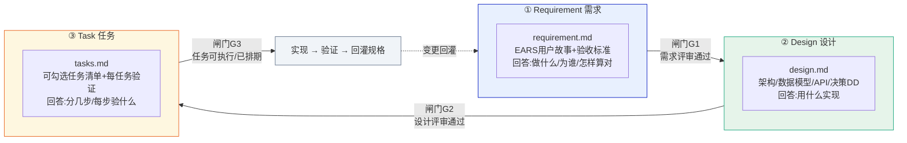

三条不能破的铁律贯穿到底：**第一，单一基线**——SRS 需求基线是唯一权威源，设计和代码发现需求不对必须回源头勘误，不许下游私下打圆场；**第二，双向可追溯**——从需求编号、设计决策、任务编号一路追到测试和验收项；**第三，闸门不放水**——带着阻断问题绝不往下放进编码阶段。

把编码前的 SDD 往后延伸到测试、联调、部署与复盘，就是团队实际跑完的全生命周期地图：

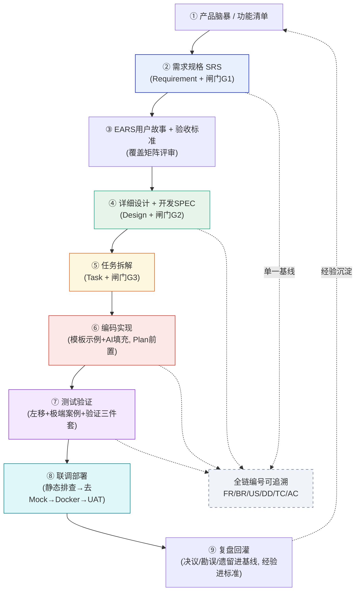

---

## 第二部分　六个阶段怎么踩坑、怎么立规矩

### 4. 需求阶段：给 AI 搭一个“想编也编不了”的输入环境

#### 真实翻车现场：AI 很擅长“合理地瞎编”

直接把一堆上市监管 PDF 扔给 AI 整理阈值表，吐出来的表格工整得吓人，可一逐行对原件就出冷汗：
- **连词反了，判定全错**：北交所创新性组合条件原文是 `OR`，AI 自作主张按 `AND` 整理，整个判定引擎结论直接颠倒；
- **自己发明评分公式**：业务要的是“达标拿满分、不达标零分”的二元判定，AI 顺手给编了一套加权算分；
- **分支与术语串台**：把标准一的 A/B 分支条件弄混，把“业务板块”和“上市板块”混为一谈。

需求是整条链最上游的“源代码的源代码”。团队的原话很直白：**“PRD 里差一个字，到后面结果偏差能放大十倍。”**

#### 解法：结构化锚点 + 权威要素溯源 + 宁缺毋假

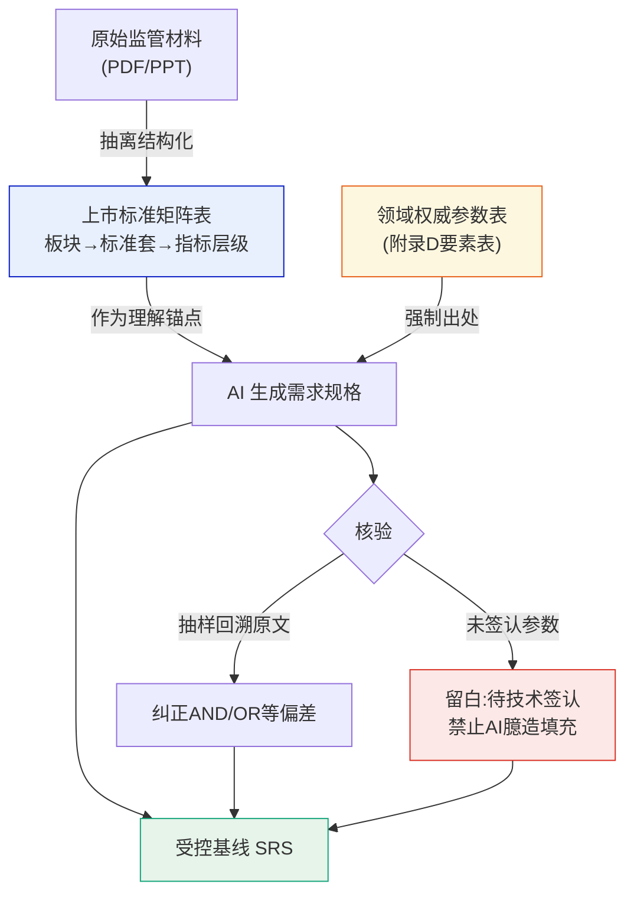

1. **先抽矩阵再让 AI 干活**：先把监管原件人工抽成“板块 → 标准套 → 指标”三层矩阵表，56 个财务要素、27 个上行要素全部入表当锚点，不让 AI 对着长 PDF 自由脑补。
2. **强制带出处 + 定死生效顺序**：建立唯一权威要素附录，每条必须写清“原文摘录 + 条件组 + 指标编码 + 阈值 + 出处页码”，并明确规定**正文和附录冲突时一律以附录为准**。
3. **还没定死的参数一律留白**：性能指标、并发量、容灾要求没拿到签认前，直接写“待技术签认”，明令禁止 AI 填默认经验值。**宁可文档留白，绝不让假数字混进需求。**
4. **歧义回源头修，不在下游和稀泥**：写设计或代码时发现需求含糊，走“确认 → 勘误 → 升级 SRS 版本”流程，绝不在代码里自己猜一个逻辑盖过去。
5. **警惕 AI “过度热心补全”**：拿 AI 模拟用户找 PRD 漏洞很好使，但它会顺手给 MVP 版本强行补上整套复杂版本治理闭环——**找漏靠 AI，砍不砍需求必须人拍板**。

#### 实证：产出即校准，用脚本数清 EARS 用户故事

团队用 EARS 五种固定句式把模糊需求压成可测的用户故事：

| EARS 句式类型 | 固定模板 | 适用场景 |
| --- | --- | --- |
| 普遍型 | 系统应〔动作〕 | 任何时候都要守的恒定规则 |
| 事件驱动 | 当〔触发〕时，系统应〔动作〕 | 收到外部触发或操作时 |
| 异常型 | 如果〔异常条件〕，则系统应〔处理〕 | 异常报错兜底 |
| 状态驱动 | 在〔状态〕下，系统应〔动作〕 | 特定状态才触发的逻辑 |
| 可选型 | 当〔功能可用〕时，系统应〔动作〕 | 开关类能力 |

120 条用户故事写完后，团队没有靠肉眼“大概扫一眼”，而是立刻跑脚本清点条目总数、编号连续性和模块分布——**当场抓出旧汇总表少算了 5 条（115 vs 120）**，当轮修正并记进修订记录。让机器清点机器生成的文档，比目测靠谱得多。

---

### 5. 设计阶段：防住跨文档“静默分叉”

#### 真实痛点：改一个评分规则，全链 25 处跟着变

设计产物不是一条直线，是一张互相引用的网。SRS 改了一句评分口径，用户故事、详设、建表 DDL、权限种子、API 定义、前端页面、原型 Mock 全都得动。项目里一次“评分二元化”决议，光详细设计一份文档就牵动了**约 25 处**联动修改。AI 单点改文件极快，但指望它自动记住“哪 25 个地方还留着老口径”几乎必漏，而且漏掉也不会报错，直到联调才炸雷。

#### 解法：单一基线 + 全库 Grep + 先源头后衍生 + diff 自证

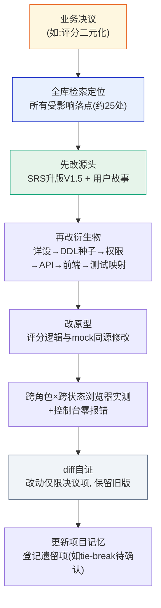

整套动作四步钉死：所有下游文档开头声明自己对齐的 SRS 版本（例如 V1.5）；动手改之前先全库检索列出受影响落点清单；严格按照“SRS/用户故事 → 详设 → DDL → 原型”的顺序往下改；留存旧版文件并做 diff 自证没有顺手改飞。顺带一提，项目把文档内版本号和文件名解耦（文件继续叫 `-V1.4.md`，内容持续升到 V1.5，旧版单独留档），避免每次升版把引用路径全扯断。

#### 两个实战小技巧：分章写详设 & 拿真实源码校验开发规范

1. **大详设分章追加，执行版和归档版分开**：让 AI 一口气吐 12 章详细设计必定半路截断，而且写到第 9 章时早忘了第 2 章定的编号和口径。团队的做法是**分章追加生成，每写下一章前重读上游基线**，同时把“给 AI 照着编码用的详设”和“包含概设用来过审计归档的版本”拆成双轨维护。
2. **开发规范 SPEC 必须拿真实代码仓验货**：AI 写开发规范时老爱抄过期的 README，结果包名、依赖版本、脚手架写法全对不上。团队直接通过仓库接口拉出脚手架配置、依赖清单、目录树和关键类源码逐条比对，给规范打上分级标记：

| 校验标记 | 实际做法 |
| --- | --- |
| ✅ 一致 | 确认规范与真实代码仓一致 |
| ⚠ 已修正偏差 | 改回真实实现，并注明采集日期与源码路径 |

就靠这一步，团队顺手修掉了一批包名与 FeignClient 命名错误，还揪出了旧文档从来没写过的实际依赖（如 Lombok、knife4j、flowable）。**规范得描述代码“真实长什么样”，而不是“当年以为长什么样”。**

#### 写审分离：拉专业评审团 + 只读子代理独立复核

AI 生成太快，光靠一个人从头看到尾必定眼花。项目每一关都按角色组评审团，逼着输出带严重度和具体位置的“问题清单 + 覆盖矩阵”：

| 评审关口 | 审谁 | 谁来审 | 真实拦下了什么 |
| --- | --- | --- | --- |
| PRD 联合评审 | SRS V1.1 | 产品 / 架构 / 高管 / 财务 / 开发 | **拦下 7 阻断 + 16 重要**，闭环后升 V1.2 |
| EARS 故事评审 | 故事 × SRS | 业务 / 需求分析 / 架构 / 测试 / 安全 | 输出覆盖矩阵 + F1～F4 勘误回灌 SRS |
| 业务联合评审 | SRS × 故事 | 业务合议 | 拍板评分二元化，回灌全链 25 处 |
| 统一方案复核 | 观测平台 SRS | **只读子代理独立复核** | 12 项规则闭环，**抓出 1 项高危否决优先规则遗漏** |

其中**“只读子代理独立复核”**特别好用：另开一个只给读权限、不准改任何文件的 AI 会话专门挑刺，和主干活会话形成**写审分离**。二代 SRS 升版时正是它抓出了一处遗漏的否决优先条件——漏掉这一条，整个板块达标判定直接落错档。并且团队立了死规矩：**只读文档核对不准写成“已通过系统测试”，没真正跑过的层级必须写“未测”。**

---

### 6. 任务阶段：把设计翻译成 AI 的“施工图”

设计文档再漂亮，直接对 AI 说“照着设计开始写代码”，多半还是失控——它要么一把改二十个文件搞出一堆冲突，要么写了半截告诉你“搞定了”，其实连编译都没过。任务拆解就是设计到代码之间的施工组织设计，每个任务清单条目必须带齐四样东西：

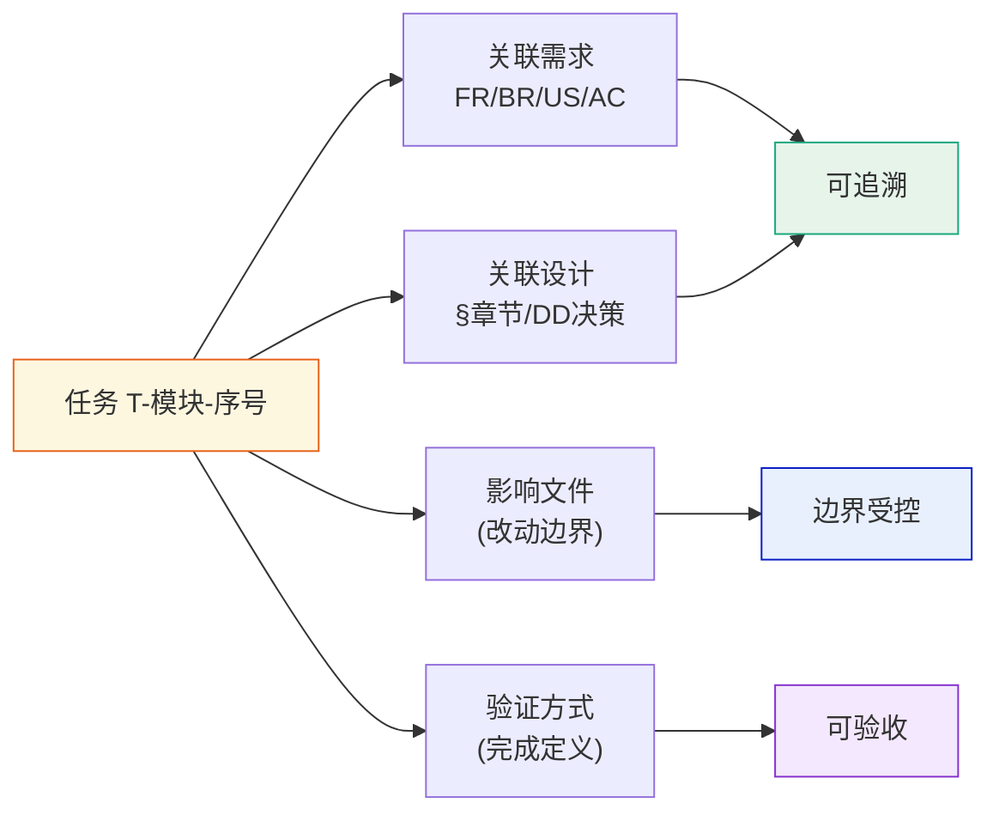

粒度卡在“一次可独立提交、可独立验证的最小单元”，前后依赖用前置关系写明，状态只在**代码写完并且通过验证后**才准勾选完成。三层验证按任务类型对号入座：

| 验证层级 | 靠什么验 | 适用范围 |
| --- | --- | --- |
| 静态门禁 | lint / typecheck / build / 语法检查 | 所有代码任务必跑 |
| 单元与接口 | 单测、接口用例、算例回归 | 核心逻辑、算法与后端 API |
| 端到端实测 | **浏览器全走通 + 控制台零报错**（跨角色 × 跨状态） | 前端页面与完整链路 |

更重要的是提前写进流程里的**四条防 AI 翻车对策**：第一，会话太长上下文会丢，**跨步骤一律回看设计文档，不靠聊天记忆接着干**；第二，数据库迁移脚本严格实行单写者约定，防止多人或并发步打架；第三，缺依赖或工具报错**当场停下来补工具，绝不静默跳过测试**；第四，编码发现设计和实际撞车，**先回去升级设计文档再改代码，绝对不准代码偷偷绕过设计**。

---

### 7. 编码阶段：修三道护栏，把“意外破坏”降到零

#### 护栏一：改代码前先审 Plan MD，治好“顺手删代码”

实操中出过一次惊险事故：**AI 在改页面需求时顺手删掉了核心功能页签**，编译一切正常，跑起来才发现入口没了。根因很简单——上下文有限，改的文件一多，AI 很容易误判周围代码的去留。

团队当场立规：**改代码前必须先交一份 Plan 文档，写清要改哪几个文件、每个文件动哪块、明确哪些范围绝不许碰**，人点头放行后再动手：

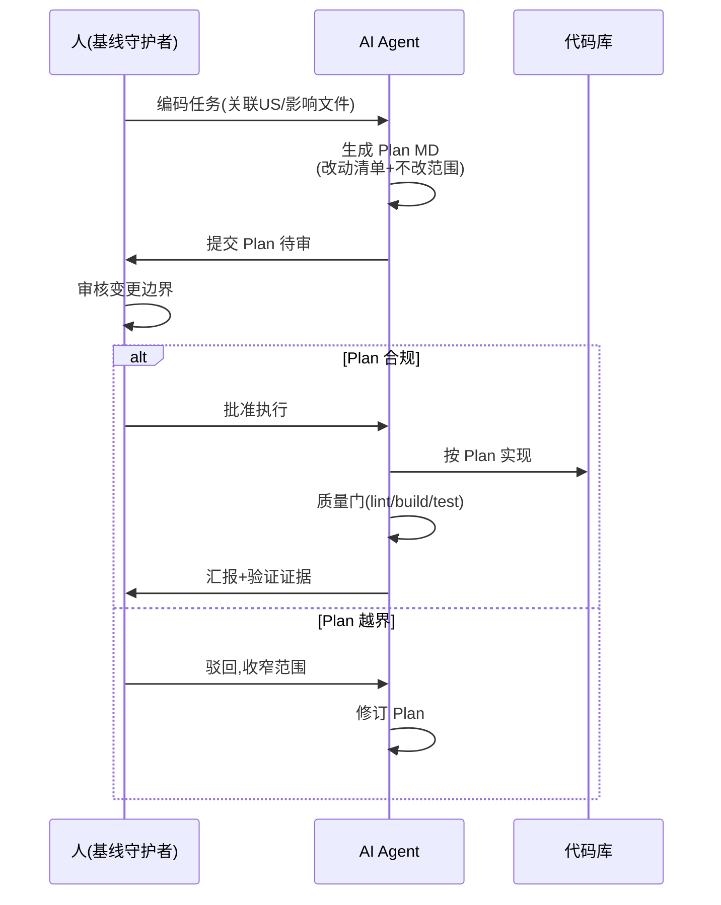

多出一次确认才几秒钟，换来的是误删、越界重构类事故彻底清零。

#### 护栏二：模板代码拷贝 + AI 填业务逻辑，解决规范打架

当存量模板、团队规范和 AI 自由发挥撞在一起，各种隐藏问题全冒出来了：违反规范乱引 CSS 包、枚举拼写歧义（例如 MET 和 MEET 混写）、定义了枚举却没人用的死代码、文档写返回标准分页对象而代码实际吐了列表加总数。

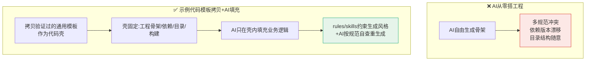

把骨架、依赖、目录和构建脚本全锁在经过验证的模板壳里（前端收死单一 UI 出口和单一 HTTP 出口，后端收死单向分层依赖与统一错误码段），只让 AI 往壳里填业务代码。就像一线同学感叹的：“这种小问题特别隐蔽，关关难过关关过。”审 AI 代码的重点不是当人肉编译器逐行看语法，而是**跑通功能行为 + 盯死核心算法 + 静态扫一遍枚举、命名和接口契约**。

#### 护栏三：允许前后端一次联动改，但划清大屏视觉边界

1. **放开前后端联动改接口**：如果硬把前后端拆成完全隔离的两轮任务，只会陷入“前端对不上后端、改完后端又对不上前端”的死循环。让 AI 在同一次受控变更里一起对齐契约，返工少一大半。
2. **重视觉模块不强求 AI 一包到底**：碰到二代平台的数据指标大屏时，团队达成了一致共识——**展示型页面别指望 AI 端到端还原像素级视觉**，正确分工是“先人工把样式骨架定死，AI 只负责把数据接口填进去”。就像项目 FDE 总结的那样：“它肯定不是万能的，一定要找到合适的边界……不到那个粒度它是还原不出来的。”功能性模块先冲，展示型模块放后头人工精调，是最划算的排序。

---

### 8. 测试阶段：给 AI 铺好测试环境，逼出一份诚实报告

AI 时代写测试用例几乎不花钱，测试工作真正的含金量转移到了三件事上：**提前介入（左移）、把测试基础设施搭稳、以及守住测试报告的诚实底线。**

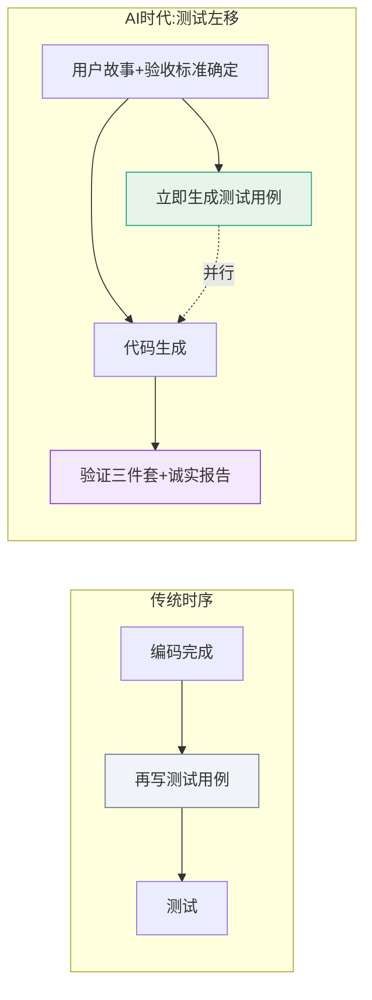

1. **左移选材标准：不挑文笔好的，挑拆得清、可测试的**。有多个版本用户故事时，团队故意选了逻辑拆解最细的版本生成测试集，和代码生成并行推进。
2. **极端案例法 + 专家背书 + 正反覆盖**：拿北交所 **4 层 `AND/OR` 嵌套**条件做最复杂用例，配最简单用例双向夹击边界漏洞，再拉行业专家过一遍业务数据。同时团队踩过一个典型坑——AI 第一版生成了满屏报错失败测试，差点漏掉正常路径正向验收，因此把**“正反覆盖审查”**直接写进了测试 checklist。
3. **先把环境跑顺再叫 AI 测（极容易被忽视！）**：一线 FDE 吃过亏后总结道：“环境是个大问题，AI 一测发现环境挂了就一头扎进去修环境，正式任务彻底黄了。”为了不让 AI 把会话全烧在装依赖和过登录上，团队专门搭了三件套基础设施：

| 专为 AI 搭的基础设施 | 堵住了什么死循环 | 具体做法 |
| --- | --- | --- |
| 人工预验证环境 | AI 在测业务时卡死在调环境上 | 开测前人先在专用机上把前后端完整拉起跑通一遍 |
| Mock SSO 免登 | 端到端测试被集团真鉴权卡在门外 | 开发测试期开 Mock 双角色免登开关 |
| 浏览器插件读取 DOM | 纯坐标点 UI 脚本极其脆弱 | 插件直接读页面结构自动输入、点击和断言 |

4. **验证三件套 + 诚实分层结论**：前端一律过“全路由跨角色实测 + JS 结构校验 + **控制台零报错**”（没截图能力就降级走结构化 DOM 断言；调页面改完给 URL 加查询参数强刷防老状态假阳性）。最后输出逐条对齐验收标准的诚实清单，严禁用模糊话术粉饰：

| 结论标记 | 代表什么 |
| --- | --- |
| ✅ | 真跑通过，必须附上运行或截图证据 |
| ⚠️ | 存在缺口，写明卡在哪里 |
| ➖ | 未覆盖（例如测试环境拿不到真实集团 SSO 或性能未签认），老实写明原因 |

另外立一条联调追踪死规矩：**提缺陷必须附截图加 Request ID 发群**，在 AI 改代码飞快的节奏下，这就是定位后台问题最省时间的凭证。

---

### 9. 联调与部署：静态扫一轮，直接省下十几个现场 Bug

详细设计评审过了、单元测试也跑了，正式联调前还会出什么幺蛾子？团队在联调前把全部接口做了一次文档与代码静态一致性核对，**照样当场揪出 13 个接口存在字段缺失或折叠问题**，还有几处多调用点返回字段命名不统一。

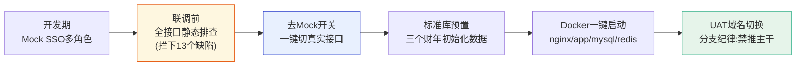

每提前静态拦下一个问题，联调会上就少扯一次皮。紧接着靠“去 Mock 一键开关切真实接口 + 预置三个财年标准初始化数据 + Docker Compose 一键拉起 nginx/app/mysql/redis”把环境交付变标准件。顺便把**“分支代码完整性检查”**塞进了部署清单——项目里真踩过一次“前端分支推代码失败成空目录、差点对着空气联调”的尴尬坑。

---

## 第三部分　组织怎么改、账怎么算、边界在哪

### 10. 团队协作：为什么 2 个人能干完以前一队人的活，但加人也快不起来？

AI Coding 从“个人提效玩具”升级成“团队交付能力”，靠的是五个管理动作把人对齐：

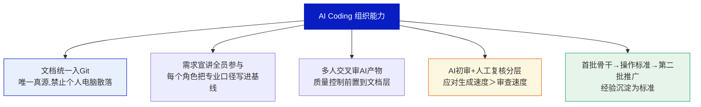

1. **所有规格进 Git 仓库**：谁电脑里私存的 Word 都不算，SRS、SPEC、设计必须版本化可 diff，代码改了规格同步改，让 AI 永远读到同一份真源。
2. **需求宣讲全员参与**：不再是产品经理对开发单向宣讲，而是业务、财务、研发、测试一起把各自专业口径补进基线。
3. **多人交叉审 AI 产物**：由多个角色交叉核对 AI 产出的文档，把质量关口前移到文档层而不是等到编码后返工。
4. **破解“AI 写得比人审得快”**：**让只读 AI 子代理先做形式初审**（编号连续吗、覆盖率漏没漏、条款对齐没），把人类宝贵的注意力全部省下来做**业务判断与取舍拍板**。
5. **骨干趟路沉淀成标准再推广**：把 Plan 模板、质量门和踩坑清单固化下来带第二批人，避免“高手一走，手艺全丢”。

从投入账上看，成本结构彻底变了脸：

| 账目维度 | 传统研发模式 | AI Coding 模式 |
| --- | --- | --- |
| 显性支出 | 大量人力工时 | 模型 Token 消耗（比人工便宜一个数量级） |
| **最大隐性成本** | 跨团队扯皮与返工 | **资深人员审文档、定口径的时间** |
| 队伍形态 | 多人分工写代码 | **2 人小团队**即可吃下整项目 |
| 提速方式 | 堆人头并行开发 | **加人也提不了多少速**（阶段前后强依赖，卡在决策带宽上） |

结论很现实：AI Coding 时代真正紧缺的不是写代码的人手，而是**懂业务、敢拍板、审得住基线的资深角色**。

### 11. 五维度复盘度量：别光盯着“88.3% 实现率”

收尾复盘时用同一套五维指标记账，才能把踩过的坑直接转成下一轮的模板与反模式（注：真实项目里曾发生 1 次多 Agent 并发写 HTML 冲突——靠写前比对哈希保住了他方改动；另有 1 处文档版本引用漂移留待勘误）：

| 度量维度 | 盯哪些指标 | 本项目实测表现 |
| --- | --- | --- |
| **规格质量** | 阻断项数 / 返工与勘误次数 | PRD 评审拦下 7 阻断 + 16 重要；SRS 经五轮受控升版 |
| **可追溯性** | 需求→验收覆盖率 / 设计回链率 | 120 条用户故事全编号双向可追 |
| **一致性** | 跨文档版本错位 / 统计漂移数 | 抓出统计表少计 5 条；1 处引用漂移待勘误 |
| **实现验证** | 一次通过率 / 报错数 / 验证混用数 | 实现率 88.3%，整体完成度 97.4%，未混淆文档核验与系统测试 |
| **协作纪律** | 越界改动 / 写冲突 / 臆造默认值 | 拦下 1 次 HTML 并发写冲突并保留他方改动；待签认参数全留白 |

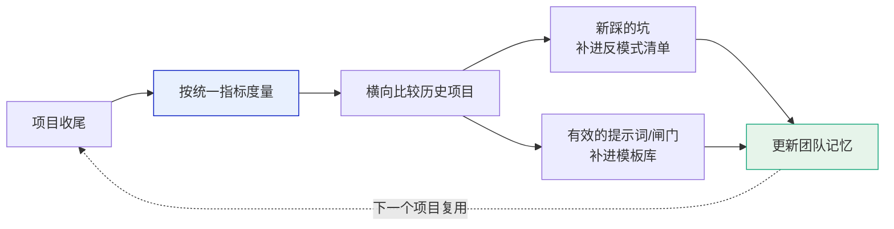

真正该盯死的前置健康指标，是**“评审阻断项在编码前的拦截率”**和**“联调前静态排查抓到的缺陷数”**——这两项高了，后面的联调和上线自然稳。

### 12. 诚实划边界：什么时候千万别硬套这套重规格？

| 业务场景 | 适不适合走重规格 SDD | 原因 |
| --- | --- | --- |
| 规则密集的中大型功能/系统 | ✅ 强烈推荐 | 多轮迭代、多人协作、错一点影响全链 |
| 金融、政务、合规内管系统 | ✅ 强烈推荐 | 审计、追溯、口径一致性是硬指标 |
| 多人或多 Agent 并行开发 | ✅ 强烈推荐 | 没有单一基线和边界声明立刻写乱 |
| 一次性跑批脚本 | ❌ 别硬套 | 直接对话写完跑通就扔，写规格纯属内耗 |
| 方向还在天天变的探索性 Demo | ❌ 别硬套 | 需求没定型前写死规格反而绑手绑脚 |
| 改几个字、修个样式的极小改动 | ❌ 别硬套 | 杀鸡不用牛刀 |

另附四条实打实踩出来的边界：展示型大屏人工先定样式、AI 会过度补全要人来砍、**接手存量老项目前先让 AI 读完老代码建立真实基准再动手**、前后强依赖环节别迷信靠加人堆出并行速度。

### 13. 起步建议与坦诚尾声

准备在团队里推这套打法的同学，按下面三步稳稳落地即可：

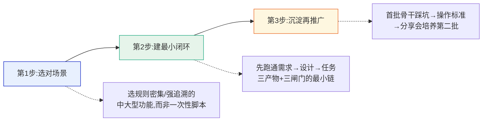

老实说，这个项目到复盘时也还有没画完句号的尾巴——SRS 的最终正式签署、几项性能并发参数的签认、两代产物的长期基线收口关系，都还安安静静躺在遗留项清单里。但它实打实证明了一件事：**在企业级场景里把 AI Coding 跑成 88.3% 实现率的，从来不是某个会写魔法代码的模型，而是单一基线、编号追溯、质量闸门、Plan 前置和诚实验证这些“老软件工程纪律”**——只不过在 AI 时代，它们从“加分项”变成了“保命项”。

> 本文整理自笔者长期基于 Qoder 开展多轮企业级 AI Coding 项目的真实交付与复盘积累，供同行交流对照。

---

## 附录

### 附录 A　可直接迁移复用的项目资产

| 资产名称 | 交付形态 | 拿去干嘛 |
| --- | --- | --- |
| SDD 流程与标准规范 | 方法论文档 | 三阶段、三产物、三闸门的完整操作定义 |
| 需求工程作业手册 | 流程文档 | 各阶段作业指导加复盘核对表 |
| 三产物模板骨架 | 需求/设计/任务模板 | 新需求开局直接套用，省得从零搭结构 |
| 提示词模板库 | 6 类提示词 | 把各种核验和边界纪律压进每次调用 |
| 反模式清单 | 16 项踩坑对照表 | 发给团队开局避雷 |
| 复盘度量框架 | 5 维度指标表 | 项目收尾记账和横向复盘对比 |
| Plan MD 模板 | 变更前置审核单 | AI 动手改代码前先写清改什么、不改什么 |

### 附录 B　真实踩坑换来的 16 项反模式对照表

| 踩过的反模式坑 | 实际后果 | 立下的纠正规矩 |
| --- | --- | --- |
| 把原型或实现细节写进需求（如硬编码日期、“第 2 条”） | 需求极脆弱，把实现方式焊死 | 需求只写“做什么”，具体长啥样留给设计 |
| 算指标缺口径（时间窗、精度、单位、空值、历史范围） | 判定引擎系统性算错 | 需求专门单设“计算口径”一节 |
| 汇总统计表和正文实际条目数对不上 | 追溯全假了 | 每次改完跑脚本清点校准 |
| 超长设计文档让 AI 一次性吐完 | 写到后面截断丢内容、前文口径飘 | 分章追加，写新章前重读上游 |
| 设计引用的上游 SRS 版本号忘了更新 | 基线错乱，两头打架 | 发布前强查引用版本号 |
| 下游发现上游有歧义，私下猜着改了算 | 需求与设计彻底分叉 | 登记决策备案并勘误升版源头 |
| 没审 Plan 就放 AI 直接改代码 | 顺手删掉核心功能页签 | 必走 Plan MD 审核变更范围 |
| 任务不写验证方式，或把文档核对吹成测过了 | 假完成，隐患直通联调 | 每任务附实测证据，严分核验与系统测试 |
| 截图工具挂了直接跳过 UI 检查 | 漏掉页面渲染报错 | 降级结构化 DOM 校验兜底 |
| 改完前端页面不强刷缓存 | 拿上一轮旧 state 误判通过 | 调试 URL 加查询参数强刷重载 |
| AI 跑测试一遇环境报错就死磕修环境 | 正式测试彻底完不成 | 人先在预验证环境完整跑通一遍 |
| 顺手改无关老代码或阈值 | 变更爆炸，引入未知回退 | 死守任务声明的影响文件边界 |
| 多个 Agent 并行写同一份文件互相覆盖 | 辛辛苦苦改的丢了一半 | 写前校验文件哈希与修改时间 |
| 还没找甲方签认的性能参数让 AI 自己编默认值 | 带着假指标上线 | 留白标注待签认及责任人 |
| 开发规范照抄过期 README 或文档站 | 规范跟真实代码仓脱节 | 拉真实源码逐条比对并标注偏差 |
| 数据大屏这类重视觉模块全交 AI 端到端 | 视觉怎么调都不对味 | 人工定死样式骨架，AI 只接数据接口 |
