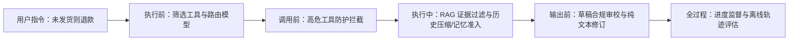

# 开发框架：让 Agent 学会判断，从 Jev 接入到完整 Harness 决策流程

用大模型搭完一个能调工具、能跑多轮的 Agent 后，团队很快就会撞上同一类工程难题：主流程推进到关键叉路口时，到底该让谁拍板？

比如：手里注册了几十个业务工具，这轮对话只该把哪一两个递给主模型？模型已经准备发起一笔退款调用，上下文里的事实真的够支撑它扣款吗？RAG 检索回来的文档里，有没有混进“忽略前面指令”的提示注入？任务跑了十几步，Agent 自己嘴上说“搞定了”，到底有没有偷懒或偏航？

如果让生成式大模型在每个节点都停下来“写一段推理、吐一份 JSON”，整个链路又慢又不稳，还经常在关键时刻掉格式。把这批“需要语义理解，但只需要结构化结论”的叉路口拆出来，交给 TypeSafe 推出的 **JEV（System One）决策模型**，再由外层任务控制脚手架（**Harness**）把判断接回主流程——这就是 AgentScope Java 正式支持 JEV 的核心思路。完整模块入口见 [JEV 模块文档](https://java.agentscope.io/v2/zh/jev/index)，System One 概念见 [TypeSafe System One 官方介绍](https://docs.typesafe.ai/concepts/system-one)。

## 1. 先理清分工：生成模型、JEV 和 Harness 谁干什么？

要把判断逻辑接稳，先得把系统里的三类角色——**生成模型、JEV 决策模型、确定性业务代码与 Harness**——划分清楚。AgentScope 并没有把 JEV 塞进常规的聊天模型接口里，而是通过独立的客户端和 Harness 中间件接入，原因很简单：

- **生成式大模型（System 2 认知大脑）**：负责拆解复杂问题、组织面向用户的自然语言回复、编写代码补丁、发起工具调用。
- **JEV 决策模型（System 1 决策传感器）**：不做开放式文本生成，只接收当前上下文（State）和预设好的问题定义（Question），直接返回类型化的选项、分数以及经过校准的概率，专攻分支、排序、过滤和合规打分。
- **确定性代码（规则引擎与权限系统）**：负责硬性事实核验。比如“当前用户有没有退款权限”“订单在数据库里是不是已经退款”，直接查身份系统和业务库永远比任何模型更准、更快。只有涉及语义理解的判断（如“回复草稿有没有遗漏退款条件”“检索段落里有没有诱导指令”），才值得交给 JEV。
- **Harness（外层控制脚手架）**：把 JEV 产出的结构化结论放到恰当的执行卡点上，决定什么时候只记日志观察（SHADOW）、什么时候真正拦截或改写流程（ENFORCE），并在超时或异常时按安全边界回退。

记住一条基本原则：**概率校准看的是大量样本下的统计频率一致性，不保证单次判断百发百中。** JEV 给出的概率和置信度只是决策信号，到底卡 0.8 还是 0.9 才能自动放行，依然要用你自己的业务样本实测校准后再决定。

### 一次调用的最小结构：材料与三种题型

向 JEV 发起判断请求时，结构只有两部分：一份共享的上下文材料（State），和一组用自定义 ID 命名的判断问题（Question）。例如在核查回复草稿时，材料里放入“业务记录：尚未执行退款”和“回答草稿：退款已经完成”，问题则明确问“业务记录是否支持草稿中声称的退款状态”。问题写得越具体，概率越有意义；如果只笼统问一句“这个回答好不好”，不附带政策和事实标准，任何模型都给不出可复用的分数。

根据判断需求不同，问题分为三种基础类型：

| 问题类型 | 返回内容 | 最适合解决什么问题 |
| --- | --- | --- |
| 是非判断（`NoulQuestion`） | 命题为真的概率（0～1） | 这个工具现在能用吗？这句话有证据支撑吗？ |
| 多选一（`ChoiceQuestion`） | 选中项、各选项概率分布与置信度 | 在几个已配置的路由分支里走哪一条？ |
| 程度打分（`ScoreQuestion`） | 等级概率分布、加权分与置信度 | 风险处于哪一级？回复覆盖了多少用户诉求？ |

其中，**多选一适合“只能挑一条路”的场景**（如模型路由）；而面对“查订单”和“条件退款”可能同时派上用场的工具列表，就需要**逐个工具做是非判断**，不能硬塞成单选。

在原始概率之上，AgentScope 还封装了可复用的评审器组件（`JevJudge`），把连续概率直接翻译成业务代码好接的四种终态：**通过（PASS）、明确失败（FAIL）、证据不足（INCONCLUSIVE）和调用故障（ERROR）**。这样既能防住“把网络超时误当成 0 分拒绝”，也能在灰区样本到来时引导系统补充证据或转交人工。详见[问题类型与状态契约](https://java.agentscope.io/v2/zh/jev/concepts)与[评审定义](https://java.agentscope.io/v2/zh/jev/guides/judge-api)。

## 2. 从一次“条件退款”看完整 Harness 决策链路

假设客服 Agent 收到一条很常见的用户指令：**“查一下订单，如果还没发货就退款，并告诉我结果。”**

如果放任大模型一路裸奔，常见的线上翻车现场有四类：把几十个不相干的运维/财务工具全塞进上下文拖垮准确率；没先查清发货状态就急着调了退款接口；知识库里混进了恶意文本把模型带偏；或者明明只提交了申请，模型却在回复里向用户承诺“钱已到账”。

在接入 JEV 之后，Harness 会把结构化判断嵌进这条链路的四个阶段，各司其职：



需要特别注意一道边界：**前面每一步的“放行”只解决局部问题，不能互相替代。** 退款工具通过了候选筛选，不等于已经满足退款条件；退款调用通过了执行前防护，不等于订单系统真的扣款成功；回答草稿通过了合规审校，也不能替代数据库里的执行回执。

### 各阶段决策机制与工程边界

1. **执行前——先把菜单精简，再把危险动作拦在门外**：
   - **工具筛选**：每轮推理前，用独立的是非判断筛选当前真正相关的可选工具，控制暴露给主模型的工具数量上限（必须保留的系统级工具另行保留，不占配额）。**真实痛点**：把全部几十个工具描述硬塞给主模型既烧 token 又容易选错；但如果粗暴全删，用户一句普通寒暄也可能触发误判。**机制与取舍**：默认只取最近 8 条非空文本消息（总预算 8000 字符）来评估，虽然能锁住决策输入开销，但在超长会话里可能会漏掉早期的任务背景，需要按业务对话长度实测调窗。明确判定“不需要业务工具”时只留必要工具；一旦判定超时或异常，则安全回退到原工具目录。切记：**筛选只收敛模型能看见的菜单，不替代底层接口鉴权。** 详见[工具选择指南](https://java.agentscope.io/v2/zh/jev/guides/tool-selection-api)。
   - **阶段路由与团队建议**：在规划、执行等显式划分的任务阶段切换时，结合宿主提供的模型能力、上下文容量、输出预留与配额池，先筛掉不达标模型，再让决策模型挑出合适档位或建议思考等级；单次调用内复用路由结果，真正派发前仍会复核配额条件。多 Agent 协作时也能按阶段推荐可用的授权成员，但最终分派权仍在宿主调度器手里，不会因为一条工具输出就擅自乱切阶段。详见[阶段路由](https://java.agentscope.io/v2/zh/jev/guides/phase-routing-api)和[团队建议](https://java.agentscope.io/v2/zh/jev/guides/team-routing)。
   - **高危工具执行防护**：即使“退款”出现在候选工具里，当主模型还没查订单状态就试图直接发起调用时，防护栏会在派发前拦截这次具体的工具调用。在强制拦截模式（ENFORCE）下，不仅判为拒绝的调用会被拦下，**一旦决策接口本身超时或报错，受保护的工具同样拒绝放行（Fail-closed）**——宁可不扣款也不能冒着误操作风险盲放。参数的合法性、业务权限和接口幂等依然由原有的业务执行链保障。详见[执行防护指南](https://java.agentscope.io/v2/zh/jev/guides/tool-guard-api)。

2. **执行中——治理长历史、守住记忆门禁与检索证据**：
   - **历史上下文压缩与归档**：长任务跑久了，塞满文件正文和搜索结果的工具记录很快就会挤爆窗口。压缩器只针对宿主允许裁剪的工具调用，判断哪些历史该保留、截短（注意：截短保留的是结果前缀，不等于语义摘要），哪些可以成对移出当前上下文；对于最近消息、系统指令、固定约束、残缺调用记录以及拿不准的内容则直接保护保留。**防丢兜底**：ENFORCE 模式下必须在文件或持久化存储中先完成按用户/会话/Agent 隔离的归档，归档失败或压缩收益不够时干脆保留原历史；后续如果发现漏了信息需要回读，取的是归档过的原始消息，绝不会重新跑一遍历史工具带来副作用。详见[上下文压缩](https://java.agentscope.io/v2/zh/jev/guides/context-compaction-api)、[归档恢复](https://java.agentscope.io/v2/zh/jev/guides/context-archive)与[显式交换对规划](https://java.agentscope.io/v2/zh/jev/guides/context-planner-api)。
   - **长期记忆准入把关**：历史压缩时把材料挪出窗口，**绝不等于这些内容自动值得写进长期记忆**。记忆门禁会专门评估一条候选事实有没有持久价值、有没有和已有记忆冲突，并只输出准入建议，实际落库仍由应用层显式掌控。详见[记忆准入](https://java.agentscope.io/v2/zh/jev/guides/memory-api)。
   - **RAG 证据过滤与事实依据检查**：普通向量检索只看关键词或语义相似度，很容易把“虽然否定用户提问前提、但极其关键的业务限制”（例如用户问“能无条件退款吗”，政策写“必须未发货且七天内且经审核”）误判成不相关而丢掉，或者把文档里夹带的提示注入带进上下文。证据处理器会在宿主完成权限控制（ACL）之后，对可见段落区分“提示注入”“正面依据”和“修正前提的关键政策”，再把干净证据交给模型，最后核对草稿是否忠实使用了这些材料。详见[证据处理](https://java.agentscope.io/v2/zh/jev/guides/evidence-pipeline-api)、[相关性与依据检查](https://java.agentscope.io/v2/zh/jev/guides/rag-api)和[Knowledge 适配](https://java.agentscope.io/v2/zh/jev/guides/knowledge-adapter-api)。

3. **输出时——只修有毛病的草稿，绝不重跑业务循环**：
   - **真实痛点**：订单明明已经成功退了，但模型在最终回复里把“申请已提交，需审核”口嗨写成了“退款已到账”。如果因为文案错而打回重跑整轮 Agent，极可能重复触发外部业务调用。
   - **机制与取舍**：回答审校器只在“没有新增工具调用、准备直接输出给用户”的终点触发。ENFORCE 模式下如果原稿未过检，只会进入**有限次数的纯文本修订**——修订过程不带任何工具，彻底杜绝二次执行；修订稿再次通过才放行，超时、证据不足或修订次数耗尽则拦截原稿转兜底/人工。代价是**流式输出必须先攒着等过审再吐出**，无法一边生成一边逐字流给前端。仅观察的 SHADOW 模式则会放行原稿、只记审计记录。详见[回答修订](https://java.agentscope.io/v2/zh/jev/guides/answer-refinement-api)、[内容护栏](https://java.agentscope.io/v2/zh/jev/guides/content-guardrail-api)和[草稿管线](https://java.agentscope.io/v2/zh/jev/guides/draft-pipeline-api)。

4. **长任务与扩展场景——防卡死、算清账、严守验证口径**：
   - **持续进度监督与离线轨迹评估**：在长任务运行中，监督器观察是否取得实质推进、有没有陷入死循环或跑偏，决定建议继续、复核还是补充验证；但**监督器与轨迹评估器都只支持 OFF 和 SHADOW 模式**——前者不会自行强行停掉任务，且只有宿主提供与当前版本和作用域匹配的真实验证证据后才能确认完成（模型嘴上说 DONE 不算数）；后者事后拆开评估“工具选得对不对”与“回答依据足不足”，把失败、跳过和弃权清晰分开而不是混成一个低分，用来建立版本对比和回归基线。详见[持续监督](https://java.agentscope.io/v2/zh/jev/guides/supervision-api)、[验证证据接入](https://java.agentscope.io/v2/zh/jev/guides/supervision-evidence)、[单次任务复核](https://java.agentscope.io/v2/zh/jev/guides/task-review)、[轨迹评估](https://java.agentscope.io/v2/zh/jev/guides/trace-evaluation-api)、[指标定义](https://java.agentscope.io/v2/zh/jev/guides/metric-definitions)与[批量评估](https://java.agentscope.io/v2/zh/jev/guides/evaluator-api)。
   - **专业扩展（代码评审与只读浏览器）**：针对代码 diff 或源码快照，代码评审组件会分阶段筛选风险并在解析出的真实区域定位证据，但同样仅限 OFF/SHADOW，**没报问题绝不等于代码绝对安全**，也不能替代自动化单测和人工审核；只读浏览器导航器则通过专用读取工具在独占会话中从可见候选中挑选只读动作，页面变动后必须重观察，且**只有独立完成验证器通过才算 VERIFIED**。多标签分流与客服承诺核查也可直接组合轻量 API，无需为了用判断能力硬套一整套重型 Agent。相关入口见[代码评审指南](https://java.agentscope.io/v2/zh/jev/guides/code-review-api)、[浏览器执行](https://java.agentscope.io/v2/zh/jev/guides/browser-execution-api)、[动作建议](https://java.agentscope.io/v2/zh/jev/guides/browser-proposals)、[候选分类](https://java.agentscope.io/v2/zh/jev/guides/application-api)与[客服评审](https://java.agentscope.io/v2/zh/jev/guides/support-api)。

### AgentScope Harness 决策组件与安全边界速查表

为了避免在正文里堆砌 Java 类名干扰阅读，这里把核心组件、运行模式和异常回退口径集中收在一张表里供工程检索：

| 所处环节 | 解决的核心问题 | 对应组件（AgentScope Java） | 支持模式 | 判断失败 / 不确定时的安全口径 |
| --- | --- | --- | --- | --- |
| 通用调用与评审 | 发起结构化判断、输出四态评审结论 | `JevClient` / `JevJudge` | 直接调用 | 抛 `JevException` 或返回 `ERROR` / `INCONCLUSIVE`，不把异常当零概率 |
| 执行前：工具筛选 | 砍掉无关工具描述，按数量上限精简目录 | `JevToolSelectionMiddleware` | OFF / SHADOW / ENFORCE | 回退展示完整原工具目录（Fail-open） |
| 执行前：阶段路由 | 按能力、上下文、配额筛池选模或荐成员 | `JevPhaseRouting` / `JevTeamPlanner` | 显式接入 | 回退默认原模型，显式切换阶段 |
| 执行前：调用防护 | 拦截证据不足或前提未满足的高危工具调用 | `JevAutoModeMiddleware` | OFF / SHADOW / ENFORCE | ENFORCE 下**拒绝派发受保护调用**（Fail-closed） |
| 执行中：历史压缩 | 成对移出/截短工具历史，压缩前先归档 | `JevContextCompactor` | OFF / SHADOW / ENFORCE | 归档失败或收益不足则保留当前完整历史 |
| 执行中：记忆准入 | 筛选值得长期留存且不冲突的记忆事实 | `JevMemoryGate` | 显式接入 | 仅输出准入建议，不自动落库 |
| 执行中：证据处理 | ACL 后过滤提示注入、保留纠偏关键政策 | `JevEvidenceProcessor` / `search_evidence` | 显式接入 | 与原文依据检查协同，保障忠实引用 |
| 输出前：草稿修订 | 纯文本修订合规漏洞，不重跑工具循环 | `JevResponseMiddleware` | OFF / SHADOW / ENFORCE | 拒绝放行未过审草稿，流式输出需待审后发布 |
| 长任务：监督评估 | 识别停滞/偏航、验证交付证据与轨迹复盘 | `JevSupervisionMiddleware` / `JevTraceEvaluator` | 仅 OFF / SHADOW | 绝不擅自停机或撤销业务，只产出观察与回归指标 |
| 专业任务扩展 | 代码 diff 风险定位、只读浏览器操作选择 | `JevCodeReviewer` / `JevBrowserNavigator` (`read_browser`) | OFF/SHADOW（代码）；独立验证器（浏览器） | 仅做辅助定位或需独立验证器确认 `VERIFIED` |

## 3. 接入实操：从一个独立判断走到 Harness 中间件

下面按照从最小可用到生产集成的顺序，演示如何在 Java 17+ 项目中把 JEV 跑起来。注意把 `${agentscope.version}` 替换为项目实际选用的版本并保持各模块一致。

### 第一步：引入依赖与配置凭据

业务代码需要直接使用客户端、评审器或评估器时，引入扩展包：

```xml
<dependency>
    <groupId>io.agentscope</groupId>
    <artifactId>agentscope-extensions-jev</artifactId>
    <version>${agentscope.version}</version>
</dependency>
```

在启动进程环境中配置 TypeSafe 密钥 `TYPESAFE_API_KEY`（未显式传 key 时，客户端会依次读取 `TYPESAFE_API_KEY` 和 `JEV_API_KEY`，两者均为空则拒绝构建客户端）。JEV 的凭据与主生成模型各自的模型配置彼此独立。

### 第二步：跑通第一次真实判断

下面是一段可以直接放进 IDE 运行的最小验证代码。它故意构造了一组“业务事实与回答草稿打架”的输入，观察模型给出的概率（该调用会请求真实接口并产生用量）：

```java
import io.agentscope.extensions.judge.jev.JevClient;
import io.agentscope.extensions.judge.jev.JevRetryPolicy;
import io.agentscope.extensions.judge.jev.NoulAnswer;
import io.agentscope.extensions.judge.jev.NoulQuestion;
import io.agentscope.extensions.judge.jev.SystemOneRequest;
import java.time.Duration;
import java.util.Map;

public class JevQuickStart {
    public static void main(String[] args) {
        var client = JevClient.builder()
                .baseUrl("https://api.typesafe.ai")
                .model("jev-latest")
                .timeout(Duration.ofSeconds(5))
                .retryPolicy(new JevRetryPolicy(2, Duration.ofMillis(500)))
                .build();
        var request = SystemOneRequest.builder()
                .state(Map.of(
                        "business_record", "尚未执行退款",
                        "assistant_answer", "退款已经完成"))
                .question("supported", new NoulQuestion(
                        "Does business_record support the refund status claimed in assistant_answer?",
                        null))
                .build();
        var result = client.systemOneBlocking(request);
        var answer = (NoulAnswer) result.answers().get("supported");
        System.out.println("记录支持草稿的概率：" + answer.noul());
    }
}
```

这里有三个工程习惯建议一开始就立好：
- 命令行验证可用阻塞方法 `systemOneBlocking`，但响应式服务端务必组合异步返回的 `Mono` 流，避免阻塞事件循环。
- 这里的 5 秒是**单次请求超时**，叠加 2 次重试后总耗时可能更长，建议在上层统一设置逻辑判断超时预算；接口异常会抛出 `JevException`，切忌当成概率等于 0 处理。
- 可以把草稿改成“目前尚未执行退款”再跑一次对比输出；真实概率值由模型动态返回，不要把某一次的浮点值写死进单测断言。更多配置见[客户端指南](https://java.agentscope.io/v2/zh/jev/guides/client)。

### 第三步：用 JevJudge 把概率转成四态评审结果

业务代码通常不想自己到处写 `if (prob > 0.8)`。复用上面的客户端定义一个 `JevJudge`，就能把概率直接映射为 `PASS / FAIL / INCONCLUSIVE / ERROR`：

```java
import io.agentscope.extensions.judge.jev.JevJudge;
import io.agentscope.extensions.judge.jev.NoulQuestion;
import java.time.Duration;
import java.util.List;
import java.util.Map;

var definition = new JevJudge.Definition("refund-answer-v1", List.of(
        new JevJudge.Criterion(
                "supported",
                new NoulQuestion(
                        "Does business_record support the refund status claimed in assistant_answer?",
                        null),
                true, 0.2, 0.8)));
var judge = new JevJudge(client, Duration.ofSeconds(2));
var review = judge.judge(
        Map.of("business_record", "尚未执行退款", "assistant_answer", "退款已经完成"),
        definition);
var observed = review.doOnNext(result -> {
    System.out.println("评审状态：" + result.status());
    System.out.println("条件明细：" + result.findings());
});
// 响应式服务返回或组合 observed；独立命令行可调用 observed.block()。
```

这里 `true` 表示期待命题成立，演示阈值卡在 `0.2`（不高于此值判 FAIL）和 `0.8`（不低于此值判 PASS），落在 `0.2～0.8` 灰区报 INCONCLUSIVE，网络超时等故障报 ERROR。实操中务必记住：**不同业务的阈值必须用自己的样本重调，同时每次调整判断标准或阈值时顺手更新版本号（如 `refund-answer-v1`）方便回归对照；另外千万别为了打印日志去对同一个 `Mono` 订阅两次，否则一次评审会变成两次真实计费调用。**

### 第四步：把判断作为中间件挂进 Harness

当希望每次推理前自动筛选工具时，引入 `agentscope-harness` 依赖，并先以 **SHADOW（旁路观察）模式**挂进已有 Agent 试跑：

```xml
<dependency>
    <groupId>io.agentscope</groupId>
    <artifactId>agentscope-harness</artifactId>
    <version>${agentscope.version}</version>
</dependency>
```

```java
import io.agentscope.extensions.judge.jev.JevExecution;
import io.agentscope.extensions.judge.jev.example.JevToolSelectionMiddleware;
import io.agentscope.harness.agent.HarnessAgent;
import java.time.Duration;

var options = new JevExecution.Options(
        JevExecution.Mode.SHADOW,
        Duration.ofSeconds(2),
        "order-tools-v1",
        (ctx, record) -> System.out.println(record));
var selector = JevToolSelectionMiddleware.builder(client)
        .execution(options)
        .maxTools(2)
        .confidenceThreshold(0.8)
        .rejectionThreshold(0.2)
        .build();
var agent = HarnessAgent.builder()
        .name("order-support")
        .model(model)
        .toolkit(toolkit)
        .middleware(selector)
        .build();
```

普通中间件默认关闭（OFF）；先挂在 SHADOW 模式下，用“查订单”“未发货则退款”和“你好”三类请求分别跑一遍，确认观察器记录里的建议工具符合预期且不影响原工具列表；校准好阈值之后，再切换为 `ENFORCE` 重新构建即可生效。注意：直接调用 `JevJudge` 等应用 API 会立即执行评审，不受中间件的全局模式开关约束；生产环境里的观察器回调也应保持轻量快速返回，把判断版本、耗时与建议关联到当前运行追踪上。详见[运行模式](https://java.agentscope.io/v2/zh/jev/guides/harness-runtime)。

### 第五步：Spring Boot 自动装配客户端

如果是 Spring Boot 服务，直接引入 Starter 省去手动构造客户端的样板代码：

```xml
<dependency>
    <groupId>io.agentscope</groupId>
    <artifactId>agentscope-jev-spring-boot-starter</artifactId>
    <version>${agentscope.version}</version>
</dependency>
```

在 `application.yml` 中配置超时与重试策略：

```yaml
agentscope:
  jev:
    api-key: ${TYPESAFE_API_KEY:}
    base-url: https://api.typesafe.ai
    model: jev-latest
    timeout: 5s
    retry:
      max-retries: 2
      initial-backoff: 500ms
```

业务 Service 通过构造器注入即可复用该客户端（如需关闭自动创建可设置 `agentscope.jev.enabled=false`，需要微调构建参数可注册 `JevClientBuilderCustomizer` Bean）。同样要注意：**Starter 只帮你管好底层客户端连接，不会暗中给所有 Agent 自动装上工具筛选或开启 ENFORCE 拦截**，中间件仍需显式装配。

```java
import io.agentscope.extensions.judge.jev.JevClient;
import io.agentscope.extensions.judge.jev.SystemOneRequest;
import io.agentscope.extensions.judge.jev.SystemOneResult;
import org.springframework.stereotype.Service;
import reactor.core.publisher.Mono;

@Service
public class DecisionService {
    private final JevClient client;

    public DecisionService(JevClient client) {
        this.client = client;
    }

    public Mono<SystemOneResult> decide(SystemOneRequest request) {
        return client.systemOne(request);
    }
}
```

### 第六步：Service 会话级配置与零密钥离线体验

如果使用 AgentScope Service，可以直接在 Session 的 `agentOverrides.jev` 字段里按用途分别开关工具选择、防护、路由、审核、评估、压缩、监督、代码评审、检索和浏览器能力，API 密钥由部署环境统一托管，宿主负责接入检索源、模型目录、浏览器会话和验证证据，详见[Service 配置](https://java.agentscope.io/v2/zh/jev/guides/service-api)。

想先零成本跑通全链路机制而不想先申请密钥的开发者，可以直接运行官方仓库 `agentscope-examples/jev` 下的离线演示工程——它用脚本模型和合成判断把检索修订、压缩归档、阶段路由、监督和轨迹评估完整串了一遍（仅用于验证流程接线，不代表真实模型精度），按[案例指南](https://java.agentscope.io/v2/zh/jev/guides/agent-integration-example)跑通即可。

## 4. 上线前的清醒检验：用真实任务判断是否值得接管

在生产环境里每多加一次决策调用，就意味着多出一份等待时间和接口成本。工程上绝不能“因为接了新模块所以一定更好”——工具菜单变短了，端到端延迟未必下降；审核关卡多了，任务最终成功率也未必上升。

验证是否值得开启 ENFORCE，必须用同一批业务样本对照“接入前”和“接入后”的端到端表现，同时盯着三笔账算清楚：

- **别只看拦截住多少坏事，还要算误杀率**：退款防护既要看漏放了多少违规退款，也要看误拦了多少正常用户请求；回答修订要对照最终正确率与因此增加的首字/整段等待时间；上下文压缩则要复验关键约束有没有丢、后续轮次的回答质量有没有掉。
- **统计口径绝不和稀泥**：把模型报错（ERROR）、证据不足弃权（INCONCLUSIVE）和主动跳过单独留档，别全折算成低分；把“决策本身耗时”和“整个任务总耗时”分开记；接口没返回用量信息时明确标记缺失，绝不能记成零成本。
- **先 SHADOW 攒样本、验证回退再 ENFORCE**：上线顺序始终是先旁路记录、校好阈值，再分用途逐个切入强制模式，并刻意构造超时和故障用例验收回退行为——工具筛选和路由失败必须保留原流程继续跑，高危工具防护失败必须果断拒绝派发，发布前审核失败必须拦住未经认可的原稿。

完整的评测方法、预算设定与观测实践可参考官方文档，也欢迎在 [Issue #3251](https://github.com/agentscope-ai/agentscope-java/issues/3251) 交流实际业务中的有效配置或踩坑记录。
