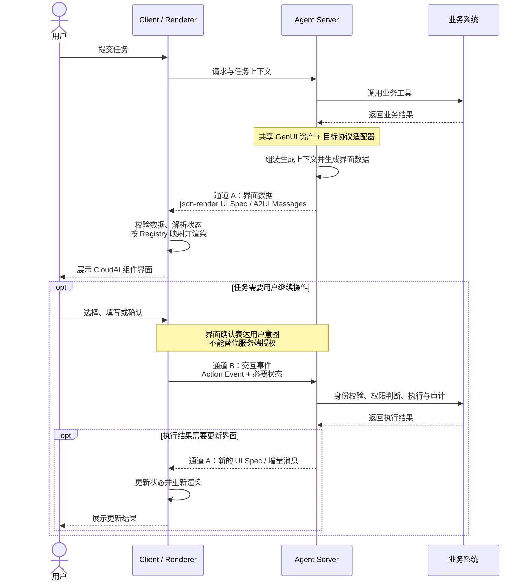

# GenUI：让 Agent 从给出答案走向交付结果

## 一、痛点：模型答得很漂亮，用户在最后一步还是得手动折腾

在用云、管云这类复杂操作场景里，用户要的从来不只是“读懂一段文字”，而是**把几组指标证据横向摆在一起对比、判断操作风险、然后在当前对话里直接把动作执行掉**。

传统界面有两种做法，但中间正好留了一大块空白：

- **纯文本**：擅长解释和开放问答，可一旦要对比好几张曲线、定位异常时间窗或点一个带风险提示的确认按钮，光靠 Markdown 文字既难看又不好操作。
- **固定页面**：擅长承载稳定高频的标准流程，但必须由前端提前画死；而 Agent 在真实任务里算出来的结果五花八门、属于典型长尾需求，根本不可能提前穷举画完所有页面。

**GenUI（生成式 UI）** 补上的就是这“最后一公里”：让 Agent 根据当次任务的真实结果，在受约束的范围内动态组织结论、证据图表和可执行操作按钮，直接在对话里交付一个可看、可点、可继续推进的界面。


（纯文本 Markdown 对比 GenUI 动态结果卡片与实例运维界面：）


---

## 二、核心机制：为什么只输出“声明式数据”，而不让模型直接写 HTML/JSX？

GenUI 不是要替代自然语言，也不是替代传统控制台固定页面。三者分工很清楚：自然语言负责解释说明，固定页面负责高频标准操作，GenUI 专门吃下**无法提前穷举的长尾动态任务**。


落地时最容易想歪的一步，是让大模型直接吐出 HTML、JavaScript 或 React JSX 代码让前端 eval 执行。生产系统绝不能这么干，原因有两个：

1. 代码输出空间太开放，品牌规范和交互一致性根本管不住；
2. 把模型自由生成的可执行代码直接塞进浏览器，安全边界直接失守。

因此 GenUI 坚持走**声明式协议**：Agent 只输出结构化 JSON 描述“这里需要呈现什么语义、哪个指标、哪个操作”，具体长什么样、怎么安全交互，全权交给客户端提前审核好的可信组件库去渲染。

整个机制踩实三条解耦原则：

- **业务结果与界面表达解耦**：业务工具查出的原始事实是唯一事实源，界面只是随时重排的投影视图；
- **表达语义与视觉实现解耦**：Agent 只挑“异常摘要”“时序对比图”“高危确认操作”这类业务语义，品牌视觉和交互细节由客户端组件独占；
- **设计知识与技术框架解耦**：设计规范不写死在某一个前端框架或通信协议里，而是先沉淀成平台中立的**共享设计资产**，再由适配层翻译给不同协议。


### 共享设计资产：把生成自由度关进三层护栏

如果只给大模型一套基础 UI 组件库，它拼出来的界面依然容易层级混乱、按钮乱摆。CloudAI GenUI 在底层沉淀了三类共享设计资产：


| 资产类型 | 管什么 | 具体内容 |
| --- | --- | --- |
| **Catalog** | “能用什么” | 本次任务允许调用的组件白名单及其数据结构、操作契约，包含基础组件、业务组件和语义组合块（Block），是硬边界 |
| **Template** | “通常怎么摆” | 按常见任务意图总结出的推荐布局结构与范例，帮 Agent 快速收敛排版 |
| **使用规则** | “该怎么用” | 信息主次层级、什么场景选什么组件、高危操作怎么弹确认提示等约束 |

> 注：具体协议层也会出现 “catalog” 一词（例如 A2UI 用它指客户端声明的可用组件集合）。文中 **GenUI Catalog** 指跨协议的共享设计资产库，**协议侧 catalog** 指适配层翻译给某一具体协议与渲染器的组件清单。

有了这三类资产，GenUI 的确定性就靠三道防线兜住：**Catalog 白名单限定能用什么元素 → Schema 校验在渲染前拦截非法结构 → 客户端可信组件独占最终渲染实现**。

---

## 三、接入设计资产前后对比与结构化 Spec 示例

仅有协议和基础组件库（如 shadcn）时，信息主次和操作边界全凭模型临场发挥；接入 Block、Template 和使用规则后，生成界面的结构清晰度与一致性明显拉高：

接入设计资产前（基于基础组件直出）：


接入设计资产后：


更关键的是，系统在流式输出时采用**按消息、按节点逐个校验**的机制：渲染器一边收增量协议数据，一边过 Schema 校验，不合法的单个节点直接跳过或降级，不用等整屏数据生成完才卡着一起画，同时天然把 XSS 脚本注入等风险挡在门外，结构化协议数据也方便全链路留痕和回放排错。

::: details Json Render Case：结构化 UI Spec 示例与最终渲染效果
下面是一份诊断场景下由 Agent 输出的声明式 Spec 数据，先声明洞察摘要，再引用四个指标卡片和一张慢日志与资源组合趋势图：

```json
{
  "root": "insight",
  "elements": {
    "insight": {
      "type": "InsightBlock",
      "props": {
        "tag": "analysis",
        "title": "慢日志是当前性能问题的主要原因",
        "summary": "实例整体资源充足，慢日志峰值与资源波动同步出现，优先治理高频慢 SQL。"
      },
      "children": [
        "metrics",
        "evidence"
      ]
    },
    "metrics": {
      "type": "Grid",
      "props": {
        "columns": 4,
        "gap": "sm",
        "className": null
      },
      "children": [
        "cpu",
        "memory",
        "connections",
        "locks"
      ]
    },
    "cpu": {
      "type": "MetricCard",
      "props": {
        "badgeText": "CPU 峰值",
        "title": "68%",
        "description": null
      }
    },
    "memory": {
      "type": "MetricCard",
      "props": {
        "badgeText": "内存使用率",
        "title": "61%",
        "description": null
      }
    },
    "connections": {
      "type": "MetricCard",
      "props": {
        "badgeText": "连接使用率",
        "title": "42%",
        "description": null
      }
    },
    "locks": {
      "type": "MetricCard",
      "props": {
        "badgeText": "锁等待",
        "title": "3",
        "description": null
      }
    },
    "evidence": {
      "type": "ChartGroup",
      "props": {
        "title": "慢日志数量",
        "layout": "single"
      },
      "children": [
        "health-chart"
      ]
    },
    "health-chart": {
      "type": "ComboChart",
      "props": {
        "data": [
          { "time": "12:00", "slowLogs": 2, "cpu": 44, "memory": 31, "connections": 20 },
          { "time": "13:00", "slowLogs": 9, "cpu": 32, "memory": 25, "connections": 38 },
          { "time": "14:00", "slowLogs": 2, "cpu": 28, "memory": 33, "connections": 30 },
          { "time": "15:00", "slowLogs": 3, "cpu": 30, "memory": 28, "connections": 37 },
          { "time": "16:00", "slowLogs": 13, "cpu": 45, "memory": 28, "connections": 31 },
          { "time": "17:00", "slowLogs": 4, "cpu": 18, "memory": 39, "connections": 30 }
        ],
        "categoryKey": "time",
        "barSeries": { "key": "slowLogs", "label": "慢日志数量", "colorToken": "chart-1" },
        "lineSeries": [
          { "key": "cpu", "label": "CPU", "colorToken": "chart-4" },
          { "key": "memory", "label": "内存", "colorToken": "chart-3" },
          { "key": "connections", "label": "连接", "colorToken": "chart-2" }
        ],
        "height": 240,
        "showGrid": true,
        "showLegend": true,
        "xAxisInterval": null,
        "leftDomain": [0, 16],
        "rightDomain": [0, 100],
        "rightUnit": "%"
      }
    }
  }
}
```

前端渲染器校验后映射为 CloudAI 可信组件，最终呈现效果如下：


:::

---

## 四、双向运行链路与实战落地场景

GenUI 不止负责把结果“画出来”，还要让用户能直接点按钮继续干活。运行时靠一去一回两条通道形成闭环：

- **通道 A（Server → Client，推界面数据）**：Agent Server 拿到业务系统结果后，结合共享设计资产和适配器输出 UI Spec（json-render）或流式协议消息（A2UI），由客户端校验并渲染成界面。
- **通道 B（Client → Server，回传交互事件）**：用户在界面上点选择、填参数、确认执行后，客户端打包成交互事件传回服务端。**铁律：前端点确认只代表用户表达了意图，所有身份鉴权、权限校验、实际执行与审计日志一律留在服务端完成**，结果变化后再通过通道 A 增量刷新界面。



注意：**json-render** 与 **A2UI** 共享的是上层设计语义与使用规则，具体网络协议 JSON 并不直接通用（例如 A2UI 面向流式 Surface 增量更新，json-render 则由宿主决定传输层），靠各自适配层承接差异。

目前这套能力已经在数据库智能助手（AIDBS）的三个高频长尾场景里落地：

1. **诊断与运维**：同屏列出诊断摘要、异常指标走势、证据对比与高危处置二次确认按钮。


2. **数据查询与业务分析**：把查询结论、引用表对象、知识依据、可视化图表和下钻入口拼在一张卡片里。


3. **对话式售卖**：在对话流里直接走完需求澄清、规格比选、参数微调、报价确认和下单动作。


---

## 五、边界与选型取舍：什么时候千万别用 GenUI？

把 GenUI 用在不该用的地方，只会把本来稳定的页面搞得又慢又贵；对它做过强的假设，则会直接伤到安全与信任。团队划定了三条禁区和五条能力边界：

### 三类场景不该用 GenUI

- **高频、固定的标准操作**：乖乖用提前设计好的固定页面，效率最高、体验最稳。
- **纯开放式解释问答**：用纯自然语言就行，硬套一堆卡片只会制造视觉噪音。
- **强合规、强事务、表单极复杂的重配置控制台**：老老实实走控制台表单，生成式 UI 扛不住几十个字段联动的复杂状态机校验。

### 五条硬性工程边界

- **Schema 管得住结构，管不住事实真假**：Schema 能拦掉不存在的组件名或字符串填成数字，但拦不住模型编造的假数值。数字必须直接从业务工具返回绑定，结论必须带可溯源证据。
- **前端点“确认”不等于授权**：鉴权、越权拦截和审计永远留在服务端。
- **体积和首屏延迟是硬约束**：Spec 越大、Token 越贵、首屏越慢，复杂视图必须配合流式生成与增量渲染。
- **跨协议只共享语义，不互换 JSON**：底层协议由适配层隔离。
- **隔离外部协议演进波动**：比如 A2UI 仍在快速迭代（稳定线为 v0.9 系列，v1.0 处于候选阶段），OpenUI 也在持续变化，因此坚持“上层共享资产稳定、底层协议靠适配层消化变更”。

### 技术路径进展与后续评估维度

| 路径 | 形态 | 当前状态 | 进展与下一步 |
| --- | --- | --- | --- |
| **json-render** | UI Spec + 渲染器 | **已打通** | 生成、校验、渲染闭环完成，持续拓展真实业务验证 |
| [**A2UI**](https://a2ui.org/) | 声明式流式 JSON 协议 | **进行中** | 已在业务场景验证，正完成 CloudAI Catalog 与组件映射 |
| [**OpenUI（OpenUI Lang）**](https://www.openui.com/docs/openui-lang) | 面向 LLM 的行式 DSL | **规划中** | 已列入兼容规划，待开展技术验证与资产映射 |

后续推进重点卡住四个验收维度：**生成与体验**（结构有效率、组件匹配度）、**交互与性能**（首屏时间、流式增量更新、Token 成本）、**安全与可观测**（容错降级、Trace 回放）以及**接入复用成本**。

---

## 六、术语速查

| 术语 | 一句话解释 |
| --- | --- |
| **Agent Server** | 理解意图、调业务工具并产出界面协议数据的服务端；所有鉴权、执行与审计发生在这里 |
| **Client / Renderer** | 收协议数据、跑结构校验并映射本地组件的客户端渲染器 |
| **Registry** | 协议组件类型到本地可信组件的注册映射表，即客户端白名单落点 |
| **Spec** | json-render 中描述一屏界面的结构化数据，由 `root` 指定根节点、`elements` 扁平字典组织节点树 |
| **Surface** | A2UI 中承载组件的画布单元（如主视图、侧栏、弹窗），支持增量更新 |
| **Action Event** | 客户端打包用户选择、填写、确认动作及必要状态回传服务端的交互事件 |
| **CloudAI 组件** | 经过设计与安全审核的客户端可信组件库，是所有 GenUI 界面的唯一渲染来源 |
| **Schema 校验** | 渲染前检查组件名合法性、字段类型和引用的结构检查（不校验业务数据真假） |
